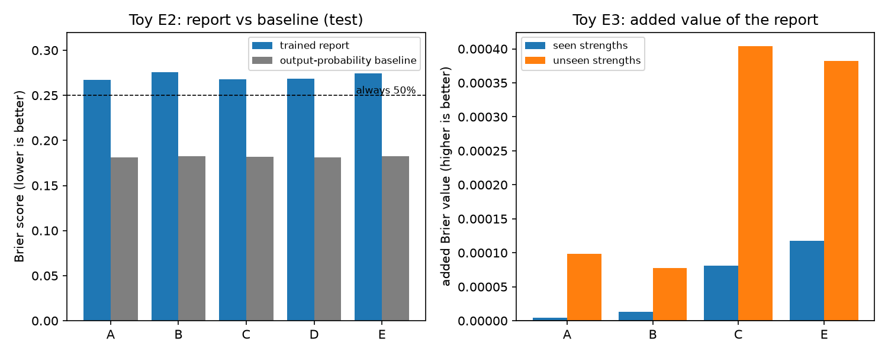
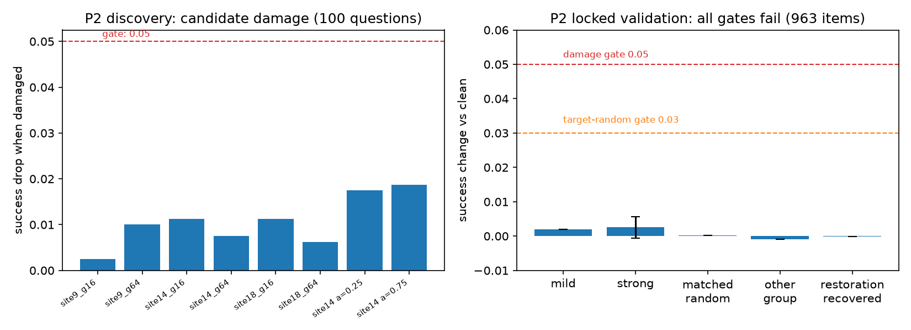
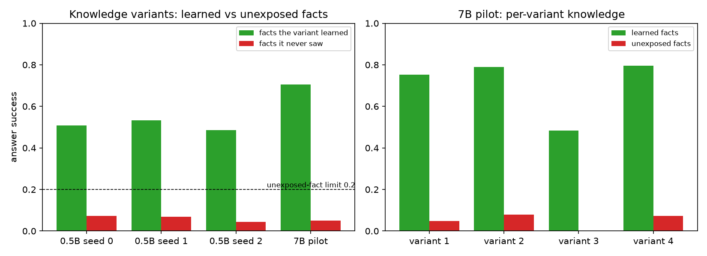
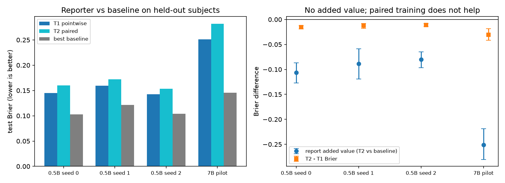
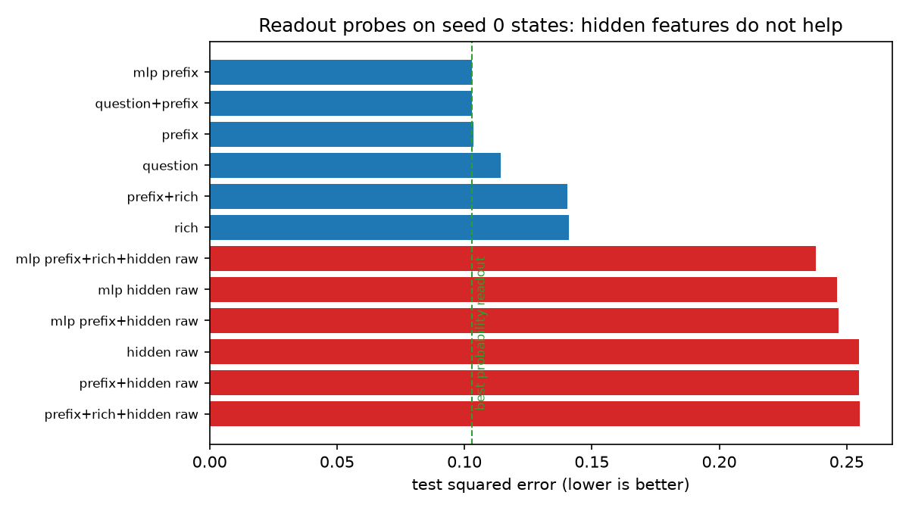
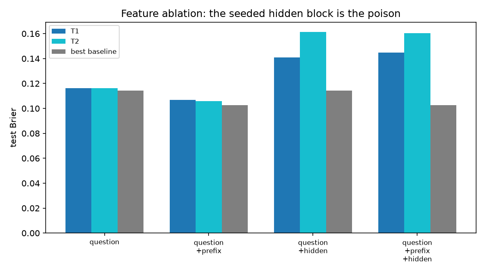

# Can models learn to report their own confidence?

**Three attempts, what worked, and where every one fell short**

Keshav Krishna · New York University · 16 October 2026

> **Status update (16 October 2026).** Two evaluation fixes changed conclusions in this report: added-value evaluation now uses subject-grouped out-of-fold report predictions, and reporter features use the raw final hidden state instead of a seeded projection. Consequences: the external readout's added value is positive in 5/5 runs, **but** the hidden-inclusive report ranks states below chance (AUROC 0.39) so the increment is under a sign-flip caveat; the hidden state is *not* uninformative; the balanced transfer design shows the failure is one of **discrimination** (AUROC < 0.5), not combination; and the main claim — instillation through the model's own emitted confidence — remains unresolved (emitted numbers are constant). Treat statements below that report "no added value" as superseded. Current numbers and framing: [PROJECT_SUMMARY.md](PROJECT_SUMMARY.md).

**The short version.** We tried three ways to train a model to say how likely it is to answer correctly. In the first, a small toy world, reward-based training did improve retrieval, but the confidence report never beat a simple baseline built from the model's own answer probabilities. In the second, we damaged a real model's internal memory and trained confidence to follow the damage; the manipulation turned out to be too weak to test anything. In the third, we built several versions of a real model that each knew a different set of invented facts and trained one shared reporter; the knowledge manipulation worked exactly as designed, but the reporter still added nothing beyond the answer probabilities. In all three attempts, reward-based training behaved like ordinary supervision wherever we compared them directly.

This report collects the three attempts in order, in plain language, with the numbers and plots. All artifacts are in the repository and every figure is generated from saved files.

---

## 1. The question, in plain words

When a model answers a question, can it also give a probability that the answer is correct? And can that probability track **this particular model's current knowledge** — going up when the model knows a fact, down when it does not — rather than just echoing how popular or familiar the question looks?

The hard part is the baseline. The model's own next-token probabilities are already a decent correctness predictor: when the model puts 90% on one answer it is usually right more often than when it spreads mass around. So a useful confidence report must do better than those probabilities, not merely match them. Every experiment below ends with the same test: **fit a good predictor from the output probabilities, then ask whether adding the trained confidence number improves it.**

Two terms used throughout:

- **Brier score** — the average squared error of a probability. Lower is better. Always saying 0.5 scores 0.25. Perfect confidence scores 0.
- **Added value** — the Brier improvement from adding the report to a predictor that already uses the baseline features. Positive is good; zero means the report told us nothing new.

---

## 2. Attempt 1: a tiny world with a reward (the toy)

### Setup

A miniature world with 512 subjects, 4 relations, and 128 possible answers. A small transformer (one block, width 32, MLP width 256) reads a subject's memory and answers a question. During training, 30% of subjects share the same answer across all relations — a shortcut that disappears on fresh subjects.

Five training arms shared one warm start:

| Arm | How retrieval was trained |
| --- | --- |
| A | Frozen; only the reporter was trained |
| B | Reward for correct answers + penalty for drifting from the starting policy |
| C | B plus labeled examples with irrelevant facts changed, and a consistency penalty |
| D | Plain supervision on correct answers and the consistency loss; no reward |
| E | B plus C's extra examples, **without** the consistency penalty |

Because the answer set was tiny, the reward could be computed exactly (the expected reward is just the probability the model puts on the gold answer), so "RL" here means reward optimization without sampling noise. A sampled policy-gradient version existed but was not needed for the headline arms.

### Results



- **Retrieval improved.** On fresh subjects, C beat B by +2.6 percentage points in greedy accuracy and +1.6 points in following valid answer swaps, positive in all five seeds.
- **But the matched-supervision arm matched it.** Arm E saw the same extra examples without the consistency term and did just as well in E2, so the specific benefit of the consistency objective was never established.
- **The report was weak and added nothing.** Raw report Brier was 0.267–0.276, *worse* than always saying 50% (0.250), against a probability baseline of 0.181–0.182. Adding the report improved the baseline by only +0.0003 to +0.0005 Brier. The difference between C and E was −0.00012, in only 2 of 5 seeds (see left panel above, and note the tiny scale of the right panel).
- **One real signal:** C and D were closer to the true success probability than B (squared error 0.128 vs 0.147, in all five seeds), but this did not convert into added predictive value.
- **Hidden-state probes did not close the gap.** Linear and small neural probes on the frozen internal state reached Brier 0.20–0.24, far behind the 0.14–0.15 probability baseline.

**Verdict.** Reward training improved the retrieval scores a little; the confidence report did not become useful; and where reward-style training could be compared with plain supervision, the two were indistinguishable.

---

## 3. Attempt 2: cutting a real model's memory (P0–P2)

### Idea

Take a real model (Qwen2.5-7B-Instruct) and change its internal memory while keeping the question text identical: weaken a group of MLP channels at a chosen layer, then optionally restore them by patching clean activations back in later. If the damage reliably lowers the chance of a correct answer, we can train confidence to follow the damage — the same question, a genuinely different internal state.

The plan called for three stages before any confidence training: a **reporter positive control** (P0), a **contract check** that branching and interventions behave correctly (P1), and a **locked validation of the manipulation** (P2). We ran all three.

### What the checks showed

- **P0 passed.** A fresh reporter trained on the baseline's own features reproduced the baseline's predictions almost exactly (error 1.2×10⁻⁴, allowance 10⁻³) and matched it as a correctness predictor (gap +4×10⁻⁴, tolerance 2×10⁻³). The reporting stack itself can learn a signal when one exists.
- **P1 passed.** Cached-continuation results equaled full recomputation within the fp16 numerical floor; reporter adapters never touched answer logits; no gold answer or condition name leaked into prompts; every discovery question was audited (mean success 4.8% — a hard, long-tail pool).

### What the manipulation did

Discovery on 100 questions found the best candidate damage was only +0.011 (with a rescue that recovered ~87% of it), far below the 0.05 target. The locked validation ran anyway, on 963 held-out questions and 15,408 sampled answers, with the gates frozen in advance:

| Gate | Result | Threshold | Outcome |
| --- | --- | --- | --- |
| Target damage | +0.0025 [−0.0005, +0.0057] | ≥ 0.05 | fail |
| Target − matched random control | +0.0024 [−0.0009, +0.0057] | ≥ 0.03 | fail |
| Restoration recovers the loss | −0.08 | ≥ 0.5 | fail |



Damage was within noise in every relation (father +0.28 points, mother −0.15, place of birth +0.57), controls were indistinguishable from the target, and unrelated questions were unaffected. The intervention simply did not move the model's competence.

**Verdict.** The attenuation manipulation has no usable effect on this pool. Per the plan's decision table, the intervention-dependent training branch stops here. We did not increase attenuation or sweep more sites — the plan forbids that, and the evidence says the route is empty.

---

## 4. Attempt 3: several models, each knowing different facts

This was the revision motivated by your direction: instead of damaging a model, **give the same base model different learned knowledge** and ask the reporter to track what each version knows.

### Design, in plain words

- **Invented facts.** 240 facts: 60 invented subjects times 4 attributes (mentor, workshop, emblem, instrument). Values are drawn per fact from pools of 12, with no formula linking a value to the subject — an early version had such a formula and variants could guess unexposed facts, which taught us to add a direct "unseen facts" check to verification.
- **Counterbalanced versions.** Four knowledge adapters (small rank-8 patches). Each fact is learned by exactly two of the four variants, so each variant knows exactly half the facts and every pair of variants shares one sixth. The same question therefore has genuinely different success rates across variants.
- **Held-out paraphrase.** Variants train on five question phrasings; a sixth, never trained, is used for verification and for the reporter's inputs. Knowing a fact must transfer to the new phrasing, not just memorize a template.
- **Transfer version.** A fifth adapter learns a disjoint set of facts from disjoint subjects. The reporter never sees it during training. This is the real test: can the reporter recognize knowledge it was never trained on?

### The knowledge manipulation worked



Three runs at 0.5B and one at 7B all pass verification: success on facts a variant learned is 0.34–0.61 at 0.5B and 0.48–0.80 at 7B (estimated from the balanced design), success on facts it never saw is 0.00–0.14 (limit 0.2), spread between variants on the same question is 0.70–0.94, held-out paraphrases survive at 76–88% of the training phrasing's rate, and formatting problems are under 1%.

### The reporter still added nothing

We trained the same grid-mean reporter in two ways on identical data: **T1**, pointwise (fit the success probability directly), and **T2**, the same objective plus a within-question contrast term that compares two variants answering the same question. Inputs were the question metadata, answer-fork probability summaries, and a hidden-state projection — never the variant identity, exposure list, gold answer, or sampled text.



| Study | T1 Brier | T2 Brier | Best baseline | Added value |
| --- | --- | --- | --- | --- |
| 0.5B seed 0 | 0.145 | 0.160 | 0.103 | −0.106 |
| 0.5B seed 1 | 0.160 | 0.172 | 0.121 | −0.089 |
| 0.5B seed 2 | 0.143 | 0.154 | 0.104 | −0.080 |
| 7B pilot | 0.251 | 0.282 | 0.146 | −0.251 |

Every added-value interval lies below zero, and T2 is *worse* than T1 in all four studies. On the unseen transfer variant the picture is mixed (added value +0.17, +0.09, −0.09 at 0.5B; +0.04 at 7B) — the only setting with positive signs, and not consistent enough to claim.

### Why the reporter failed: two follow-up checks

**Feature ablation.** Same states, same heads, four input sets:

| Inputs | T1 | T2 | Baseline | Added |
| --- | --- | --- | --- | --- |
| question only | 0.116 | 0.116 | 0.114 | +0.0000 |
| question + probability summaries | 0.107 | **0.106** | 0.103 | +0.0001 |
| question + hidden projection | 0.141 | 0.161 | 0.114 | −0.097 |
| all inputs | 0.145 | 0.160 | 0.103 | −0.106 |

The hidden-state projection was the poison: without it, the head matches the baseline and calibrates positively, and T2 is marginally better than T1. But even at its best the report adds **+0.0001** — nothing.

**Readout probes.** Maybe the projection threw information away? We checked with the raw 896-dimensional hidden state and with a regularized neural readout, and also with a richer probability block (top-k logits plus token identities):



| Readout | Test error |
| --- | --- |
| MLP on probability summaries | **0.103** |
| Probability summaries (linear) | 0.103–0.104 |
| Rich top-k probability block | 0.141 |
| Raw hidden state (linear / MLP) | 0.255 / 0.246 |
| Probability + hidden | 0.247–0.255 |

The raw hidden state carries no usable signal about success — both linear and neural readouts sit at the "ignore the features" level — while the compact probability summary is the best predictor available, and adding anything else only hurts. The richer probability block is worse than the compact one.



**Verdict.** The manipulation is verified and reproducible; the reporter does not add predictive value beyond the model's own answer probabilities, and the contrastive (T2) objective does not change that.

---

## 5. The one-paragraph answer

Across a toy world, a real-model intervention study, and a controlled knowledge-variant study, **training improved retrieval and sometimes moved reports closer to true success probabilities, but no trained confidence report beat a well-fitted predictor built from the model's own output probabilities.** Reward-based training was matched by plain supervision wherever the comparison was run (toy arms C vs E; the P2 route never produced a trainable effect; the planned sampled-RL comparison never became reachable). The knowledge-variant setting isolates the failure cleanly: the answer-fork probability features already contain the competence signal, the hidden state at that point does not add linearly or shallowly readable information, and the pair objective buys a tiny contrast improvement without incremental value.

### What this does and does not say

- It does **not** say the model has no internal signal. It says the tested readouts do not exceed output probabilities, and that a trained report built on them cannot either.
- It does **not** prove RL is useless in general. In this project, reward never had room to help: either supervision matched it, or there was no effect to optimize.
- It **does** say the earlier toy conclusion survives a stronger test: with a validated manipulation, a strong baseline, and three seeds plus a 7B check, added value stayed at zero (or below).

---

## 6. What could change the conclusion

1. **A different target state.** Everything here reads the state just before the answer tokens. There may be settings where output probabilities are uninformative but internal state is not — multi-step reasoning, tool use, states before the question is fully read.
2. **A native reporter.** We tested heads over saved features, not a model emitting numbers itself. Given no readable signal beyond the probabilities, a native report is unlikely to add value, but it remains untested.
3. **Bigger scale or other model families.** The 7B pilot shows the same pattern as 0.5B, which argues against a simple scale fix.
4. **Changed supervision target.** Reporting *changes* in competence rather than levels, or comparative reports ("which of these two answers is more likely correct"), would need retraining but could surface different phenomena.

---

## Appendix A. What we fixed along the way

Several early failures were implementation problems, not scientific findings; they are listed here so the negative results are not misread:

- The pooled question loader evaluated a fallback ID builder eagerly, crashing P1 on the cohort schema.
- Discovery screened the first 100 questions in relation-sorted order, which meant one relation only; screening is now stratified across relations and popularity.
- Answers had no end-of-answer token in training, so variants rambled until the token cap; EOS is now supervised.
- An early fact generator made values a formula of the subject index, letting variants infer unexposed facts; values are now hash-based and verification gates on unexposed-fact success.
- The reporter read logits at the end of the question (which predict the word "Answer"), not at the answer fork; the features now come from the suffix forward.
- The reporter head overfit a large hidden block; inputs are standardized and regularized, validated by a synthetic-scale check.
- Transfer evaluation divided by an empty group when a split had one variant per question.

## Appendix B. Reproducing the artifacts

```bash
# Toy results (existing)
runs/section33_v1/selective_metacognition/e1.json e2.json e3.json

# Causal-confidence stages (cluster)
python -m causal_confidence.cli setup
python -m causal_confidence.cli p0
python -m causal_confidence.cli p1 --draws 8
RUN_ID=<id> python -m causal_confidence.cli p2-discover
RUN_ID=<id> python -m causal_confidence.cli p2-validate   # locked; writes figures

# Knowledge-variant study (local, async)
bash scripts/run_knowledge_local.sh                        # seeds 0-2, 0.5B
python -m causal_confidence.cli knowledge --model Qwen/Qwen2.5-7B-Instruct ...

# Diagnostics
.venv/bin/python scripts/knowledge_feature_ablation.py
.venv/bin/python scripts/knowledge_readout_probe.py
.venv/bin/python report/make_knowledge_confidence_figures.py
```

Key files: `runs/section33_v1/causal_confidence/cc_v1/p2c/` (validation JSON, per-question outcomes, figures), `runs/causal_confidence/cc_v1/knowledge/seed{0,1,2}/` and `runs/section33_v1/causal_confidence/cc_v1/know7b_seed0/` (knowledge studies), `runs/causal_confidence/cc_v1/knowledge/diagnostics/` (ablation and probes).
