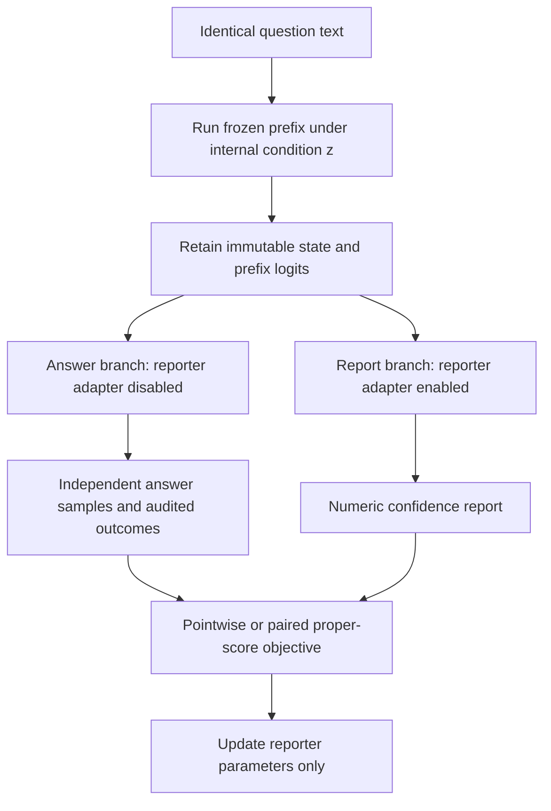

# Training confidence to track changes in a model's own knowledge

**Research plan and experiment specification · 15 October 2026**  
**Status:** Proposed; none of the new experiments below has been run.  
**Working title:** Causal training of model-specific confidence.  
**Primary deliverable:** A trained confidence reporter whose predictions follow measured changes in the current model's factual competence, with explicit tests of transfer and added predictive value.

This is a new proposal following the negative [selective-metacognition toy results](SELECTIVE_METACOGNITION_TOY_REPORT.md). It does not replace those results or reopen the failed relation-map intervention as a validated method. The earlier [retrieval-selectivity proposal](SELECTIVE_MLP_METACOGNITION_PROPOSAL.md) remains the record of the previous hypothesis.

## 1. Main idea in simple words

Ask exactly the same question while changing what the model can retrieve internally. Train the model to report a probability that follows its actual chance of answering correctly in each state.

For example, consider a question about a person's birthplace. The text stays identical. In one internal state the model retrieves the birthplace reliably. In another, a validated intervention disrupts the computation supporting that answer. In a third, the computation is restored. Confidence should follow the observed changes in success. A similarly sized intervention that leaves success unchanged should not automatically lower confidence.

These are desired behaviors, not labels assigned by the experimenter. If an intended disruption improves success, the training target must reflect the improvement. The model never receives a message saying that its memory was damaged.

The change from the previous proposal is direct: **train the connection between retrieval and confidence, rather than train better retrieval and hope that confidence improves as a side effect.** Keep the answer policy fixed while learning the reporting channel. Later experiments can ask whether joint training is useful, but it is outside the first study.

This addresses the question in [meet.md](../meet.md): does confidence reflect this model's current competence, beyond what question familiarity and population difficulty explain? Holding the question fixed controls its wording and subject popularity exactly. It does not remove differences in the model's effective difficulty across internal states; those differences are the intended target.

### Plan at a glance

1. Diagnose the old reporter and validate state sharing between answer and confidence branches.
2. Establish an intervention that changes retrieval, with restoration and matched controls.
3. Train pointwise and paired confidence reporters on identical examples and outcomes.
4. Test new questions, intervention families, and independently learned knowledge states.
5. Test whether a specific internal pathway supports the reporting improvement.
6. Compare RL with exact reward optimization only if the earlier stages justify it.

The first commitment is P0–P2 below. Larger reporting runs depend on those results.

## 2. What the previous experiments establish

| Existing result | Consequence for this plan |
| --- | --- |
| Frozen MLP summaries did not meet the useful-gain gates over the existing baselines. | Do not begin another broad search over concentration, mass, or dot-product summaries. |
| S3 relation-map attenuation failed to produce the required selective damage. | Do not reuse that manipulation as causal supervision. A new manipulation needs its own independent validation. |
| Toy C improved some answer scores, but E largely matched it. | Extra supervision remains a sufficient explanation; every new objective comparison must use identical data. |
| In audited E2, C's report Brier was 0.268 versus a probability baseline of 0.182; adding the report improved Brier by only about 0.00038. | Reporter learning is itself unresolved. Absolute reporting quality matters, not only relative gains. |
| E3 also showed very small added value and no clear C-over-E benefit. | Do not claim that predicting a future intervention solves the problem. |
| The one-seed hidden-state diagnostic also trailed the baseline. | This is evidence against those tested readouts, not a proof that the representation lacks useful information. |

Evidence: [confirmatory report](SECTION_3_3_CONFIRMATORY_REPORT.md), [S3 results](../runs/section33_v1/retrieval_monitoring/selectivity_report.json), [audited E2](../runs/section33_v1/selective_metacognition/e2.json), [E3](../runs/section33_v1/selective_metacognition/e3.json), and [probe diagnostic](../runs/selective_metacognition/e3_probe_diagnostic.json).

Two earlier interpretations must not carry forward. First, sampled correctness does not make an ordinary probability baseline an oracle: the probability assigned to the gold answer requires knowing which answer is correct. Second, failure of a trained probe does not establish information-theoretic absence.

## 3. Research claim and novelty boundary

The candidate contribution is a training and evaluation protocol for **calibrated confidence across different internal knowledge states of the same question**, followed by causal tests of the reporting mechanism.

| Claim | Evidence required | Current status |
| --- | --- | --- |
| H1: Reporting can be trained to track competence changes. | Better held-out within-question tracking and Brier than the same-data pointwise reporter. | Needs P3. |
| H2: The gain generalizes beyond artificial disturbance cues. | Transfer to unseen intervention families and independently trained knowledge variants. | Needs P4. |
| H3: Confidence adds useful prediction beyond tested probability features. | Out-of-sample incremental Brier improvement with matched baseline fitting and calibration. | Needs P3–P4; separate from H1. |
| H4: A retrieval-to-report pathway contributes to the improvement. | Specific removal/restoration effects on reporting, with controls for generic output disruption. | Needs P5. |
| H5: RL is a better optimization method here. | Better sample efficiency or outcomes than matched exact/supervised optimization. | Optional P6; not assumed. |

H1 alone is a training result. H1 plus H2 is the minimum target for a model-specific monitoring claim. H4 strengthens the mechanistic interpretation. H3 is required to claim added predictive value; it can fail even if H1 and H2 pass. None establishes consciousness or unrestricted privileged introspection.

### Nearby research and what remains to distinguish

| Source | Relevant contribution | Implication for novelty |
| --- | --- | --- |
| [Geometric Factual Recall in Transformers](https://arxiv.org/abs/2605.12426), May 2026 | In a controlled setting, an MLP learns relation-conditioned selection from structured subject representations. | Motivates studying selection, but does not show that improving selection improves reporting in a pretrained model. |
| [Can LLMs Introspect? A Reality Check](https://arxiv.org/abs/2605.26242), May 2026 | Shows how input cues and general anomaly detection can explain apparent introspection. | Requires identical-question comparisons, strong input-only predictors, and controls for disturbance detection. |
| [Introspection Adapters](https://arxiv.org/abs/2604.16812), April 2026 | Trains a shared adapter to report behaviors across fine-tuned models. | An adapter trained across model variants is not itself new. The target here is question-level success probability and its causal dependence on retrieval. |
| [Introspecting Alignment Shifts Beyond Behaviors Implanted Through Fine-Tuning](https://arxiv.org/abs/2608.04347), revised September 2026 | Uses base activations and activation differences to report alignment shifts. | Reading activation changes is also not sufficient novelty. Our primary reporter must work from its current state without a clean-reference state at inference. |
| [RLMF](https://arxiv.org/abs/2606.32032), June 2026 | Uses metacognitive feedback in RL for faithful uncertainty expression. | Generic metacognitive reward or confidence RL is already established. |
| [Beyond Binary Rewards / RLCR](https://arxiv.org/abs/2507.16806), 2025 | Combines correctness and proper-score confidence rewards. | Brier reward is a baseline, not the contribution. |
| [Cognitive Pairwise Training](https://arxiv.org/abs/2606.00869), 2026 | Trains comparative judgments of reasoning traces. | Pairwise metacognitive supervision is not broadly new. The proposed pairing concerns the same question in different internal states, without exposing answer traces to the reporter. |
| [Mechanisms of Introspective Awareness](https://proceedings.mlr.press/v306/macar26a.html), ICML 2026 | Investigates distributed MLP computations involved in detecting internal perturbations. | Detecting intervention presence is insufficient; success probability must be the target. |
| [Reported Confidence Tracks Commitment More Than Correctness](https://arxiv.org/abs/2606.29490), June 2026 | Finds a dissociation between verbal confidence, commitment, and correctness. | A change in willingness to answer or hedge must not be mistaken for improved correctness monitoring. |

This is a targeted literature check, not a systematic proof of novelty. Before a full-scale run, check the methods and evaluation protocols of these closest papers against the frozen protocol. If the combination is already directly tested, revise the contribution explicitly.

### What to take from Goodfire

[Neural Networks Are Already Clean](https://already-clean.goodfire.com/) is an informal research essay and working hypothesis. It motivates inspecting native neurons, both signs of their activity, and the computations that read them. Its SwiGLU examples show why positive products can conceal different gate/value sign regimes. It does not establish that readable neurons provide accurate confidence or that a particular sign regime is intrinsically unreliable.

Our proposed use is limited: preserve signed contributions when identifying candidate mechanisms, then test them through interventions. Interpretability labels and large activations are not ground-truth reliability labels. The claim that training a reporting pathway can use this evidence more effectively is our hypothesis, not a result of the essay.

## 4. Define the target before choosing the method

Let \(q\) be a question, \(z\) an internal condition, \(\theta\) a fixed answer-policy checkpoint, and \(\tau\) the decoding configuration. Define

\[
A\sim\pi_{\theta,\tau}(\cdot\mid q,z),\qquad
Y=\mathbf{1}\{A\text{ passes the audited answer policy}\},\qquad
p_{qz}=\Pr(Y=1\mid q,z,\theta,\tau).
\]

The reporter predicts \(p_{qz}\) **after the internal condition has been established but before seeing an answer draw**. It does not predict another checkpoint's success, generic answerability, consistency, or the consequence of an announced future intervention.

Use eight independent answer samples per training state initially and 16 per evaluation state. These are noisy estimates, not exact probabilities. Keep the decoding policy fixed: initial specification is temperature 1, top-p 1, and at most 32 new answer tokens. Greedy accuracy is a separate descriptive outcome. Freeze the tokenizer, prompt, stopping rule, and model revision with the run configuration.

The primary answer key remains fixed when memory is perturbed or factual knowledge is learned. A donor answer is not automatically made correct. If a synthetic-world experiment changes the true world as well as the memory, label it separately and never pool it with fixed-world factual QA.

## 5. Architecture and access to the internal state

Use the existing [retained-state implementation](../section33/analysis/retained_state.py) as a starting point, not as proof that every new hook and model works. Its key warning is directly relevant: continuation tokens read cached keys and values, not an arbitrary saved final hidden vector. A last-layer intervention can change immediate answer logits without leaving corresponding evidence in the continuation cache.

Required contract:

1. Apply the manipulation only at declared prefix positions. Both branches inherit the same changed prefix. Do not silently continue the hook on generated confidence tokens.
2. Use middle layers with downstream cache propagation. Save the original answer-prefix logits if needed to sample the first answer token correctly. A retained hidden vector alone does not establish that the native reporter can access it.
3. Deep-copy branch caches. Generating confidence must not mutate later answer samples.
4. Compare each cached branch to a complete recomputation with the same condition and suffix, including first-token logits, attention masks, and position indices.
5. Disable reporter adapters for answer generation. Detach the shared prefix and freeze every answer-policy parameter during reporting training.
6. Keep condition IDs, masks, intervention strengths, gold answers, correctness labels, and sampled answer text outside the reporting prompt and feature inputs.
7. Each member of a pair is processed independently. The training loss may compare reports, but a deployed reporter does not see the other state or a clean-reference activation.

The initial native reporter is a rank-8 adapter active on the report suffix, with a fixed numerical output format. Select its module list once on development data. A separate scalar sigmoid head over saved states is a feasibility diagnostic. Injecting external MLP features into the report stream would create an augmented observer and must be treated as a distinct architecture.

**Native-report rule:** evaluate the number actually emitted under a fixed decoding rule, initially greedy constrained decoding. An expected number computed externally from confidence-token probabilities is a useful diagnostic but cannot substitute for a successful emitted report.

## 6. Data, answer policy, and splits

Start with the existing Qwen2.5-7B-Instruct checkpoint used by this repository, frozen at an explicit revision. This keeps the first pretrained result comparable to the earlier work. Do not choose a new model because it gives the desired calibration result. A smaller-model feasibility run or a second model is a separately labeled replication after the initial gates.

Prefer relations with unambiguous answers. Parent and birthplace questions are initial candidates. Exclude or explicitly enumerate multi-answer/time-dependent references. Do not carry forward noisy occupation labels without a semantic answer policy. Dates require a fixed granularity and normalization policy.

| Partition | Initial size in questions | Permitted use |
| --- | --- | --- |
| Intervention discovery | 100 | Nominate sites and channel groups; screen a bounded candidate set. |
| Intervention validation | 300 | Evaluate the frozen manipulation once for P2. |
| Reporter training | 1,000 | Train reporters and fit baseline models. |
| Reporter development | 200 | Tune/calibrate with a prespecified budget; choose one configuration. |
| Reporter test | 400 | First locked evaluation of P3. |
| Transfer sets | At least 200 per initial transfer setting | P4; independent of discovery and reporting training. |

These are proposed pilot sizes, not a power guarantee. Split by subject/entity before generating paraphrases, conditions, or outcome samples. All relations and aliases of a subject stay in one partition. Relation-disjoint transfer requires enough audited relations to reserve at least one; otherwise report that test as not performed. Do not represent a four-relation split as broad relation generalization.

Audit all pilot references and aliases before label collection. Use the same matcher for every arm. Resolve ambiguous outputs using a blinded adjudication policy; do not change acceptance rules after inspecting arm differences. Record abstentions, format failures, truncation, and ambiguous cases separately. Ordinary incorrect answers remain in the primary endpoint. Coherent synthetic false-memory cases are a separate limitation set because available internal evidence may not identify their falsity.

Maintain a clean natural-QA test stratum, including questions the base model gets wrong. Do not restrict the entire study to clean-correct examples. Any headroom analysis must use an independent screening sample and remain secondary.

## 7. Construct internal conditions without repeating S3

The intervention must first establish that it changes answer success in a reproducible way. Relation specificity is an additional claim, not a prerequisite that can be assumed from a map's label.

### 7.1 Candidate quantities

For normalized input \(x\), use the actual gated-MLP computation:

\[
g=W_{\rm gate}x,\quad v=W_{\rm up}x,\quad
s=\operatorname{SiLU}(g)\odot v,\quad
u_j=s_jW_{\rm down}[:,j].
\]

Preserve the sign of \(s_j\), the gate/value sign regime, token position, layer, and direction of \(u_j\). The existing [MLP implementation](../section33/features/mlp_math.py) distinguishes the true coefficient from input/write-vector dot products. Neither \(\|u_j\|\) nor its concentration is inherently a correctness signal.

Use attribution only to nominate candidates. Validate actual removal and restoration. Discovery may use labeled outcomes; the frozen rule applied to held-out questions must not use their gold answers, correctness outcomes, or confidence reports. Prefer fixed channel groups per relation learned on discovery data. If using a question-adaptive rule, specify its gold-free inputs and count its computation.

### 7.2 Bounded discovery search

Initial candidate sites are three middle-depth locations, approximately one-third, one-half, and two-thirds of decoder depth, at the final question position after both subject and relation are visible. Screen two group sizes, 16 and 64 channels, with attenuation 0.5. Retain at most two candidates for development checks at attenuation 0.25 and 0.75. Avoid the earlier overshoot regime.

For a group \(G\), attenuation is \(s'_j=(1-\alpha)s_j\) for \(j\in G\), with \(0\leq\alpha\leq1\). Disabling the hook or reinserting the entire removed contribution at the same site should restore the run; those are engineering checks, not independent mechanistic evidence. For the scientific rescue test, leave the original disruption active and patch a prespecified downstream group with its clean activations from the same question. Nominate that rescue group on discovery data and freeze it before validation. Compare with a matched downstream control patch. If only direct undo works, report recoverable engineering behavior but leave the pathway-rescue gate unmet.

If no candidate works, record that result. One prespecified alternative is all-subject-token donor patching. It must be revalidated from saved artifacts and described as a subject-state manipulation, not relation-specific weakening. Do not expand into an open-ended site/model sweep.

### 7.3 Six initial condition slots

| Slot | Construction | Purpose |
| --- | --- | --- |
| Clean | No effective intervention | Natural-performance anchor. |
| Target, mild | Frozen candidate group; lower attenuation | Small competence change. |
| Target, strong | Same group; stronger attenuation | Dose response without overshoot. |
| Restoration | Patch a frozen downstream group from the clean episode while the original disruption remains active | Test pathway rescue beyond direct undo. |
| Matched random | Same layer/positions and channel count, with realized perturbation norm matched as closely as feasible | Generic-disturbance control. |
| Other group | A frozen comparison group, preferably from another relation, at matched disturbance | Specificity control. |

Report count-matched and norm-matched controls separately when both cannot be achieved simultaneously. Log actual perturbation norms; nominally equal coefficients do not imply equal interventions. Use multiple random groups, initially five per candidate during validation, and cluster them within questions rather than treating them as independent subjects.

These slots describe construction, not desired labels. Record actual effects in every slot. Train on all validated slots without selecting individual examples for a large observed effect. Include pairs with little or opposite change; distinguish them using independent outcomes, not hand-assigned targets.

## 8. Training objective and the role of RL

For state \(z\), let \(\hat p_z\) be the fraction correct in the training outcome bank. For a deterministic scalar report \(c_z\), define

\[
L_{\rm point}=\frac12\big[(c_a-\hat p_a)^2+(c_b-\hat p_b)^2\big],
\]

\[
L_{\rm pair}=\big[(c_a-c_b)-(\hat p_a-\hat p_b)\big]^2,\qquad
L=L_{\rm point}+\lambda L_{\rm pair}.
\]

The pair contains two states of the same question. Use multiple pair types, including target–clean, restoration–target, random–clean, and other-group–clean. Randomize pair order. Weight questions equally so that additional pairs do not give particular questions disproportionate influence. Use the state-mixture weights in Section 11 for the aggregate pointwise term and equal weights over the prespecified pair types for the aggregate contrast term; implement separate weighted sums rather than accidentally overweighting states repeated in several pairs. Start with \(\lambda=1\); permit only \(\{0.25,1,4\}\) on development data, with \(\lambda=0\) the pointwise control.

**What this objective can and cannot do.** For errors \(e_z=c_z-p_z\), the ideal pair term is \((e_a-e_b)^2\). It emphasizes errors in the contrast, while the pointwise term anchors the absolute probability. It supplies no new labels or information beyond the state outcomes, and both objectives have the same ideal optimum when the model can represent the true probabilities. A benefit would concern finite-data learning, optimization, or generalization. The pair term is not an identifiability theorem for introspection.

Using independent sample means instead of exact probabilities adds label noise. In expectation, the squared-loss noise contribution is constant with respect to the reporter. Do not select or weight training pairs by the size of their noisy observed outcome difference without accounting for that selection.

### 8.1 Native numerical reports

Use a constrained set \(\mathcal C=\{0,0.05,\ldots,1\}\), represented by ordinary numeric text. Specify the grammar and sequence probabilities, since numbers may have different token lengths. The squared quantization error of rounding an ideal probability to this grid is at most \(0.025^2=0.000625\); this does not bound the total trained-model error.

The primary native training objective is the exact expected loss over the reporter's output distribution \(\rho_\phi\):

\[
\mathcal L(\phi)=
\mathbb E_{C_a\sim\rho_\phi(\cdot\mid q,z_a),\,C_b\sim\rho_\phi(\cdot\mid q,z_b)}
\left[L_{\rm point}(C_a,C_b)+\lambda L_{\rm pair}(C_a,C_b)\right].
\]

Each report depends on its own state only. Compute this expectation directly or through the first two moments of each distribution. With \(\mu_z=\mathbb E C_z\) and \(V_z=\operatorname{Var}(C_z)\), the expected pair term is

\[
[(\mu_a-\mu_b)-(\hat p_a-\hat p_b)]^2+V_a+V_b.
\]

The expected pointwise terms similarly include \(V_z\). Omitting these variance terms changes the objective to squared error of the mean, which is not the same as expected reward for a sampled emitted report. Report both actual emitted-number metrics and mean-report diagnostics. If only the diagnostic improves, the native-report claim fails.

A shared format warm start is allowed for all arms, with identical examples and training steps. Any KL penalty, schedule, or output-format loss must be identical between objective arms unless that component is the declared ablation. Initial reporter tuning budget: three learning rates, \(10^{-5},5\times10^{-5},10^{-4}\), on a small training/development subset; freeze the chosen rate and update budget before test evaluation.

### 8.2 RL comparison

The corresponding joint report reward is

\[
R(C_a,C_b)=-L_{\rm point}(C_a,C_b)-\lambda L_{\rm pair}(C_a,C_b),
\qquad
J(\phi)=\mathbb E[R]-\beta\mathcal K(\rho_\phi,\rho_{\rm ref}).
\]

Use a fixed reference reporter and the same KL term in the exact-optimization comparator. A policy-gradient estimator uses the reward with the sum of the two report log-probability gradients; any variance-reduction baseline must be independent of the sampled action conditional on the state. Use plain REINFORCE with a leave-one-out baseline first. Do not assume group normalization in GRPO preserves this proper-score objective.

With 21 choices, exact differentiation already optimizes this reward expectation. RL is therefore an estimator comparison, not a new source of supervision. Evaluate matched optimizer updates and matched compute separately. Free-form uncertainty language can motivate sampled RL later, but introduces judging and format confounds and is outside the first test.

## 9. Training arms and required comparisons

| Arm | Model/report treatment | Question answered |
| --- | --- | --- |
| T0 | Frozen model, standard prompted confidence | What is available without training? |
| T1 | Reporter trained with pointwise expected score; all six condition slots | Does ordinary confidence training suffice? |
| T2 | Same reporter, same examples, plus the true within-question pair term | Does explicit competence-change training help? |
| T3 | Same as T2, but correctly labeled pairs are formed across different questions within relation/popularity strata | Does within-question pairing matter beyond a generic contrastive loss? |
| T4 | T2 objective, adapter restricted to candidate downstream MLP sites | Can a localized reporting pathway support the effect? |
| T5 | T2 objective, equally sized adapters at prespecified random comparison sites | Is T4 better because of site selection rather than capacity? |
| T6 | Sampled RL version of T2, with identical reward and regularization | Does RL improve optimization or efficiency? |

Run T0–T2 first. T3 is required before attributing a gain specifically to same-question contrasts. T4–T5 belong to P5, and T6 is optional P6. Do not launch the full matrix initially.

T3 must preserve each state's correct target; shuffling labels would create a trivially disadvantaged control. Match state exposure counts, pair counts, outcome draws, update budgets, and tuning budgets. Rescale aggregate losses consistently; distinguish objective geometry from simply increasing gradient magnitude.

For external scalar-head feasibility, repeat T1–T2 with the same fixed state input and architecture. A scalar-head result does not establish that the model can verbalize the signal.

## 10. Staged experiments and decision rules

The numerical thresholds below are **proposed engineering and scientific effect-size targets**, not estimates from existing results. Freeze them after development-only feasibility/power work and before each locked evaluation. A wide interval means inconclusive; it does not mean equivalence or permission to keep tuning on the same test set.

### P0. Explain the reporter failure before interpreting another null

**Question:** can the reporting implementation learn a signal that is demonstrably available?

Use saved toy checkpoints if present. If checkpoints were not retained, first inspect available cached features; regenerate only the minimum diagnostic data with a documented configuration. Do not represent summary JSON files as sufficient to reproduce hidden states.

Compare the existing grid-mean head, direct scalar sigmoid regression, and the successful probability-baseline model on identical train/development/test rows. Give the reporter the baseline's exact feature inputs, including relation/context information where relevant. Separately train it to reproduce the baseline's predicted probabilities, which isolates representation learning from correctness estimation. Then compare hidden states alone and hidden states plus baseline features.

Inspect training versus held-out loss, target distributions, output saturation, feature scaling, parameter gradients, and train/test support. Match the baseline's fitting data and calibration access. A larger probe on exact labels has already been tried; this is a targeted positive control, not another unconstrained architecture sweep.

**Gate:** held-out mean squared error for reproducing baseline predictions at most 0.001, and a same-input correctness reporter no more than 0.002 Brier worse than that baseline. Treat these as tolerances for an engineering diagnostic, with seed variation reported. If reproduction works but correctness learning does not, investigate regularization/data differences before concluding an implementation bug.

**Output:** `p0_reporter_controls.json` plus a short failure analysis. Resolve a failed positive control before using subsequent reporter failures as evidence about metacognitive signal availability.

### P1. Validate the pretrained episode and answer policy

**Question:** do both branches experience the same internal condition, and are the outcomes trustworthy?

Use 50 discovery questions for smoke checks, then the discovery pool. Verify full-run/cache equivalence, branch isolation, adapter gating, first-token sampling, and that a known middle-layer change propagates into later cached states. Include a deliberately last-layer-only change as a diagnostic showing why a cache can miss an intervention; exclude such sites from the main study.

Audit references, alias rules, and parsing. Check that model success is not almost entirely at floor or ceiling. Do not condition final test inclusion on observed failures or successes. If the question pool is unusable, revise it using discovery data and freeze a fresh split.

**Gate:** deterministic branch outputs agree within a numerical tolerance established by duplicate no-hook runs; reporter training leaves the answer branch unchanged within that same tolerance; every pilot item has an audited answer policy. Log exact tolerances and exceptions. A visually plausible example is not enough.

**Output:** episode contract checks, immutable data manifest, and answer-policy audit.

### P2. Validate a new retrieval manipulation

**Question:** can the chosen manipulation produce a recoverable competence change beyond matched generic disturbance?

Run bounded discovery on 100 questions, freeze one manipulation, then evaluate on 300 independent validation questions. Use 16 answer draws per condition initially. With \(D_G=\mathbb E[p_{\rm clean}-p_G]\), report target damage, control damage, their paired difference, restoration, and per-relation effects.

**Proposed gate:** target damage at least 0.05; target-minus-matched-random damage at least 0.03 with its paired 95% interval above zero; restoration recovers at least half the lost success on average. Also report fluency, truncation, and unrelated-task effects so generic model breakage is visible. Restoration by merely turning the hook off is not the mechanistic recovery endpoint.

Other-group controls determine whether relation specificity is supported. If they fail, retain at most the weaker claim of localized retrieval disruption. Do not rename the same result relation-selective. If only donor patching passes, document the subject-level scope before continuing.

**Output:** `p2_intervention_validation.json`, per-question outcomes, frozen intervention configuration, and damage/restoration plots. Failure stops this intervention-dependent branch. A separate knowledge-variant study would require an explicit revised protocol.

### P3. Train and evaluate confidence on current competence

**Question:** does paired training improve useful confidence over the same-data pointwise control?

Start with a 200-question training subset and scalar-head feasibility, then train native T1–T2 on the 1,000-question pool. Use three seeds initially. Both arms receive identical outcome banks. Freeze the intervention, prompt, outcome policy, and report grammar. Use the 200-question development split for configuration and calibration, then evaluate once on 400 test questions.

**Primary contrast:** T2 minus T1 in reporting quality. **Proposed continuation gate:** at least 0.005 Brier improvement with the subject-clustered 95% interval above zero, plus at least 10% reduction in within-question contrast error with its interval above zero. Require clean-condition Brier degradation to have a one-sided 95% upper bound below 0.005. Report per-seed effects; three seeds provide limited evidence about training variability.

Run T3 before making a pairing-specific claim. A win over T1 but not T3 supports contrast training more generally, not the special value of fixed-question pairs. If only the external head or expected report succeeds, state that explicitly and diagnose the native-output bottleneck.

**Separate H3 gate:** adding confidence to the strongest selected probability baseline reduces held-out Brier by at least 0.005 with a 95% interval above zero. This is not required to inspect a mechanistic H1 result, but is required to claim added predictive utility.

**Output:** per-seed T0–T3 table, calibrated and raw reports, learning curves, baseline comparisons, and fixed-question change plots.

### P4. Rule out intervention shortcuts and test transfer

**Question:** does the reporter track competence outside the perturbations it was trained on?

Evaluate four distinct shifts, without retuning:

1. New strengths of the same manipulation: useful but weak evidence of transfer.
2. New channel groups/sites or a different validated intervention family: stronger than strength interpolation. Validate that the new manipulation changes success before interpreting reporting.
3. Clean natural questions with no artificial intervention, including a held-out relation and a second audited dataset where feasible.
4. Independently trained knowledge variants of the same base model, initially four small factual-learning adapters with different fact exposure sets. The confidence adapter is fixed and receives no variant ID.

For knowledge variants, train the answer adapters on separate factual statements, not confidence labels. Facts queried at evaluation may deliberately have been learned by a knowledge adapter; that is the manipulation. Their subjects, reporter targets, paraphrases, and variant checkpoints must remain unseen during reporter training. Record this distinction to avoid confusing intentional knowledge acquisition with reporter-label leakage. Generate fresh outcomes after each answer adapter is frozen.

Counterbalance fact exposure so the same question is known better by different variants, and each variant has a mix of stronger and weaker topics. Measure actual success rather than equating training exposure with knowledge. Compare a text-only observer, a peer-model observer without access to the target's state, and the target's probability baseline. Four variants are a feasibility test, not broad population evidence.

**Proposed gate:** retain the P3 improvement direction on both a new intervention family and the knowledge-variant set, with positive paired 95% intervals; satisfy the clean-performance guardrail. Before claiming a practically useful transfer result, require the same 0.005 Brier effect-size threshold on a prespecified primary transfer set. Report all transfer settings, including failures.

**Output:** a transfer matrix separating strength, mechanism, question, and knowledge-update generalization. Success only on damaged states supports intervention awareness, not general self-monitoring.

### P5. Test the proposed retrieval-to-report mechanism

**Question:** does a particular pathway contribute to the trained improvement?

Use development data to nominate downstream sites or channel groups whose signed contributions plausibly connect the validated retrieval manipulation to the report. Attribution supplies candidates; held-out ablation and patching test their effects. Evaluate T4 against T5 with matched trainable parameter count.

On held-out episodes, intervene only in the reporting branch after the state fork. Remove candidate information, patch corresponding activations between two states of the same question, and restore the original values. Independently check that answer-branch logits and outcomes are unchanged. This isolation is an experimental construction, not evidence that the intact model naturally separates the functions.

Compare candidate pathways with matched random sites, generic formatting/confidence-token sites, and unrelated numeric-report tasks. A pathway whose removal makes every numerical output invalid does not specifically explain metacognitive monitoring. A change in mean confidence alone is also insufficient.

**Proposed gate:** candidate removal eliminates at least half of T2's improvement over T1, exceeds matched-control damage with a paired 95% interval above zero, and restoration recovers at least half of the lost improvement. Apply this only when the original gain is clearly positive; report absolute changes rather than unstable recovery ratios when the denominator is small. Fixed-question contrast tracking should deteriorate, not merely the average report.

Use label-permuted but numerically equivalent output codes as a secondary test for reliance on confidence-word semantics. Separate output-format learning from access to reliability information. Failure here leaves a training result but no supported pathway claim.

**Output:** held-out removal/restoration effects, T4/T5 comparison, pathway diagram with measured edges, and language/format controls.

### P6. Optional RL and efficiency study

**Question:** does sampled reward optimization provide any practical advantage over exact optimization of the same reward?

Compare T6 with T2 using identical initial reporters, state pairs, outcome banks, KL penalties, and output grammar. Report both matched-update and matched-compute results, reward variance, collapse to constant confidence, report-distribution variance, and invalid-output rates. Use five seeds for a confirmatory optimizer claim if feasibility warrants it.

Do not reward activation concentration, neuron magnitude, or confidence itself. These can be diagnostic variables but have no established monotonic relation to correctness. Any future joint answer/reporter training must separately protect answer quality and refresh outcome labels as the answer policy changes.

**Gate:** an RL claim requires a reproducible gain in held-out reporting or compute/sample efficiency. If exact optimization matches or wins, use it and report that RL was unnecessary for this output space.

## 11. Baselines, metrics, and statistical analysis

### 11.1 Baselines with declared information access

| Baseline | Inputs | Role |
| --- | --- | --- |
| Constant | Training-set success rate | Absolute floor; also report constant 0.5. |
| Question-only | Text representation, relation, popularity, length, aliases | Tests difficulty/familiarity explanations; no internal condition labels. |
| Prefix probability | Next-token probability summaries at the answer fork: top probability, entropy, margin; relation/metadata | Prospective, inexpensive output-based comparator. These are token probabilities, not probabilities of complete factual answers. |
| Rich prefix predictor | Fixed top-k logits and token identities, or a regularized full-logit projection selected on development data | Tests whether gains merely exploit a weak summary baseline. |
| Hidden-state readout | Prespecified retained-state inputs, same fitting/tuning budget | Tests accessibility without native verbalization. |
| Generated-answer comparator | Answer text, sequence log-probability, length, and token statistics from a separately generated answer | Stronger comparator with additional information/compute; report separately. |
| Sampling comparator | Consistency or semantic-entropy estimates from multiple generated answers | Higher-cost teacher/reference; agreement is not correctness. |
| Privileged diagnostic | Condition identity, strength, or an explicitly gold-dependent quantity | Diagnostic only; never present as an ordinary deployable baseline. |

Select the strongest ordinary baseline using development data, not the test set. Fit baseline and baseline-plus-report predictors with the same model classes, budgets, cross-validation folds, and calibration access. For any test-time recalibration experiment, use a distinct labeled adaptation split and label the result as adapted transfer.

An arbitrary full-logit predictor may retain much of the hidden state's information. We do not claim information independent of all possible output readouts. The added-value claim concerns specified, finite-data predictors at disclosed computational budgets. A before-answer report and an after-answer predictor have different access; both comparisons are useful when labeled correctly.

### 11.2 Primary and secondary metrics

For an emitted report \(c_{qz}\) and independent evaluation outcomes \(Y_{qzk}\), compute

\[
\operatorname{BS}=\sum_{q,z}w_{qz}\frac1K\sum_k(c_{qz}-Y_{qzk})^2,
\qquad
\Delta\operatorname{BS}_{\rm added}=\operatorname{BS}(b)-\operatorname{BS}(b+c).
\]

Here \(b+c\) means a predictor fitted with confidence as an additional input, not numerical addition of two predictions. Weights sum to one. The proposed main mixture gives clean examples half the weight and the other five condition slots one-tenth each; questions are equally weighted within a condition. Also show clean-only, each-condition, and uniformly mixed scores. This prevents an arbitrary number of damage variants from defining the result.

Within-question contrast error is

\[
\operatorname{CE}_{\Delta}=\mathbb E_{q,(a,b)}
\left[(c_{qa}-c_{qb})-(\hat p_{qa}^{\rm eval}-\hat p_{qb}^{\rm eval})\right]^2.
\]

This metric includes evaluation sampling noise. Use the same independent outcome bank for all reporter arms so the paired comparison shares that noise; estimate uncertainty rather than treating \(\hat p\) as truth. Bootstrap/resample outcomes within the subject-cluster analysis or use a prespecified binomial hierarchical sensitivity analysis. For absolute error estimates, report the sampling-noise contribution or use independent replicate banks. Do not subtract a noisy variance estimate and silently clip negative values.

Report calibration slope/intercept, reliability plots, ECE with fixed bins, AUROC, and selective risk at fixed coverage as secondary metrics. ECE alone is not a success criterion. Report sign agreement only with its denominator and an independently defined effect-size stratum; tiny noisy differences make sign scores misleading. Popularity-bin analyses are secondary and do not remove all difficulty variation.

### 11.3 Uncertainty and selection control

- Cluster by subject, keeping all questions, conditions, pairs, random masks, and answer draws together. Repeated samples are not independent new questions.
- Use paired comparisons on identical episodes. Report each training seed and distinguish subject uncertainty from seed variability. Three seeds are exploratory; broaden to five only after a justified positive pilot.
- Use development-only simulations to estimate the precision available at 400 test questions. If intervals cannot resolve the prespecified effect, enlarge the test pool before opening it or report an inconclusive pilot.
- Freeze primary contrasts and gate order. Treat large families of secondary tests with multiplicity control or explicitly exploratory reporting.
- Publish full test results after the first evaluation. Any subsequent selection uses a new test partition and a new protocol version.

## 12. Shortcuts and failure modes to actively test

| Failure mode | Required control or response |
| --- | --- |
| Reporter learns that any abnormal state deserves low confidence. | Matched harmless interventions, restoration, and independently learned improvements; test helpful and harmful changes under similar disturbance magnitude. |
| Intervention identity or strength leaks into the prompt. | Audit serialized inputs; keep IDs in logging only. Evaluate condition-classification from allowed features as a shortcut diagnostic. |
| Reporter memorizes subjects or variant identities. | Subject-disjoint splits, held-out variants, counterbalanced fact exposure, and no variant identifier in the prompt. |
| Pairwise gain comes from extra data or loss scale. | Same-state T1, valid across-question T3, matched exposure counts and optimization budgets. |
| Native report only changes commitment or wording. | Evaluate numerical correctness scores, separately measure abstention/hedging, and include format controls. |
| Reporter can predict only a provided external signal. | Keep augmented feature observers separate; require a native emitted report for the native claim. |
| Gold answer enters test-time feature construction. | Inspect hook/candidate code and manifests; train-time labels are allowed, test-time gold-dependent inputs are not. |
| Confidence is accurate only on training interventions. | P4 transfer gates; do not call strength interpolation broad transfer. |
| A coherent false memory is confidently wrong. | Retain a separate boundary test; do not assume internal information can reveal arbitrary externally defined falsity. |
| A pathway ablation merely breaks all reporting. | Matched controls, numeric/format tasks, and restoration; measure differential removal of the trained gain. |
| Small positive means are called useful or equivalent. | Use effect-size thresholds and intervals; report unresolved precision explicitly. |

## 13. Compute budget and execution order

No new model training is required to finish this plan. The following budgets are proposals for later execution. Measure throughput on the actual GPU before assigning wall-clock estimates.

| Stage | Main cost | Initial bound |
| --- | --- | --- |
| P0 | Cached-data readout fits; limited regeneration if necessary | One bounded diagnostic pass, no new retrieval sweep. |
| P1 | Prefix/cache checks and answer audit | 50-question smoke test, then discovery pool. |
| P2 discovery | At most six initial site/group candidates plus two refined candidates | Up to roughly 10,000 short answer draws before independent validation. |
| P2 validation | 300 questions, six slots, 16 draws | 28,800 draws before additional random-control replicates. |
| P3 training labels | 1,000 questions, six slots, eight draws | 48,000 draws, shared by all arms and seeds. |
| P3 development/test labels | 600 questions, six slots, 16 draws | 57,600 draws, reused across reporter evaluations. |
| P3 reporting | T1/T2, initially three seeds | Six adapter runs after scalar-head feasibility; add T3 only for attribution of a positive effect. |
| P4 knowledge variants | Four variants, 200 questions, 16 draws | 12,800 draws plus the cost of creating variants; other transfer sets budgeted separately. |
| P5/P6 | Mechanistic and optimizer ablations | Conditional on the relevant preceding gates. |

At 32 generated tokens per answer, 48,000 training draws have a maximum answer-token budget of 1.536 million, excluding prompts and overhead. Cache reuse may reduce prefill cost; repeated branching, full-grid scoring, and hook instrumentation may reduce throughput. Count those costs rather than assuming a single-pass runtime.

Store retained caches only for the current minibatch unless disk/memory estimates justify more. Persist compact features and outcomes, and reconstruct frozen prefixes when native reporter training needs them. Do not accidentally detach the report-suffix computation while detaching the frozen prefix.

Recommended work order:

1. Finish P0 and P1, including the reference audit and immutable manifests.
2. Run P2 discovery and one locked validation.
3. If P2 passes, collect a small P3 subset and establish reporter learnability.
4. Expand to P3's native T1/T2 comparison; add T3 if positive.
5. Run P4 before investing heavily in circuit localization.
6. Run P5 for a mechanism claim and P6 only for an optimizer claim.

## 14. Implementation and artifact specification

Create a separate package, provisionally `causal_confidence/`, rather than changing the semantics of completed toy runs. The module names below are proposed, not existing commands.

| Proposed module | Responsibility |
| --- | --- |
| `protocol.py` | Frozen run configuration, stage gates, model revision, and protocol version. |
| `data.py` | Subject splits, audited answers, relation definitions, and duplicates. |
| `episodes.py` | Prefix interventions, retained-state branching, adapter gating, and cache checks. |
| `interventions.py` | Signed channel manipulation, restoration, and matched controls. |
| `outcomes.py` | Frozen-policy sampling and immutable correctness banks. |
| `reporters.py` | Scalar diagnostics and native numerical reporting adapters. |
| `objectives.py` | Pointwise/pair losses, exact grid expectation, and optional sampled reward estimator. |
| `baselines.py` | Question/probability/hidden-state predictors, fitted out of sample. |
| `evaluate.py` | Brier, contrast errors, calibration, transfer, and clustered intervals. |
| `mechanisms.py` | Reporting-branch ablation, patching, and specificity controls. |

Reuse the existing [retained-state code](../section33/analysis/retained_state.py), [MLP mathematics](../section33/features/mlp_math.py), and [toy diagnostic](../selective_metacognition/diagnostics.py) where appropriate. Check their contracts and comments: the diagnostic's statement that probe failure establishes absent fragility information is stronger than the evidence and should not be adopted in new code or reporting.

Suggested output root: `runs/causal_confidence/<protocol_version>/<run_id>/`. Never overwrite the old S3/E1/E2/E3 artifacts.

Each episode record should include: question/subject/relation IDs; partition; exact prompt hash; model/tokenizer/adapter revisions; internal condition and hook configuration; realized perturbation norm; outcome-bank seed; answer strings and match decisions; confidence string and parsed number; optional report distribution; baseline feature version; and validity flags. Metadata used for auditing must remain separate from reporter inputs.

Required implementation checks are substantive: cache/full-run equivalence; no reporter-to-answer mutation; frozen parameter/gradient checks; numerical agreement of exact grid expectation with exhaustive enumeration; policy-gradient agreement with exact gradients on a tiny categorical example; correct Brier array shapes; split isolation; and absence of gold/condition leakage. These verify the new experimental mechanism, not merely mirror helper implementations.

## 15. Planned figures, tables, and evidence package

| Artifact | Scientific purpose |
| --- | --- |
| Pipeline diagram | Show exactly when the condition is applied, when branches split, and what receives gradients. |
| Damage/control/restoration plot | Establish that the training manipulation works before showing confidence results. |
| Fixed-question success-change versus confidence-change plot | Display both sensitivity to real changes and stability under harmless ones. |
| Main T0–T3 table | Separate absolute reporting quality, contrast tracking, and added value. |
| Transfer matrix | Distinguish strength interpolation from new mechanisms and knowledge updates. |
| Pathway removal/restoration plot | Test causal contribution to the reporting improvement. |
| Compute/quality plot | Evaluate whether any extra reporting or RL cost is justified. |

Publish predictions and outcomes sufficient to reconstruct every metric. Include unsuccessful conditions and all prespecified arms. An appealing example is illustrative; the primary claim rests on the locked aggregate tests.

## 16. How to interpret the possible outcomes

| Outcome | Supported conclusion and next action |
| --- | --- |
| P0 positive control fails. | Reporting/training pipeline is unresolved. Fix or diagnose it; do not infer absent metacognition. |
| P2 manipulation fails. | No validated causal training substrate from this family. Stop its training branch. |
| Pointwise T1 works; paired T2 does not improve it. | Training confidence may work, but the paired-objective hypothesis lacks support. |
| T2 beats T1 but not T3. | A generic contrast loss may help; same-question pairing is not isolated as the cause. |
| Scalar or mean-report diagnostics work; emitted report fails. | Information/readout accessibility improved, but native confidence expression remains unresolved. |
| Gains occur only under familiar interventions. | The method may have learned disturbance cues. Do not claim general knowledge monitoring. |
| H1/H2 pass but H3 fails. | Confidence better tracks own competence but provides no demonstrated added value beyond tested output predictors. |
| H1–H3 pass; P5 fails. | Useful training method without an established specific MLP mechanism. |
| H1/H2/H4 pass; H3 fails. | Mechanistic evidence for trained monitoring, with limited incremental predictive utility. |
| P3–P5 pass, including H3. | Strong evidence for useful trained monitoring with a tested causal pathway, within the studied tasks/models. |
| RL does not beat exact optimization. | Use exact optimization; do not make an RL-specific contribution claim. |

The provisional paper claim, only if supported, is: **Training on identical questions across changing internal knowledge states improves a model's reports of its own factual success; the improvement transfers beyond the training interventions and depends on an identifiable reporting pathway.** Add a statement about incremental prediction only if H3 passes.

## 17. Self-review and unresolved decisions

| Review dimension | Assessment before execution |
| --- | --- |
| Contribution | The combination is a plausible research direction. No component—proper scoring, adapters, pairs, or ablations—is individually claimed as new. A final nearest-work comparison remains necessary. |
| Clarity | Target, information access, branch timing, objectives, and claim-specific gates are explicit. Native reports are separated from external readouts. |
| Experimental strength | Same-data controls and independent validation address the previous confounds. Pilot sample sizes still need development-only precision analysis. |
| Evaluation completeness | Clean data, unseen mechanisms, knowledge variants, strong baselines, and mechanistic controls are specified. Broader model/dataset replication remains conditional work. |
| Method soundness | The pair loss has no new ideal optimum; its value must be empirical. Artificial disturbances, output-format learning, and readout capacity remain substantive risks. |

Before collecting locked evaluation data, record the exact audited relation set, model revision, report prompt/grammar, adapter modules, matching tolerances, outcome policy, and bootstrap procedure. P2 determines the intervention rather than assuming it in advance. Development-only precision analysis determines whether the proposed pilot can resolve the chosen effect sizes. Any change after test access requires a new protocol version and fresh evaluation data.
