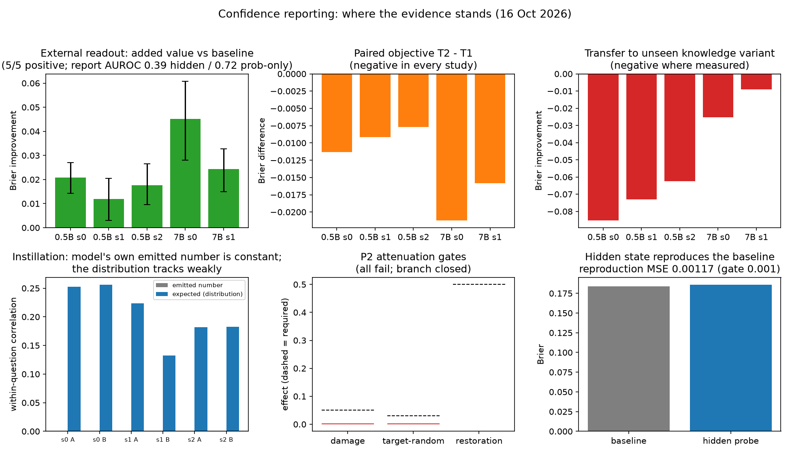

# Confidence reporting: summary of everything done so far

**Keshav Krishna · New York University · 16 October 2026**  
Two-page summary. Fuller version: [`CAUSAL_CONFIDENCE_REPORT.md`](CAUSAL_CONFIDENCE_REPORT.md).

**The short version.** The main claim is **instillation**: can the model itself learn to look inward — to emit a confidence that follows its internal knowledge state, and eventually to act on it? The external-readout results below are a subordinate, diagnostic claim; they do not test instillation.

1. **Main claim (instillation) — not yet supported.** The model's own emitted confidence is currently a constant in every tested configuration. The underlying report distribution does carry a weak competence signal (expected-value correlation 0.13–0.27) but is compressed and miscalibrated, so no valid number surfaces it. Two implementation flaws were found and fixed (a wrong KL suffix, a training/evaluation decoding mismatch); the clean fixed configuration is still constant, so calibration/optimization/capacity remain the open problem — not evidence that the signal is absent.
2. **Subordinate claim (an external readout adds value beyond output probabilities) — positive on the specified test, under a caveat.** After two evaluation fixes, added value is positive in **5 of 5 runs** (+0.012 to +0.045 Brier, all intervals above zero). But the hidden-inclusive report ranks states **worse than chance** (AUROC 0.39–0.40 on the test split), so the augmented predictor may simply be flipping its sign; a probability-only reporter (AUROC 0.72) adds exactly zero. A sign-flip and per-variant diagnostic is running to settle what the increment means.
3. **Transfer fails on discrimination.** With the balanced transfer design (prevalence 0.38, baseline Brier 0.111), incremental transfer is near zero and inconclusive (+0.0056 T1 [−0.0025, +0.0133]; +0.0045 T2 [−0.0037, +0.0121]) while ranking on the new variant is below chance (AUROC 0.42/0.48). Scale and ranking do not transfer.
4. **No for the earlier manipulation.** The MLP-attenuation branch failed its locked validation and is closed.

## Scorecard

| Question | Status | Key evidence |
| --- | --- | --- |
| **Main claim: can the model itself emit a confidence that tracks its knowledge (instillation)?** | **Not yet supported** | emitted number constant (0.05) in every configuration; distribution tracks weakly (corr 0.13–0.27) but is miscalibrated |
| Do knowledge variants change competence cleanly? | **Supported** | 5/5 verification passes; spread 0.70–0.94; unexposed-fact success 0.08–0.14 |
| Does an external readout add value beyond output probabilities? | **Positive on the specified test; interpretation pending** | +0.012 … +0.045, 5/5 CIs above zero; but report AUROC 0.39–0.40 → possible sign-flip artifact; probability-only report adds 0 |
| Does the within-question pair objective help? | **Not supported** | T2 worse than T1 standalone in all studies; T1 and T2 add equal value |
| Does the readout transfer to a new knowledge variant? | **No (discrimination fails)** | balanced transfer added ~0 (inconclusive); AUROC 0.42/0.48 |
| Can MLP attenuation test confidence training? | **No** | all three locked gates fail; branch closed |

## 1. The question

Can metacognition be **instilled** into the model — so that when it answers, it also relies on an inward look at its own internal knowledge state, not only on prompt features? Operationally: the question text is identical across states, so any variation in the model's own confidence must come from inside; a question-only predictor is the control that rules out prompt-based shortcuts.

The external readout (a small MLP over saved features) is a **diagnostic**, not the claim: it asks whether the competence signal is readable at all from the frozen state. The instillation claim requires the model's own emitted number to carry it.

## 2. The foundation: controlled knowledge variants

Four counterbalanced adapters (rank-8, gate/up projections of a frozen Qwen2.5 model) each learned half of 240 invented facts, arranged so every fact is known by exactly two of four variants; a fifth adapter learned a disjoint fact pool. Training used five question phrasings and verification used a sixth, never seen. Sample results:

| Study | Cross-variant spread | Success on unexposed facts | Paraphrase survival |
| --- | --- | --- | --- |
| 0.5B seeds 0–2 | 0.70, 0.76, 0.70 | 0.13, 0.14, 0.12 | 76–82% |
| 7B seeds 0–1 | 0.94, 0.92 | 0.08, 0.08 | 88% |

This substrate is the project's most reusable asset: it changes what the model knows while keeping the question fixed, with identical wording and verified by grading actual answers.

## 3. Subordinate result: the external readout adds value on the specified test

A small MLP reads features at the answer fork (probability summaries and the model's own hidden state) and is trained against the model's measured success. Under the corrected evaluation (draw-level Brier, out-of-fold report predictions), adding it to the strongest probability baseline improves held-out Brier in every run:

| Study | Added value | 95% interval | Baseline Brier |
| --- | --- | --- | --- |
| 0.5B seed 0 | +0.0208 | [0.0143, 0.0270] | 0.184 |
| 0.5B seed 1 | +0.0120 | [0.0031, 0.0205] | 0.198 |
| 0.5B seed 2 | +0.0177 | [0.0095, 0.0265] | 0.177 |
| 7B seed 0 | +0.0452 | [0.0280, 0.0608] | 0.202 |
| 7B seed 1 | +0.0243 | [0.0150, 0.0327] | 0.198 |

**The caveat, measured.** The same study compared reporters on identical states (0.5B seed 0):

| Inputs | AUROC | Added value |
| --- | --- | --- |
| question + probability summaries | 0.72 | −0.0002 … +0.0001 (zero) |
| question + probability + hidden | **0.39–0.40** | +0.0197 … +0.0208 |

The probability-only report is a good ranker but tells the baseline nothing new. The hidden-inclusive report **adds value while ranking below chance**: a refit predictor can exploit its negation. So the increment is, at present, a statistical feature-combination result rather than a usable confidence signal. The sign-flip and per-variant diagnostic (running) will confirm or complicate this reading.

The readout audit explains why earlier attempts failed: the answer-fork logits are exactly recoverable from the saved hidden state, and a cross-fitted probe on the **raw** hidden reproduces the probability baseline (reproduction MSE 0.00117 against a 0.001 gate; Brier 0.186 vs 0.184). The earlier failure was a lossy random projection plus in-sample predictions, not missing information.

**Precise claim (subordinate, amended):** *a trained external readout improves a specified probability-based predictor on held-out subjects within the trained knowledge variants, but the readout is currently anti-discriminating and its incremental value may come from sign inversion; this does not establish instillation, that the model can use the information, or that it generalizes to new variants.*

## 4. Negative and unresolved results

**Toy world (E1–E3, the first attempt).** Reward-trained arms improved retrieval (+2.6 points greedy over the reward-only arm) but a matched-supervision arm matched them, the report was worse than always saying 50%, and added value was ≤ +0.0005. Nothing here survived the stronger tests later.

**Paired objective fails everywhere.** The within-question contrast term is worse than plain pointwise training in all five corrected studies (−0.008 to −0.021 Brier). Whatever it is meant to buy, it does not show up on held-out subjects.

**Transfer fails on discrimination, not on combination.** The first transfer design was unbalanced (the transfer variant knew all its facts; prevalence 0.78 versus 0.27 in training), which produced a severe combination failure and misled the reading. The balanced redesign (half the facts learned; prevalence 0.38; baseline Brier 0.111 instead of 0.307) shows: incremental transfer is near zero and inconclusive (+0.0056 T1 [−0.0025, +0.0133]; +0.0045 T2 [−0.0037, +0.0121]), while both reports rank the new variant **below chance** (AUROC 0.42 T1 / 0.48 T2). Levels are roughly in range (mean report 0.414 vs success 0.370), but the ordering does not transfer. Recalibrating with new-variant labels would be *adaptation*, not zero-shot transfer.

**Native reports (the instillation claim) are unresolved.** Training adapters to emit the number themselves has produced a constant emission (0.05) in every configuration, including the clean fixed run after the KL and decoding fixes. The diagnostics are consistent: the report *distribution* tracks competence weakly (expected-value correlation 0.18–0.27 across seeds), but neither token-greedy nor argmax-string decoding surfaces it, and the level is far below measured success (0.05 vs 0.21–0.35). So: a weak signal exists in the computation; emission, calibration, and optimization are the unresolved links — capacity is the next lever, now justified by these diagnostics rather than assumed.

**Attenuation branch closed.** The MLP channel-damage manipulation failed all three locked gates (damage +0.0025 vs required 0.05; target-minus-control +0.0024 vs 0.03; restoration −0.08 vs 0.5) on 963 questions and 15,408 sampled answers.

## 5. Corrections to earlier claims

| Earlier claim | Correction |
| --- | --- |
| "The report adds no value beyond the baseline" | Artifact of in-sample report predictions (the augmented predictor overtrusted an overfit reporter) plus the lossy hidden projection. With out-of-fold predictions and raw hidden states, added value is positive in 5/5 — under the caveat below. |
| "Positive added value means the report is a usable confidence signal" | Not established: the hidden-inclusive report ranks states below chance (AUROC 0.39–0.40), so the increment may be sign inversion; the probability-only report (AUROC 0.72) adds exactly zero. Sign-flip/per-variant diagnostic running. |
| "The hidden state is uninformative" | Wrong under the tested readouts: the raw hidden reproduces the baseline exactly (logits are a frozen-head function of it). The 256-d projection was the problem. |
| "Draw-level Brier fixed the sign" | No: the variance term is common to both predictors. The reversal came from cross-fitting and the representation change. |
| Transfer "failed" | It mixed two failures. Balanced redesign: combination is fine (added ~0), but **discrimination fails** (AUROC below chance on the new variant). Zero-shot ranking does not transfer. |

## 6. Running now and next

- **Running:** the extended readout-gain diagnostic (sign-flipped added value, per-variant AUROC) behind the final fixed native run.
- **Next, in priority order:**
  1. **Native calibration and emission** with reporter adapters on several layers and rank 16, a calibration-first objective (fit the level before sharpening tracking), and both emitted and argmax-string readouts. Goal: a non-constant emitted number with AUROC above chance within question.
  2. **Inwardness controls**: identical prompt hash across variants, question-only predictor fails, variance across knowledge states — the operational definition of "looking in."
  3. **Transfer beyond ranking failure**: test whether a small labeled adaptation on a new variant fixes discrimination (labeled adaptation, not zero-shot), and retest on a second unseen adapter.
  4. **Behavior**: answer-versus-lookup using the model's own emitted number, with matched controls; the externally monitored version (report readout chosen by an external rule) is a separate, clearly labeled system.
- The reports and this summary use the instillation claim as primary; the external-readout added value is reported as a diagnostic with its caveats.

## Where the evidence lives

- `runs/causal_confidence/cc_v1/knowledge/seed{0,1,2}/` — local knowledge studies (corrected evaluation).
- `runs/section33_v1/causal_confidence/cc_v1/know7b_seed{0,1}/` and `know7b_balanced0/` — 7B studies (seed 1 replication, balanced transfer); `p2c/` — locked attenuation validation.
- `runs/causal_confidence/cc_v1/knowledge/diagnostics/` — readout audit, feature ablation, native sweeps.
- Figures: `report/figures/knowledge_confidence/` (dashboard `fig0`, toy `fig1`, P2 `fig2`, substrate `fig3`, reporter `fig4`, probes `fig5`, ablation `fig6`).
