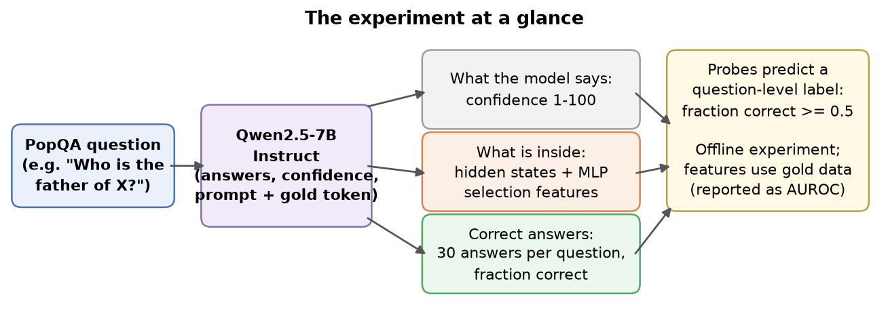
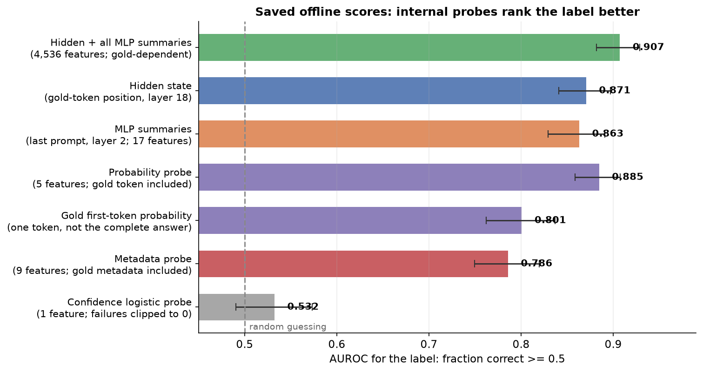
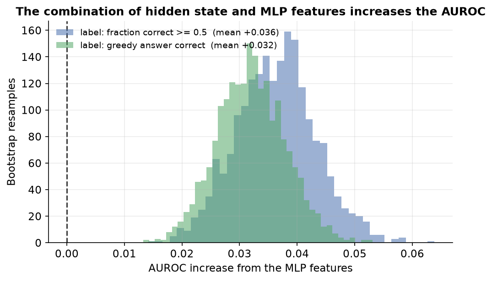
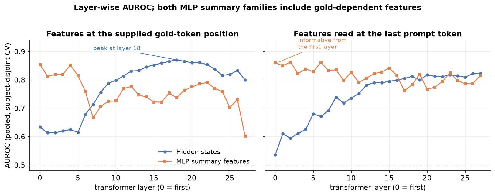
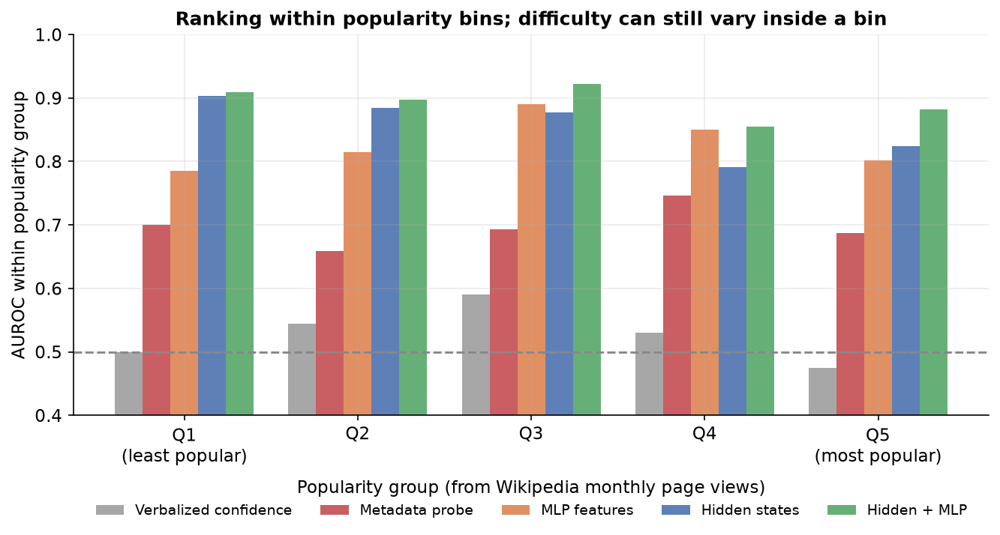
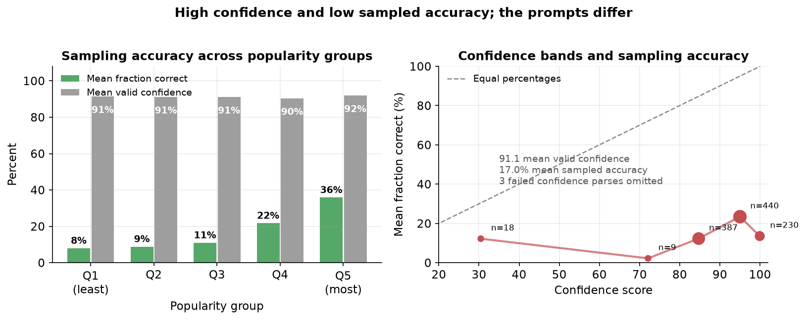

# Internal signals predict a factual-answer label in an offline Qwen2.5-7B pilot

**Simplified report: 1,087 PopQA questions, 30 sampled answers per question**
{: .subtitle }

Keshav Krishna
{: .author }

Pilot run: 28–29 September 2026 · Evidence review: 3 October 2026
{: .meta }

**Keywords:** factual recall, confidence score, hidden state, MLP, probe, PopQA
{: .keywords }

**Abstract.** This report gives the results of an offline experiment. The model is Qwen2.5-7B-Instruct. The data are 1,087 PopQA questions. The model generated 30 answers for each question. The main label is 1 when at least 15 of the 30 answers pass the answer matcher. The study trained small classifiers (probes) on recorded internal signals and on the stated confidence score. The probes use five subject-disjoint folds. The confidence probe reached AUROC 0.532. A 17-feature MLP-summary probe reached 0.863. A hidden-state probe reached 0.871. The combination reached 0.907. The audit reproduced these scores from the saved predictions. However, the feature pass uses the first token of the gold answer. The strongest probes therefore need gold data. The result applies to this offline experiment only. It does not show live error detection. Popularity-bin scores support more study, but they do not remove all difficulty effects.
{: .abstract }

## 1. Purpose and scope

The experiment compares two signal groups:

1. The confidence score that the model states (a number from 1 to 100).
2. The internal signals that the model computes (hidden states and activations from the MLP, the feed-forward block in a transformer layer).

The target is a label for a whole question. The label is 1 when at least half of the 30 sampled answers pass the answer matcher. The target is not the correctness of one selected answer.

A *probe* is a small classifier. It reads recorded numbers from the model and predicts the label. The model weights never change. A probe learns only from the answer labels.

The feature pass uses the first token of the gold answer. Section 3 gives the details. Thus, every headline score in this report is an offline score. This report does not claim live error detection.

*Figure 1. The experiment. The collector makes three kinds of model calls (answers, confidence, feature pass). The feature pass includes the gold answer token. The probe predicts the question-level label. The features use gold data, so the result is offline.*
{: .caption }

## 2. Data, model, and labels

### 2.1 Questions

The source is PopQA, a factual-question data set with popularity metadata [2]. The sample contains 1,087 questions and 1,046 subject IDs. Table 1 gives the relation counts.

| Relation | Questions |
|---|---:|
| father | 300 |
| mother | 187 |
| place of birth | 300 |
| occupation | 300 |
| **Total** | **1,087** |

*Table 1. Questions per relation.*
{: .tablecaption }

The requested size was 1,200 questions. The mother relation supplied only 187 questions. The selection uses seed 0 and a head-heavy popularity mix. The mix requests 10%, 15%, 20%, 25%, and 30% weights from the least to the most popular quintile. The weights are targets, not exact final proportions. The analysis computes five new quintiles over the saved sample.

### 2.2 Model and generation

The model is Qwen2.5-7B-Instruct [1]. It has 28 layers, hidden width 3,584, MLP width 18,944, and 152,064 vocabulary tokens.

For each question, the model generated:

- 30 answers at temperature 1.0 and top_p 1.0, with a limit of 16 new tokens;
- one greedy answer with the same limit;
- one confidence score from 1 to 100.

The total number of sampled answers is 32,610 (1,087 × 30).

### 2.3 Labels and confidence

The matcher uses the first nonempty output line. It converts the text to lowercase, normalizes Unicode, removes punctuation, and removes an initial article. Then it compares the text with the saved aliases. Aliases with at most two characters require an exact normalized match. Longer aliases also accept a token match or a substring match.

The fraction correct is the number of accepted answers divided by 30. The main label is 1 when the fraction is at least 0.5. The greedy label is 1 when the greedy answer passes the same matcher. Table 2 gives the sample statistics.

| Quantity | Saved value |
|---|---:|
| Sampled answers | 32,610 |
| Mean fraction correct | 0.1705 (17.0%) |
| Main-label positives | 179 of 1,087 (16.47%) |
| Greedy-label positives | 210 of 1,087 (19.32%) |
| Valid confidence values | 1,084 of 1,087 |
| Mean valid confidence | 91.1 |
| Median valid confidence | 95 |

*Table 2. Sample statistics.*

Label limits: 56 accepted samples match only through the substring rule. A strict token-boundary diagnostic accepts 176 main-label positives and gives mean fraction correct 0.1688. Three questions cross the 0.5 threshold. This report uses the historical labels. A corrected-label run is not done.

Three confidence values did not parse. The historical confidence probe clips these values to 0. This is a missing-value convention, not a valid confidence report. The descriptive plot leaves them out.

## 3. Signals and probe training

### 3.1 Feature pass and token positions

Let `p` be the tokenized answer prompt. The prompt contains a system instruction, four question-answer examples, and the target question. The collector separately tokenizes a space followed by the gold answer. It keeps only the first token. Call this token `g`.

The feature-pass input is `p + [g]`. The collector reads signals at two positions. Table 3 gives the positions.

| Position | Token index | Input at the position |
|---|---|---|
| `last` | `len(p) − 1` | The complete prompt, not `g` |
| `ans` | `len(p)` | The prompt and the supplied token `g` |

*Table 3. The two token positions.*

The attention mask prevents `last` from reading `g`. However, five of the 17 summary features at `last` still use `g` during calculation. Every signal at `ans` depends on `g`, because `g` is an input token.

Consequence: the strongest probes need the gold answer token. They cannot run on a new question without gold data. A live system does not have this token.

### 3.2 Saved signals

The collector saves the tensors in Table 4 for each question.

| Raw key | Shape per batch | Contents |
|---|---|---|
| `h_last`, `h_ans` | `(29, B, 3584)` | Embedding state and 28 layer-indexed hidden states |
| `gate_pre` | `(B, 28, 2, 18944)` | Gate pre-activations |
| `sel` | `(B, 28, 2, 18944)` | Selection activations (SiLU gate × up-projection) |
| `down` | `(B, 28, 2, 3584)` | MLP output values |
| `ids` | `(B,)` | Question IDs |

*Table 4. Saved raw tensors.*

The position axis is `last`, then `ans`. The collector stores float16 copies of the model values. Hidden-state entry 0 is the embedding state. Entries 1 to 28 follow the 28 layers. Thus, the probe named `H_ans_l18` reads hidden-state entry 19 at the `ans` position.

### 3.3 Summary features and baselines

The collector computes 17 summary features for each layer and each position. An MLP has a gate path and an up-projection path. The gate pre-activation is the gate value before the SiLU function. The selection activation is the product of the SiLU gate and the up-projection value. The features describe distributions, sizes, and directions:

- entropy of the gate pre-activations and entropy of their normalized squares;
- fraction of positive gate pre-activations;
- top-5 squared mass, Gini coefficient, largest signed value, and kurtosis of the gate pre-activations;
- entropy of the selection activations (normalized squares);
- norms of the selection activations and the MLP output;
- ratio of the MLP-output norm to the hidden-state norm, and cosine of the MLP output and the hidden state;
- five gold-direction features that use `D_g`, the output-head row of `g`: cosine of the selection and the gold direction, normalized gold projection, MLP margin, candidate entropy, and gold logit.

Twelve features use only activations at that layer and position. Five features use `D_g`. No result is available for the 12 features alone.

The compact MLP probe uses the 17 features at `last`, layer 2. The hidden probe uses all 3,584 values at `ans`, layer 18. The combined probe concatenates the hidden vector with all 17 features from all 28 layers and both positions (952 values). Its input has 3,584 + 952 = 4,536 values.

Two baselines use simple feature sets:

- The probability baseline has five features from the final logits at `last`: gold-token probability, vocabulary entropy, top-1 probability, top1−top2 margin, and gold-token rank. It uses the gold token, and it is not a probe on the full vocabulary distribution.
- The metadata baseline has nine features: log subject popularity, log object popularity, four relation indicators, alias count, prompt-token count, and subject-token count. Object popularity and alias count use gold metadata.

### 3.4 Probe training and evaluation

- Classifier: L2-regularized logistic regression.
- Preprocessing: `StandardScaler` fitted on training features. Raw-vector probes use PCA with up to 256 components; all-hidden-state probes use up to 64 components. The compact, hidden, and combined probes use no PCA.
- Folds: `StratifiedGroupKFold` with 5 folds, grouped by subject ID, seed 0. Each subject stays in one fold. Main-target test folds have 217 or 218 questions and 35 or 36 positives.
- `C` selection: three inner subject-disjoint folds select `C` from 0.003, 0.01, 0.03, 0.1, 0.3, and 1.0. The mean inner-AUROC winner is refit on the outer training data.
- Score: pooled out-of-fold predictions, scored with AUROC. An *out-of-fold score* comes from a probe that did not train on that question or its subject.
- Intervals: 1,000 question-level bootstrap samples. Paired comparisons use 2,000 samples on the same questions.

Two evaluation limits apply. First, the scaler and PCA are fitted on the outer training fold before the inner split. Thus, inner validation data affect preprocessing; the procedure is not fully nested. Second, the bootstrap resamples questions, not subjects. The intervals do not include retraining or method-selection uncertainty. Best layers and variants were selected on the pooled out-of-fold scores, and no final test set exists.

## 4. Results

### 4.1 Main comparison

*Figure 2. Main-label AUROC from the saved out-of-fold predictions. Bars show 95% question-bootstrap intervals. Metadata, probability, and internal features all use gold data (Section 3).*
{: .caption }

| Signal and exact variant | AUROC | 95% interval |
|---|---:|---|
| Hidden layer 18 + all MLP summaries (4,536 features) | 0.907 | [0.882, 0.929] |
| Probability probe (5 features) | 0.885 | [0.859, 0.907] |
| Hidden state, `ans`, layer 18 (3,584 values) | 0.871 | [0.841, 0.897] |
| MLP summaries, `last`, layer 2 (17 features) | 0.863 | [0.829, 0.891] |
| Raw selection activation, `ans`, layer 16, PCA-256 | 0.853 | [0.822, 0.882] |
| Gold first-token probability alone | 0.801 | [0.762, 0.837] |
| Metadata probe (9 features) | 0.786 | [0.749, 0.820] |
| Confidence logistic probe (1 feature; 3 failures clipped to 0) | 0.532 | [0.491, 0.573] |

*Table 5. Main-label AUROC, sorted by score.*

The confidence probe has AUROC 0.532. The direct AUROC of the raw confidence numbers is 0.534. Both values are close to random guessing (0.5). The internal probes rank the main label much better than the confidence probe. The combined probe has the best score.

### 4.2 Paired differences

*Figure 3. Bootstrap distributions of the AUROC difference between the combined probe and the hidden probe, for the main label and the greedy label. Each paired sample uses the same questions for both scores. The intervals do not correct method selection.*
{: .caption }

| Main-label comparison | Observed difference | 95% interval |
|---|---:|---|
| Combined − hidden layer 18 | +0.037 | [+0.023, +0.051] |
| Combined − five probability features | +0.023 | [−0.007, +0.050] |
| MLP layer 2 − hidden layer 18 | −0.007 | [−0.041, +0.024] |

*Table 6. Paired AUROC differences for the main label.*

Figure 3 gives the bootstrap mean of the combined-minus-hidden difference (+0.036). Table 6 gives the observed difference between the saved AUROC values (+0.037).

The combined probe improves the hidden probe in this resampling test. The interval for the probability comparison includes zero. The interval for the MLP-only comparison also includes zero. An interval that includes zero does not prove equivalence between feature families.

### 4.3 Layer and position

*Figure 4. Separate probes at each layer and both positions. Left: the gold-token position. Right: the last prompt token. Both MLP summary families include the five gold-dependent features.*
{: .caption }

The best hidden probe uses layer 18 at `ans` (0.871). The best compact MLP probe uses layer 2 at `last` (0.863). The MLP probe at `ans`, layer 0 has AUROC 0.853. The MLP summaries at `last` are informative from the first layer.

These values locate predictive features in the recorded data. They do not show a causal point of factual recall. Early MLP scores can reflect prompt structure, subject familiarity, the gold token, or other question properties. This pilot has no feature-removal test that separates these causes.

### 4.4 Popularity bins

*Figure 5. AUROC inside five popularity bins. The scores are the same global out-of-fold scores as Figure 2. The evaluator does not train new probes inside a bin.*
{: .caption }

| Score | All | Q1 | Q2 | Q3 | Q4 | Q5 |
|---|---:|---:|---:|---:|---:|---:|
| Confidence probe | 0.532 | 0.499 | 0.545 | 0.590 | 0.530 | 0.474 |
| Metadata probe | 0.786 | 0.700 | 0.659 | 0.693 | 0.746 | 0.687 |
| MLP `last`, layer 2 | 0.863 | 0.786 | 0.814 | 0.890 | 0.851 | 0.802 |
| Hidden `ans`, layer 18 | 0.871 | 0.904 | 0.884 | 0.877 | 0.791 | 0.824 |
| Combined | 0.907 | 0.909 | 0.898 | 0.922 | 0.855 | 0.882 |

*Table 7. AUROC within subject-popularity quintiles. Q1 is the least popular group; Q5 is the most popular group.*

Q1 holds subjects with 21 to 160 page views. Q5 holds subjects with 10,742 to 15,101,521 page views. Relation type and other difficulty factors still vary inside a bin.

The internal probes keep ranking signal inside all five bins. The confidence probe does not. This result supports more study. It does not prove that the probes are independent of popularity or of all difficulty.

A second diagnostic uses `fraction correct − metadata-probe score`. Its Spearman correlations are +0.145 (hidden), +0.237 (MLP at `last`, layer 2), +0.199 (combined), +0.210 (probability), and −0.004 (confidence). The metadata score predicts a binary label, so this difference is not a regression residual.

### 4.5 Stated confidence and sampled accuracy

*Figure 6. Left: mean fraction correct and mean valid confidence in five popularity groups. Right: mean fraction correct inside confidence bands. The answer and confidence prompts differ. This plot is descriptive; it does not calibrate answer-specific confidence.*
{: .caption }

Mean sampled accuracy is 17.0%. Mean valid confidence is 91.1. Accuracy rises from 7.9% in Q1 to 35.8% in Q5. Confidence stays between 90.3 and 91.8 in all groups.

| Confidence band | Questions | Mean fraction correct | Main-label positive rate |
|---|---:|---:|---:|
| 1–60 | 18 | 12.2% | 11.1% |
| 61–80 | 9 | 2.2% | 0.0% |
| 81–90 | 387 | 12.3% | 11.1% |
| 91–95 | 440 | 23.4% | 23.6% |
| 96–100 | 230 | 13.6% | 12.6% |
| Missing or invalid | 3 | 32.2% | 33.3% |

*Table 8. Accuracy inside confidence bands. Invalid values are excluded from Figure 6.*

Confidence has Spearman correlation 0.041 with fraction correct and 0.079 with subject popularity. The confidence prompt omits the four examples and does not include a sampled answer. Thus, the confidence score does not describe one specific answer.

### 4.6 Greedy target

| Fixed feature set | Greedy-label AUROC | 95% interval |
|---|---:|---|
| Combined | 0.885 | [0.859, 0.909] |
| Hidden `ans`, layer 18 | 0.853 | [0.824, 0.879] |
| Probability probe | 0.847 | [0.817, 0.873] |
| Raw selection activation, `ans`, layer 16 | 0.836 | [0.806, 0.864] |
| MLP `ans`, layer 0 | 0.834 | [0.800, 0.864] |
| MLP `last`, layer 2 | 0.821 | [0.785, 0.853] |
| Metadata probe | 0.762 | [0.722, 0.794] |
| Confidence probe | 0.524 | [0.483, 0.564] |

*Table 9. Greedy-label AUROC for the same fixed feature sets.*

The combined probe minus the hidden probe is +0.032, interval [+0.021, +0.044]. The best compact MLP variant changes with the target. The result supports a broad internal-signal advantage. It does not give the same ranking for every variant.

## 5. Limits

1. **Gold dependencies.** The strongest probes need the gold token or gold metadata. No oracle-free result is available.
2. **Label quality.** The matcher accepts 56 substring-only samples. The strict diagnostic changes three labels. Greedy output text is not saved, so the greedy labels cannot be replayed.
3. **Method selection.** Best layers and variants were selected on the pooled out-of-fold scores. There is no separate final test set.
4. **Preprocessing and uncertainty.** The inner split does not refit preprocessing. Bootstrap samples use questions, not subjects. The intervals do not include retraining or method-selection uncertainty.
5. **Prompt comparison.** The answer prompt and the confidence prompt differ. Confidence is not attached to a generated answer.
6. **Scope.** The headline result uses one model and one data selection. The 0.5B and 1.5B runs are pipeline checks only.
7. **Provenance.** The saved run does not contain complete prompts, the model revision, fold assignments, or fitted probes. Generation does not set an explicit torch seed.
8. **Mechanism.** The scores show predictive association. They do not prove factual storage, retrieval competition, or a causal source of correctness.

## 6. Next experiment

1. Review the ambiguous aliases and save the complete greedy outputs. Regenerate or adjudicate the labels. Keep the historical labels with their original run ID.
2. Use the same prompt context for the answer and the confidence request. For question-level confidence, define the sampling procedure. For answer-level confidence, supply the exact answer.
3. Test the 12 gold-free summaries at `last`. Test signals during the model's own answer generation. Compare these signals with gold-free probability features and question-only metadata.
4. Use fully nested preprocessing and a held-out final test set.
5. For live use, train a final probe after method selection. Save the scaler, the PCA, the classifier, the feature order, and the model revision. Then evaluate calibration and any abstention threshold.

## References

1. Qwen Team. *Qwen2.5 Technical Report.* 2024. [arXiv:2412.15115](https://arxiv.org/abs/2412.15115). Architecture: [Qwen2.5-7B-Instruct configuration](https://huggingface.co/Qwen/Qwen2.5-7B-Instruct/blob/main/config.json).
2. Alex Mallen, Akari Asai, Victor Zhong, Rajarshi Das, Daniel Khashabi, Hannaneh Hajishirzi. *When Not to Trust Language Models: Investigating Effectiveness of Parametric and Non-Parametric Memories.* ACL 2023. [arXiv:2212.10511](https://arxiv.org/abs/2212.10511). Data: [PopQA](https://huggingface.co/datasets/akariasai/PopQA).
3. Mor Geva, Roei Schuster, Jonathan Berant, Omer Levy. *Transformer Feed-Forward Layers Are Key-Value Memories.* EMNLP 2021. [arXiv:2012.14913](https://arxiv.org/abs/2012.14913).
4. Kevin Meng, David Bau, Alex Andonian, Yonatan Belinkov. *Locating and Editing Factual Associations in GPT.* NeurIPS 2022. [arXiv:2202.05262](https://arxiv.org/abs/2202.05262).
5. Shauli Ravfogel, Gilad Yehudai, Joan Bruna, Alberto Bietti. *Geometric Factual Recall in Transformers.* Preprint, 2026. [arXiv:2605.12426](https://arxiv.org/abs/2605.12426).
6. Miao Xiong et al. *Can LLMs Express Their Uncertainty? An Empirical Evaluation of Confidence Elicitation in LLMs.* ICLR 2024. [arXiv:2306.13063](https://arxiv.org/abs/2306.13063).
7. Chao Chen et al. *INSIDE: LLMs' Internal States Retain the Power of Hallucination Detection.* ICLR 2024. [arXiv:2402.03744](https://arxiv.org/abs/2402.03744).
8. Zhenliang Zhang, Xinyu Hu, Huixuan Zhang, Junzhe Zhang, Xiaojun Wan. *ICR Probe: Tracking Hidden State Dynamics for Reliable Hallucination Detection in LLMs.* ACL 2025. [arXiv:2507.16488](https://arxiv.org/abs/2507.16488).
9. Dharshan Kumaran. *Reported Confidence in LLMs Tracks Commitment More Than Correctness.* Preprint, 2026. [arXiv:2606.29490](https://arxiv.org/abs/2606.29490).
10. Gabrielle Kaili-May Liu, Avi Caciularu, Gal Yona, Idan Szpektor, Arman Cohan. *Reinforcement Learning with Metacognitive Feedback Elicits Faithful Uncertainty Expression in LLMs.* Preprint, 2026. [arXiv:2606.32032](https://arxiv.org/abs/2606.32032).

## Appendix A. Evidence files

The full long-form review is `report/REPORT_FULL.md`. The audit is `report/AUDIT.md`; machine-readable checks are in `results/audit_checks.json`.

| File | Contents |
|---|---|
| `results/pilot7b_labels.csv` | Fraction correct, greedy label, and confidence |
| `results/pilot7b_features.parquet` | Metadata, probability features, and 952 summaries |
| `results/raw/pilot7b_batch*.npz` | Raw activations, all layers, both positions |
| `results/pilot7b_*_extra.csv` | Main and follow-up metric tables |
| `results/pilot7b_*_extra_oof.npz` | Saved out-of-fold scores |
| `scripts/collect.py`, `scripts/probe_eval.py`, `scripts/extra_probes.py` | Collection, feature, and probe code |

*Style: this report uses ASD-STE100 principles. Sentences are short, verbs are active, and each term has one meaning.*
{: .meta }
