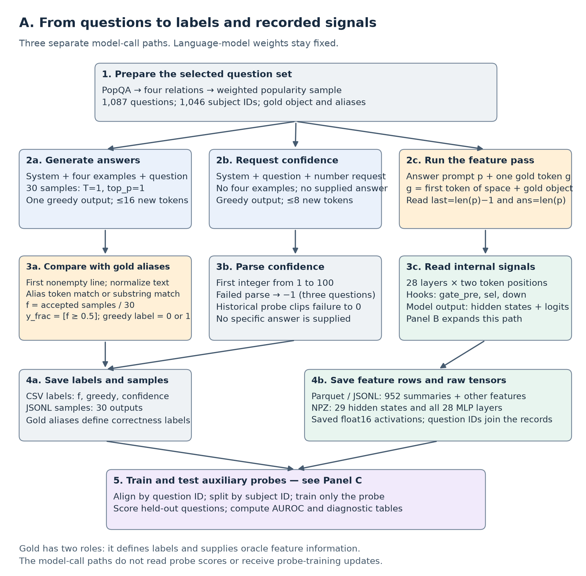
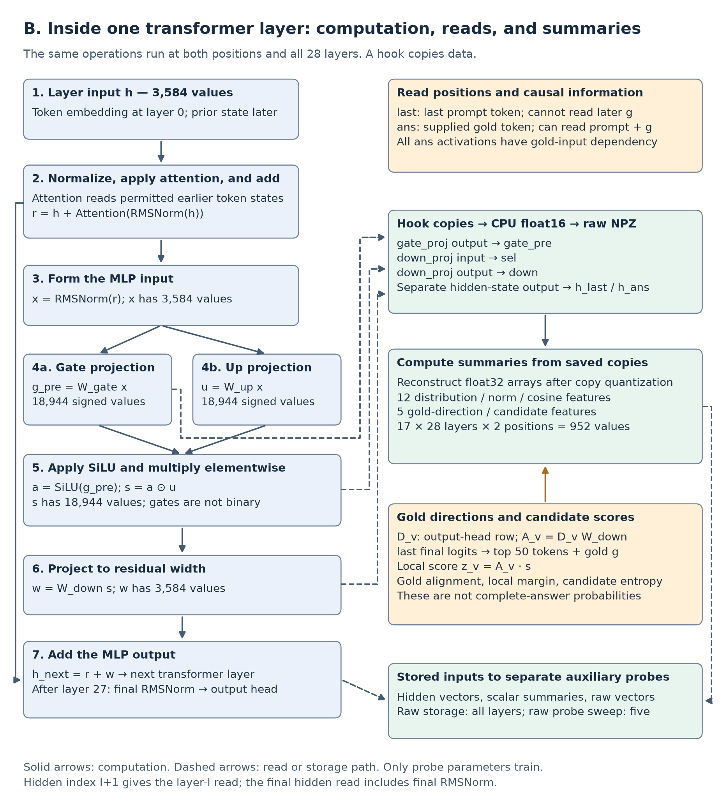
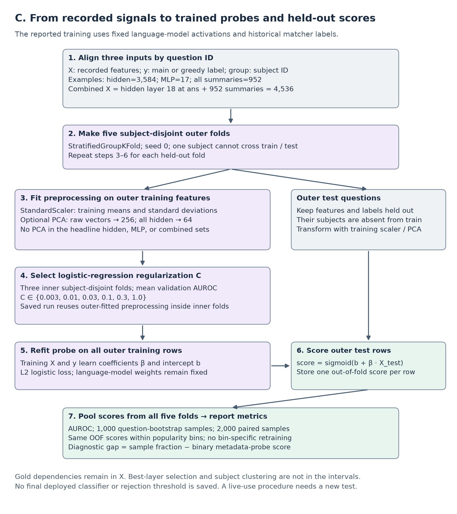

# Internal signals predict a factual-answer label in an offline Qwen2.5-7B pilot

**An evidence review of 1,087 PopQA questions and the complete signal-processing flow**
{: .subtitle }

Keshav Krishna
{: .author }

Pilot run: 28–29 September 2026 · Evidence review: 3 October 2026
{: .meta }

**Keywords:** factual recall, confidence score, hidden state, MLP, probe, PopQA
{: .keywords }

**Abstract.** We compared a stated confidence score with internal signals from Qwen2.5-7B-Instruct. The data contain 1,087 questions from four PopQA relations. For each question, the model generated 30 answers. The main label is 1 when at least 15 answers pass the answer matcher. We trained probes with five subject-disjoint folds. The confidence probe had AUROC 0.532. A 17-feature MLP probe had AUROC 0.863. A hidden-state probe had AUROC 0.871. Their combination had AUROC 0.907. An audit reproduced these scores from saved predictions. However, the strongest probe uses the first gold-answer token as input. All 17-feature sets also include five features that depend on that token. The result therefore concerns an offline experiment. It does not establish a method for live error detection. Popularity-bin results support further study, but they do not remove all difficulty effects. This report gives the signal definitions, training procedure, data-quality limits, and a three-part flow diagram.
{: .abstract }

## 1. Question and scope

The study asks whether internal signals predict a factual-answer label better than a stated confidence score. A probe is a small classifier that reads recorded numbers from the language model. The language model remains fixed. The probe learns from the answer labels.

The main target is a property of a question under repeated sampling. It is not the correctness of one specific generated answer. A second target records whether greedy decoding passes the answer matcher. Greedy decoding selects the highest-probability token at each step. It does not necessarily select the most likely complete answer.

The pilot compares hidden states with summaries of MLP activations. Here, MLP means the feed-forward block in a transformer layer. “Selection features” is the project name for these summaries. The name does not establish that a neuron represents one fact.

The saved internal probes rank the main label better than the confidence probe. The combined probe also improves the selected hidden-state score. However, these comparisons require tests without gold dependencies before use in a live system.

## 2. Relation to earlier work

Earlier work connects feed-forward computation with factual recall. The key-value account relates feed-forward units to input patterns and output vocabulary directions [3]. ROME uses causal interventions and weight edits to study factual associations [4]. A geometric account studies relation-dependent selection in a controlled memory task [5]. These accounts motivate measurements inside the MLP. This pilot does not use causal interventions to choose between them.

Earlier studies also examine confidence elicitation and internal-state signals [6–8]. One study connects reported confidence more strongly with commitment than with correctness [9]. Another trains models with metacognitive feedback [10]. Their tasks and procedures differ from this pilot. This report makes no claim that MLP probing or difficulty analysis is new.

## 3. Data and model

### 3.1 Question selection

The source is PopQA, a factual-question data set with popularity metadata [2]. The preparation script keeps four relations. It does not separately verify that every subject is a real person. Mythological subjects, such as Thor and Adad, occur in the saved sample.

| Relation | Questions |
|---|---:|
| father | 300 |
| mother | 187 |
| place of birth | 300 |
| occupation | 300 |
| Total | 1,087 |

The sample contains 1,046 subject IDs. The requested sample size was 1,200. The mother relation supplied only 187 questions. The other relations supplied 300 questions each. Data selection uses seed 0.

The script computes popularity quintiles over all eligible rows before it samples each relation. It requests weights of 10%, 15%, 20%, 25%, and 30%. It fills shortages from unused rows in that relation. Thus, the weights are targets, not exact final proportions. The analysis later computes five new quintiles over the saved sample.

The meeting notes proposed date of birth. The implemented relation is place of birth. The earlier plan also proposed other surface features and subject-token reads. Those features are not part of this pilot.

### 3.2 Model and prompts

The model is `Qwen/Qwen2.5-7B-Instruct` [1]. Its saved configuration gives 28 layers, hidden width 3,584, and MLP width 18,944. Its vocabulary has 152,064 tokens. The model uses SiLU in the MLP.

The collector loads the model in float16 and sets evaluation mode. It uses PyTorch scaled dot-product attention. It disables gradient calculation during generation and feature collection. It does not change language-model weights.

The answer prompt uses this system instruction:

> You are a factual question answering assistant. Answer each question with the shortest possible answer. Do not explain.

The prompt also contains four question-answer examples. They concern George W. Bush, Prince William, Albert Einstein, and Barack Obama. The target question comes after these examples. The confidence prompt uses the system instruction and target question, but omits the four examples.

This prompt difference limits the comparison. The confidence request is not attached to a particular sampled answer. It asks for a number before the model supplies that answer.

### 3.3 Answer labels

For each question, the model generates 30 answers with temperature 1.0 and `top_p=1.0`. Each answer has a limit of 16 new tokens. The collector also generates one greedy answer with the same token limit.

The matcher uses the first nonempty output line. It converts text to lowercase, normalizes Unicode, removes punctuation, and removes an initial article. It compares the text with the saved aliases. Aliases with at most two characters require an exact normalized match. Longer aliases permit a contiguous token match or a substring match.

The fraction-correct value is the number of accepted samples divided by 30. The main label is 1 when this value is at least 0.5. The greedy label is 1 when the greedy output passes the same matcher.

| Quantity | Saved value |
|---|---:|
| Sampled answers | 32,610 |
| Mean fraction correct | 0.170469 |
| Main-label positives | 179 / 1,087 = 16.47% |
| Greedy-label positives | 210 / 1,087 = 19.32% |
| Valid confidence values | 1,084 / 1,087 |
| Mean valid confidence | 91.12 / 100 |
| Median confidence | 95 / 100 |

The audit found 56 sample matches that require the substring fallback. A token-boundary-only diagnostic accepts 176 main-label positives and gives mean fraction correct 0.168752. Three questions cross the 0.5 threshold. Some substring matches can be valid name variants. Others can be false matches. The reported probe scores retain the original labels. A corrected-label training run has not been done.

The confidence parser reads the first integer from 1 to 100. It stores −1 if it cannot find a valid integer. Three saved values are −1. The historical confidence probe clips these values to 0. This is a missing-value convention, not a valid confidence report.

## 4. Complete flow diagram

Read the three panels in order. Panel A shows the sources of labels and signal inputs. Panel B shows the operations inside one transformer layer. Panel C shows probe training and held-out evaluation.



*Figure 1A. The collector makes three separate kinds of model calls. Gold aliases label sampled answers. The first gold-answer token also enters the feature pass. The label does not enter that pass.*
{: .caption }



*Figure 1B. The language model computes the signals. Hooks copy selected tensors. The collector computes the 17 summary features after the pass. The probe does not control the MLP gates.*
{: .caption }



*Figure 1C. Probe coefficients learn from training labels. Held-out questions supply scores for AUROC calculation. The procedure includes the preprocessing used for the saved run.*
{: .caption }

Full-size diagrams are in `report/FLOW.html`. That page works without network access. The SVG files in `report/figures/` retain readable text at higher magnification.

## 5. Internal signals: calculation and reads

### 5.1 Exact input and token positions

Let `p` be the tokenized answer prompt. The collector separately tokenizes a space followed by `q.obj`. It keeps only the first token from that result. Call this token `g`. The feature-pass input is `p + [g]`. It is not the complete gold answer.

| Position name | Token index | Information available at that position |
|---|---|---|
| `last` | `len(p) − 1` | The full prompt, including the four examples |
| `ans` | `len(p)` | The prompt and the supplied gold token `g` |

The causal attention mask prevents `last` from reading the later gold token. However, gold-dependent summary features at `last` still use `g` during calculation. Every signal at `ans` depends on the supplied token, including entropy and norm features.

The first token can represent only part of a name or word. It is not a complete entity identifier. The separate leading-space tokenization can also differ from tokenization of a naturally generated answer.

### 5.2 Computation inside one transformer layer

Use `h` for the layer input at one token position. The layer normalizes `h` and applies attention. It adds the attention output to `h`. Call this intermediate residual state `r`.

The layer normalizes `r` with RMSNorm. Call the result `x`. Three fixed weight matrices produce the MLP output:

```text
g_pre = W_gate x                         # 18,944 gate pre-activations
u     = W_up x                           # 18,944 up-projection values
a     = SiLU(g_pre)                      # 18,944 gate values
s     = a ⊙ u                            # 18,944 selection activations
w     = W_down s                         # 3,584 MLP-output values
h_next = r + w                           # 3,584 residual-state values
```

The symbol `⊙` means elementwise multiplication. `W_gate` and `W_up` each have shape `(18,944, 3,584)`. `W_down` has shape `(3,584, 18,944)`. The collector does not save `x`, `u`, or `a` as separate raw tensors.

SiLU is a smooth function, not a binary switch. Negative inputs can give negative nonzero outputs. A positive pre-activation does not identify an active fact. The MLP combines many numerical components. This report does not assign each component to a specific stored fact.

### 5.3 Hooks and raw storage

Hooks read tensors without changing them. A forward hook on `gate_proj` copies `g_pre`. A pre-hook on `down_proj` copies `s`. A forward hook on `down_proj` copies `w`. The hooks select two token positions, move the values to the CPU, and convert them to float16.

The model output supplies hidden states. The collector stores 29 states per position: the embedding state and 28 layer-indexed states. The probe uses index `l + 1` for feature name `H_*_l{l}`. The final saved state includes the model's final RMSNorm. Earlier layer-indexed states are residual states after their respective blocks.

| Raw key | Batch shape | Contents |
|---|---|---|
| `ids` | `(B,)` | Question IDs |
| `h_last`, `h_ans` | `(29, B, 3584)` | Embedding and layer-indexed hidden states |
| `gate_pre` | `(B, 28, 2, 18944)` | Gate pre-activations |
| `sel` | `(B, 28, 2, 18944)` | Selection activations `s` |
| `down` | `(B, 28, 2, 3584)` | MLP output `w` |

The position axis uses order `last`, then `ans`. Most batches contain eight questions. The final batch contains seven. All 28 layers are saved. Only the raw-vector probe sweep is limited to layers 0, 7, 14, 16, and 27.

The saved tensors are activations, not weight matrices. The summaries use float32 values reconstructed from float16 copies. Thus, raw-copy quantization occurs before summary calculation.

### 5.4 All 17 summary features

The following table defines every feature at one layer and position. `H(v)` means `−Σ v_i log(v_i)` for normalized nonnegative weights. `E(v)` means normalized squared values, with the small numerical offset used by the code. `D_g` is the output-head row for gold token `g`. `A_g = D_g W_down`.

| Feature | Quantity or operation | Gold dependency |
|---|---|---|
| `ent_gate` | `H(softmax(g_pre))` | No at `last` |
| `ent_gate_sq` | `H(E(g_pre))` | No at `last` |
| `active_frac` | Fraction of `g_pre` values greater than zero | No at `last` |
| `top5_gate` | Five largest squared pre-activations divided by total squared mass | No at `last` |
| `gini_gate` | Gini coefficient of `abs(g_pre)` | No at `last` |
| `max_gate` | Largest signed pre-activation | No at `last` |
| `kurt_gate` | Fourth central moment divided by squared variance | No at `last` |
| `ent_sel_sq` | `H(E(s))` | No at `last` |
| `l2_sel` | Euclidean norm of `s` | No at `last` |
| `l2_down` | Euclidean norm of `w` | No at `last` |
| `down_norm_ratio` | `norm(w) / norm(h_saved)` | No at `last` |
| `cos_down_h` | Cosine of `w` and `h_saved` | No at `last` |
| `cos_sel_agold` | Cosine of `s` and `A_g` | Yes |
| `proj_gold_norm` | `(A_g · s) / (norm(w) norm(D_g))` | Yes |
| `mlp_margin` | Gold candidate score minus largest other candidate score | Yes |
| `ent_cand` | Entropy of softmax over candidate scores | Yes |
| `logit_mlp_gold` | `w · D_g` | Yes |

All 17 features at `ans` also depend on gold-token input. At `last`, only the first 12 features avoid that dependency. The pilot has no saved score for this 12-feature-only ablation.

The names `ent_gate` and `active_frac` refer to pre-activations, not post-SiLU gate values. Squared entropy uses normalized squares. It does not use `softmax(g_pre²)`. The top-five calculation ranks squared magnitudes. Large negative values can therefore enter the top five.

`h_saved` is the corresponding layer-indexed hidden state. It is not the normalized MLP input `x`. At the final layer, it includes final RMSNorm. The collector uses small offsets in entropy, norm, and cosine calculations to reduce numerical errors.

### 5.5 Candidate scores and answer directions

The collector reads final vocabulary logits at `last`. It selects the 50 tokens with the largest logits. It adds `g` if that token is absent. The result contains 50 or 51 distinct candidate tokens. Padding entries do not enter the margin or entropy.

For candidate token `v`, the local score is `(D_v W_down) · s`. This approximates `D_v · w`, apart from float16-copy differences. It is a projection of one MLP output. It is not the final vocabulary logit after later layers and normalization.

If `g` is among the original top 50, the margin has 49 other candidates. Otherwise, it has 50. Candidate tokens are not necessarily different answers or facts. Multiple tokens can represent similar text fragments. Candidate entropy depends on gold data because the collector inserts `g` into the set.

### 5.6 Probability and metadata baselines

The probability baseline has five features: `p_gold`, vocabulary entropy, top-one probability, top-one/top-two probability margin, and gold-token rank. All come from final logits at `last`. `p_gold` is the next-token probability of `g`. It is not the probability of the complete answer. The baseline is not a probe on the full vocabulary distribution.

The metadata baseline has nine features: log subject popularity, log object popularity, four relation indicators, alias count, prompt-token count, and subject-token count. Object popularity and alias count use gold-answer metadata. Thus, the baseline is not entirely available from a new question alone.

## 6. What trains, and how scores are used

### 6.1 Feature construction

The selected hidden probe reads 3,584 values at `ans`, after layer 18. Layer numbers start at zero. Layer 18 is therefore the nineteenth transformer block.

The compact MLP probe reads 17 features at `last`, from layer 2. The combined probe concatenates the hidden vector with all summaries. The summary bank has `28 × 2 × 17 = 952` values. The combined input has `3,584 + 952 = 4,536` values.

The raw-vector sweep probes `gate_pre`, `sel`, and `down` at five layers. It uses the gold-token position. The reported raw result uses `sel` at layer 16. Its input has 18,944 values before PCA.

### 6.2 Probe training

The evaluator joins labels, features, and raw tensors by question ID. It groups questions by subject ID. Five-fold `StratifiedGroupKFold` keeps each subject entirely within one held-out fold. It uses seed 0. Main-target test folds contain 217 or 218 questions and 35 or 36 positives.

For each outer fold, the evaluator fits `StandardScaler` on training features. The scaler subtracts each feature mean and divides by its standard deviation. The evaluator applies the same fitted scaler to held-out features.

Raw-vector probes use PCA with up to 256 components. All-hidden-state probes use up to 64 components. PCA fits only outer training data. The selected hidden, compact MLP, and combined probes do not use PCA.

The classifier is L2-regularized logistic regression. Three inner subject-disjoint folds select `C` from `0.003, 0.01, 0.03, 0.1, 0.3, 1.0`. A larger `C` gives weaker regularization. The evaluator selects the mean inner AUROC winner and refits the classifier on all outer training data. The iteration limit is 3,000.

The saved implementation fits preprocessing once on the outer training fold before inner `C` selection. Inner validation features therefore influence the scaler and PCA. Outer test features do not. This is not fully nested preprocessing. A future run must fit preprocessing separately inside each inner training fold.

The probe learns a coefficient vector and an intercept. It maps processed features to `sigmoid(b + β · X)`. Labels train these coefficients. Language-model weights and MLP gate values receive no training updates.

The evaluator also trains exploratory neural probes with one 128-unit hidden layer. These are separate from the headline logistic probes. Cross-layer attention, an adversarial difficulty loss, and difficulty-balanced training remain proposed work.

### 6.3 Held-out evaluation and uncertainty

Each fitted probe scores its outer held-out questions. After five folds, every question has one out-of-fold score. The evaluator pools these scores and computes AUROC. AUROC measures ranking. It does not establish that probe outputs are calibrated probabilities.

The confidence row is a trained logistic probe on clipped confidence. It is not the direct AUROC of raw confidence numbers. The direct raw-number AUROC is 0.534. The trained-probe AUROC is 0.532.

Saved intervals use 1,000 question-level bootstrap samples of fixed out-of-fold predictions. Paired comparisons use 2,000 samples. Each paired sample uses the same selected questions for both scores. The classifier does not retrain during this procedure.

The bootstrap does not group questions by subject. It does not include training variability or best-layer selection. Some subjects have multiple questions. Thus, the intervals describe conditional question-resampling uncertainty. They do not provide a complete uncertainty estimate for the selected method.

No script saves a final fitted probe for deployment. Saved NPZ files contain out-of-fold scores. The pilot does not use a threshold to reject answers, request retrieval, or change model output.

## 7. Results supported by saved evidence

### 7.1 Main comparison


*Figure 2. Main-label AUROC from saved predictions. Error bars show question-bootstrap intervals. Metadata and probability baselines contain gold-dependent data. Internal feature sets have the dependencies described in Section 5.*
{: .caption }

| Signal and exact variant | AUROC | 95% interval |
|---|---:|---|
| Confidence logistic probe | 0.532 | [0.491, 0.573] |
| Nine-feature metadata probe | 0.786 | [0.749, 0.820] |
| Gold first-token probability alone | 0.801 | [0.762, 0.837] |
| Five-feature probability probe | 0.885 | [0.859, 0.907] |
| MLP summaries, `last`, layer 2 | 0.863 | [0.829, 0.891] |
| Hidden state, `ans`, layer 18 | 0.871 | [0.841, 0.897] |
| Hidden layer 18 + all MLP summaries | 0.907 | [0.882, 0.929] |
| Raw `sel`, `ans`, layer 16, PCA-256 | 0.853 | [0.822, 0.882] |

The audit recomputed saved extra-probe AUROCs, confidence intervals, and popularity-bin AUROCs. It also recomputed the gold first-token AUROC. The evidence reproduces this ranking under the historical labels and feature definitions.

### 7.2 Combined probe and paired differences


*Figure 3. Bootstrap differences between the combined and hidden probes. Both targets use the same selected feature combination. These intervals do not correct method selection.*
{: .caption }

| Main-label comparison | Observed AUROC difference | 95% interval |
|---|---:|---|
| MLP layer 2 − hidden layer 18 | −0.007 | [−0.041, +0.024] |
| Combined − hidden layer 18 | +0.037 | [+0.023, +0.051] |
| Combined − five probability features | +0.023 | [−0.007, +0.050] |

The combined score improves the selected hidden score in this resampling procedure. The probability-feature comparison interval includes zero. The MLP-only comparison interval also includes zero. This does not prove equivalence between feature families.

Earlier summaries gave +0.036 and −0.008 for the combined and MLP-only comparisons. Those values were bootstrap means. This table gives observed differences between saved AUROCs. The intervals are unchanged.

### 7.3 Layer and position


*Figure 4. Separate probes at each layer. Left: supplied-gold-token states. Right: last-prompt-token states. Both MLP summary families include gold-dependent calculations.*
{: .caption }

The best main-label hidden probe uses layer 18 at `ans`. The best compact MLP probe uses layer 2 at `last`. The answer-position MLP probe at layer 0 has AUROC 0.853. These measurements locate predictive features in the recorded data. They do not identify a causal point of factual retrieval.

Early MLP scores could reflect prompt structure, subject familiarity, gold-token information, or other properties. This pilot does not separate these explanations. It has no feature-removal study that establishes the source of the gain.

### 7.4 Popularity-bin analysis


*Figure 5. AUROC within popularity bins, using the same global out-of-fold scores. The evaluator does not retrain probes within each bin.*
{: .caption }

| Score | All | Q1 | Q2 | Q3 | Q4 | Q5 |
|---|---:|---:|---:|---:|---:|---:|
| Confidence probe | 0.532 | 0.499 | 0.545 | 0.590 | 0.530 | 0.474 |
| Metadata probe | 0.786 | 0.700 | 0.659 | 0.693 | 0.746 | 0.687 |
| MLP `last`, layer 2 | 0.863 | 0.786 | 0.814 | 0.890 | 0.851 | 0.802 |
| Hidden `ans`, layer 18 | 0.871 | 0.904 | 0.884 | 0.877 | 0.791 | 0.824 |
| Combined | 0.907 | 0.909 | 0.898 | 0.922 | 0.855 | 0.882 |

Q1 has subject page-view counts from 21 to 160. Q5 ranges from 10,742 to 15,101,521. Even one bin can contain a large popularity range. Relation type, answer popularity, and other difficulty factors also vary inside each bin.

The internal probes retain ranking signal within these bins. This supports a narrower conclusion than complete difficulty removal. The test does not establish independence from popularity or all question difficulty.

The second diagnostic computes `fraction_correct − surface_OOF`. Here, `surface_OOF` predicts the binary label, not the continuous fraction. Thus, this difference is not a residual from regression of the fraction on difficulty. We call it the diagnostic gap.

| Score | Spearman correlation with diagnostic gap |
|---|---:|
| Confidence probe | −0.004 |
| Hidden layer 18 | +0.145 |
| MLP `last`, layer 2 | +0.237 |
| Combined | +0.199 |
| Five-feature probability probe | +0.210 |

These correlations describe association with a constructed gap. They do not show detection of a component of correctness free from difficulty.

### 7.5 Stated confidence and sampled accuracy


*Figure 6. Left: mean fraction correct and mean valid confidence in each bin. Right: mean fraction correct within valid confidence bands. Answers and confidence use different prompts. This is a descriptive comparison, not calibration of answer-specific confidence.*
{: .caption }

Mean sampled accuracy rises from 7.9% in Q1 to 35.8% in Q5. Mean valid confidence stays high. The mean over 1,084 valid values is 91.1. Mean sampled accuracy over all questions is 17.0%.

| Confidence band | Valid questions | Mean fraction correct | Main-label positive rate |
|---|---:|---:|---:|
| 1–60 | 18 | 12.2% | 11.1% |
| Greater than 60, at most 80 | 9 | 2.2% | 0.0% |
| Greater than 80, at most 90 | 387 | 12.3% | 11.1% |
| Greater than 90, at most 95 | 440 | 23.4% | 23.6% |
| Greater than 95, at most 100 | 230 | 13.6% | 12.6% |
| Missing or invalid | 3 | 32.2% | 33.3% |

Confidence has Spearman correlation 0.041 with fraction correct and 0.079 with subject popularity, including invalid values. This pilot does not establish that confidence mainly tracks difficulty. Its association with measured popularity is also weak.

### 7.6 Greedy target and raw-vector interpretation

| Fixed feature set | Greedy-target AUROC | 95% interval |
|---|---:|---|
| Confidence probe | 0.524 | [0.483, 0.564] |
| Metadata probe | 0.762 | [0.722, 0.794] |
| Five-feature probability probe | 0.847 | [0.817, 0.873] |
| MLP `last`, layer 2 | 0.821 | [0.785, 0.853] |
| MLP `ans`, layer 0 | 0.834 | [0.800, 0.864] |
| Hidden `ans`, layer 18 | 0.853 | [0.824, 0.879] |
| Combined | 0.885 | [0.859, 0.909] |
| Raw `sel`, `ans`, layer 16 | 0.836 | [0.806, 0.864] |

The combined-versus-hidden observed difference is +0.032, with interval [+0.021, +0.044]. The best compact MLP variant changes with the target. Thus, the result supports a broad internal-signal advantage, not identical ordering of every variant.

The tested raw `sel` probe is weaker than the selected hidden probe for the main target. This concerns PCA-compressed activations at different layers. It does not show that linear reads of MLP weights fail. It does not prove that nonlinear summaries are necessary or that one memory theory is correct.

## 8. Evidence audit and remaining limits

The audit replayed all 32,610 sampled-answer decisions with the historical matcher. The replay reproduced every saved fraction within float32 precision. Parquet features agree with incremental JSONL features. All 136 main-run raw batches contain expected IDs and shapes. Every stored raw value is finite.

The audit also recomputed 730,464 distribution, norm, and cosine summary values from raw tensors. They agree with the saved feature table. The five gold-dependent summaries received code review, not a full numerical reconstruction from model weights.

The audit reproduced all 22 extra-probe AUROCs and intervals across both targets. It reproduced the corresponding within-bin scores. It recreated subject-disjoint folds from the implemented split procedure. Saved scores do not contain fold IDs. Fold provenance therefore relies partly on code and the run record.

A code review found a raw-row alignment error for permuted IDs. The corrected function maps target IDs to raw-row indices. It rejects duplicate or mismatched ID sets. The saved pilot already had identical ID order. This fix leaves historical scores unchanged.

CPU tests verified ID alignment, hook tensors, MLP multiplication, and the two causal positions. A small random Qwen model supplied the test tensors. These tests verify code semantics. They do not rerun 7B collection or independently validate factual aliases.

The remaining limits are material:

1. **Gold dependencies.** The strongest probes need gold-token input or gold-dependent calculations. No oracle-free result is available.
2. **Label quality.** Substring matching can accept partial words. Mythological subjects occur in the sample. Greedy output text is not saved for independent replay.
3. **Method selection.** Best layers and variants were selected with pooled out-of-fold scores. A separate final test set is absent.
4. **Preprocessing and uncertainty.** Inner preprocessing is not fully nested. Bootstrap samples use questions rather than subject groups.
5. **Prompt comparison.** Answer and confidence prompts use different examples. Confidence is not linked to a specific generated answer.
6. **Scope.** One main model and one selected data slice provide headline evidence. Small-model files are pipeline checks.
7. **Run provenance.** Complete prompts, model revision, fold assignments, and fitted probes are not saved in a run manifest. Generation does not explicitly set a torch seed.
8. **Mechanism.** Probe performance shows predictive association. It does not prove factual storage, retrieval competition, or a causal source of correctness.

The audit record is `report/AUDIT.md`. Machine-readable checks are in `results/audit_checks.json`. Original raw result files remain the evidence for this report.

## 9. Next experiment

First, review ambiguous aliases and save complete greedy outputs. Then regenerate or adjudicate labels in a new run. Keep historical labels with their original run ID.

Use the same prompt context for answer and confidence comparisons. For question-level confidence, define the sampling procedure in the request. For answer-level confidence, supply the exact generated answer.

Read the 12 gold-independent summary features at `last`. Separately, read signals during the model's own answer generation. Compare these methods with gold-free probability features and question-only metadata. Use fully nested preprocessing and a held-out final test set.

For live use, train a final probe after method selection. Save its scaler, optional PCA, classifier, feature order, and model revision. A new question must use the same prompt and feature procedure. The probe then supplies a ranking score. A separate evaluation must establish calibration and any threshold for retrieval or abstention.

The cross-layer attention model in the plan remains a possible later experiment. The current pilot trains logistic and small neural probes. It does not train the proposed attention model.

## References

1. Qwen Team. *Qwen2.5 Technical Report.* 2024. [arXiv:2412.15115](https://arxiv.org/abs/2412.15115). Architecture: [Qwen2.5-7B-Instruct configuration](https://huggingface.co/Qwen/Qwen2.5-7B-Instruct/blob/main/config.json).
2. Alex Mallen, Akari Asai, Victor Zhong, Rajarshi Das, Daniel Khashabi, Hannaneh Hajishirzi. *When Not to Trust Language Models: Investigating Effectiveness of Parametric and Non-Parametric Memories.* ACL 2023. [arXiv:2212.10511](https://arxiv.org/abs/2212.10511). Data: [PopQA](https://huggingface.co/datasets/akariasai/PopQA).
3. Mor Geva, Roei Schuster, Jonathan Berant, Omer Levy. *Transformer Feed-Forward Layers Are Key-Value Memories.* EMNLP 2021. [arXiv:2012.14913](https://arxiv.org/abs/2012.14913).
4. Kevin Meng, David Bau, Alex Andonian, Yonatan Belinkov. *Locating and Editing Factual Associations in GPT.* NeurIPS 2022. [arXiv:2202.05262](https://arxiv.org/abs/2202.05262).
5. Shauli Ravfogel, Gilad Yehudai, Joan Bruna, Alberto Bietti. *Geometric Factual Recall in Transformers.* Preprint, 2026. [arXiv:2605.12426](https://arxiv.org/abs/2605.12426).
6. Miao Xiong et al. *Can LLMs Express Their Uncertainty? An Empirical Evaluation of Confidence Elicitation in LLMs.* ICLR 2024. [arXiv:2306.13063](https://arxiv.org/abs/2306.13063).
7. Chao Chen et al. *INSIDE: LLMs' Internal States Retain the Power of Hallucination Detection.* ICLR 2024. [arXiv:2402.03744](https://arxiv.org/abs/2402.03744).
8. Zhenliang Zhang, Xinyu Hu, Huixuan Zhang, Junzhe Zhang, Xiaojun Wan. *ICR Probe: Tracking Hidden State Dynamics for Reliable Hallucination Detection in LLMs.* ACL 2025. [arXiv:2507.16488](https://arxiv.org/abs/2507.16488).
9. Dharshan Kumaran. *Reported Confidence in LLMs Tracks Commitment More Than Correctness.* Preprint, 2026. [arXiv:2606.29490](https://arxiv.org/abs/2606.29490).
10. Gabrielle Kaili-May Liu, Avi Caciularu, Gal Yona, Idan Szpektor, Arman Cohan. *Reinforcement Learning with Metacognitive Feedback Elicits Faithful Uncertainty Expression in LLMs.* Preprint, 2026. [arXiv:2606.32032](https://arxiv.org/abs/2606.32032).

## Appendix A. File map and reproduction

| File | Purpose |
|---|---|
| `data/popqa_person.jsonl` | Selected questions, aliases, subject IDs, and metadata |
| `results/pilot7b_samples.jsonl` | The 30 sampled outputs for each question |
| `results/pilot7b_labels.csv` | Fraction correct, greedy label, and confidence |
| `results/pilot7b_features.parquet` | Metadata, probability features, and 952 summaries |
| `results/pilot7b_features_partial.jsonl` | Incremental feature rows |
| `results/raw/pilot7b_batch*.npz` | Raw activations for all layers and both positions |
| `results/pilot7b_*extra_oof.npz` | Saved out-of-fold scores for both targets |
| `results/pilot7b_*extra.csv` | Main follow-up metric tables |
| `results/pilot7b_*extra_withinbin.csv` | Popularity-bin metric tables |
| `scripts/collect.py` | Prompts, generation, hooks, and feature calculation |
| `scripts/probe_eval.py`, `scripts/extra_probes.py` | Probe construction, training, and evaluation |
| `scripts/audit_artifacts.py` | Replay and consistency checks |
| `scripts/make_flow_diagrams.py` | Diagram and standalone flow-page generator |
| `scripts/make_report_figures.py`, `scripts/make_report_html.py` | Report figures and HTML |

The feature table has 967 columns. It contains 10 identifying or metadata columns, five probability features, and 952 summary features. The summaries cover both positions at every layer.

These commands reproduce the audit and report assets. They do not repeat model generation.

```bash
.venv/bin/python -B scripts/audit_artifacts.py --full-raw
PYTHONPATH=. .venv/bin/python -B -m unittest discover -s tests -v
.venv/bin/python -B scripts/make_flow_diagrams.py
.venv/bin/python -B scripts/make_report_figures.py
.venv/bin/python -B scripts/make_explainer.py
node tests/check_explainer.js
.venv/bin/python -B scripts/make_report_html.py
.venv/bin/python -B scripts/make_report_pdf.py
```

For new probe scores, run `probe_eval.py` and `extra_probes.py` for both targets. These commands fit new classifiers. A new collection requires a distinct run tag and saved model revision. Present artifacts do not establish exact stochastic reproduction.

## Appendix B. Technical terms and writing controls

This report uses short descriptive sentences and consistent technical terms based on ASD-STE100 principles. The glossary defines project-specific nouns. The source is the [official ASD-STE100 guidance](https://www.asd-ste100.org/about_STE.html). This review does not certify full dictionary and writing-rule compliance against Issue 9.

| Term | Meaning in this report |
|---|---|
| Activation | A numerical value that the fixed model computes for an input |
| Answer matcher | The implemented text-to-alias comparison procedure |
| AUROC | Ranking statistic for positive and negative labels; ties receive half credit |
| Bootstrap interval | Percentile range from resampling the specified saved observations |
| Candidate token | A vocabulary token used for a local projection calculation |
| Diagnostic gap | Fraction correct minus the metadata probe's binary-label prediction |
| Gold answer | The reference answer stored with a question |
| Gold dependency | Use of the gold token or gold-answer metadata during feature calculation |
| Hidden state | The recorded vector for one token at one model stage |
| Hook | A read operation attached to a module during a forward pass |
| MLP output | The vector `w` that the MLP adds to the residual state |
| Out-of-fold score | A score from a classifier trained without that question or its subject |
| PCA | A training-data projection onto directions of greatest feature variance |
| Probe | A classifier trained on recorded features and labels |
| Residual state | A token vector carried between transformer operations |
| RMSNorm | Root-mean-square normalization with learned scale parameters |
| Selection activation | Elementwise product of SiLU gates and up-projection values |
| Subject group | All questions with one Wikidata subject ID |
| Teacher forcing | Supplying a reference token as model input |
