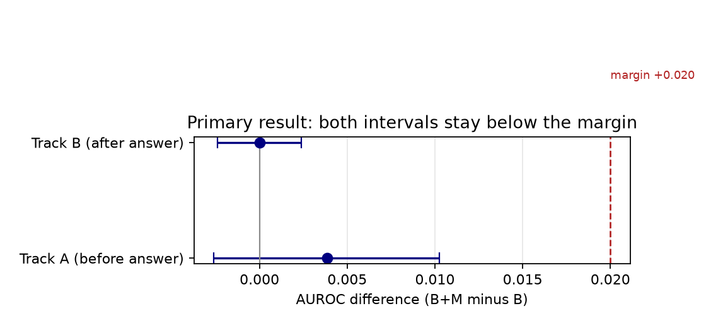
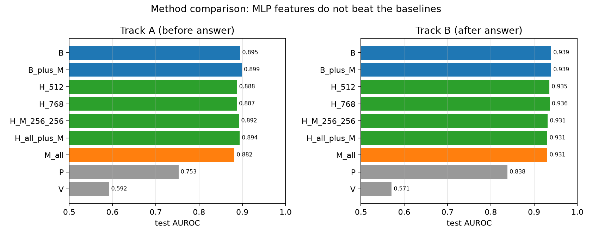
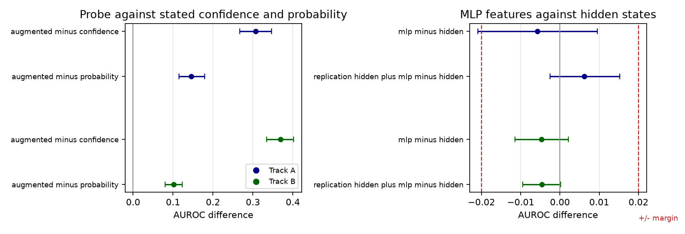
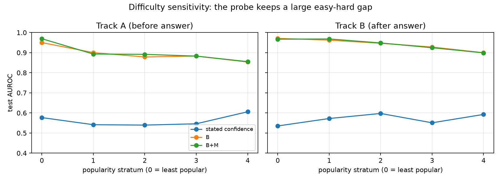
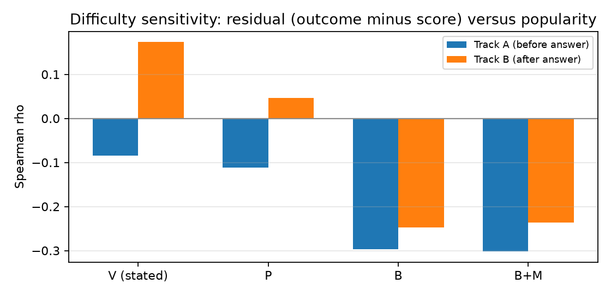
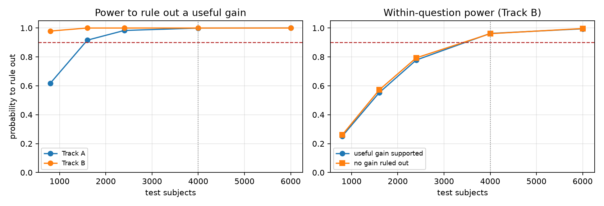

# Section 3.3 Confirmatory Report

## Do MLP interaction features improve model confidence?

**Run:** `runs/section33_confirmatory` (Qwen2.5-7B-Instruct)
**Date:** 9 October 2026
**Figures:** `report/figures/section33_confirmatory/`

---

## 1. Short answer

**No.** The MLP interaction features do not add a useful confidence signal.

The result is not "we cannot tell". The test is powerful. The result is
"a useful improvement is ruled out" on both tasks.

Two facts support this answer:

1. The full probe with MLP features (B+M) does not beat the probe without them (B).
2. A probe with MLP features only (M) is about equal to a probe with hidden
   states only (H). The MLP signal is real, but it is redundant.

The dot-product idea from section 3.3 is therefore not supported as a route to
better confidence. The signal exists, but hidden states already contain it.

---

## 2. What the experiment did

**Model.** Qwen2.5-7B-Instruct.

**Data.** A fresh Wikidata cohort. Four relations: father, mother, place of
birth, occupation. The cohort has 7,600 subjects. Each relation has 1,900
subjects. The test set has 4,000 subjects. The test set was not used to select
features, layers, or settings.

**Tasks.**

- **Track A (before answer).** The model gives one answer for each question.
  The probe predicts if this answer is correct.
- **Track B (after answer).** The model gives eight sampled answers for each
  question. The probe predicts if each sampled answer is correct.

**Probes.** A probe is a small model that reads internal features and predicts
correctness.

| Probe | Input |
| --- | --- |
| **V** | The stated confidence of the model (0 to 100) |
| **P** | Probability features from the model output |
| **H** | Hidden states from eight layers |
| **M** | MLP interaction features (dot products and mass summaries) |
| **B** | Metadata + P + H |
| **B+M** | B plus M |

**MLP interaction features (M).** These are the features that section 3.3
proposes:

- dot products between the hidden state and each column of the W2 matrix;
- the mass of each channel, that is `|s_j| * ||W2[:, j]||`;
- summaries of the mass distribution: entropy, top-1 mass, top-5 mass, and
  concentration measures.

**Decision rule (frozen before the test).** A useful gain needs two conditions:

- the lower bound of the AUROC interval is above **+0.020**; and
- the lower bound of the Brier interval is above **+0.005**.

If the upper bounds are below these margins, the experiment rules out a useful
gain.

---

## 3. Primary result

| Task | AUROC gain (B+M minus B) | 95% interval | Brier gain | 95% interval | Verdict |
| --- | --- | --- | --- | --- | --- |
| Track A | +0.0038 | [−0.0026, +0.0103] | +0.0008 | [−0.0006, +0.0022] | **useful improvement ruled out** |
| Track B | +0.0000 | [−0.0024, +0.0024] | +0.0018 | [+0.0004, +0.0032] | **useful improvement ruled out** |

The calibration guardrail passed on both tasks. On Track B, B+M is slightly
better calibrated than B (the guardrail interval is [−0.0029, −0.0004]).

**Interpretation.** Both intervals are tight and close to zero. The largest
possible gain is about +0.010 AUROC on Track A and +0.002 on Track B. These
values are below the margin of +0.020. The MLP features do not give a useful
improvement.

Method AUROC values (test set):

| Probe | Track A | Track B |
| --- | --- | --- |
| B | 0.895 | 0.940 |
| B+M | 0.899 | 0.940 |
| H (hidden only) | 0.888 | 0.936 |
| M (MLP only) | 0.882 | 0.931 |
| P (probability only) | 0.753 | 0.838 |
| V (stated confidence) | 0.592 | 0.571 |

The probe is much stronger than the stated confidence. However, the useful
signal comes from the hidden states and the probability features. It does not
come from the MLP interaction features.

---

## 4. The dot-product question

Section 3.3 makes a clear prediction:

> One dominant W2 column gives high confidence. Many equal columns give low
> confidence.

The experiment tests this prediction in two ways:

1. The `w2_literal` family measures the dot products and their summaries.
2. The `contribution_concentration` family measures the mass distribution:
   entropy, top-1 mass, top-5 mass, and concentration.

**Result.**

- The dot-product features predict correctness (AUROC 0.88 on Track A and 0.93
  on Track B). The signal is real.
- The signal is not better than hidden states. The difference M minus H is
  −0.0058 on Track A and −0.0047 on Track B.
- On Track B, M and H are practically equivalent (the interval [−0.0115,
  +0.0022] is inside the equivalence margin of ±0.020).
- When we add MLP features to the full hidden representation, the result gets
  slightly worse: −0.0046 on Track B (Holm-adjusted p = 0.020).

**Answer.** The dot-product distribution carries information about correctness.
However, the information is already present in the hidden states. The dominance
pattern is not a unique confidence signal.

---

## 5. Answers to each point in section 3.3

| Point in section 3.3 | Answer from the experiment |
| --- | --- |
| Train an auxiliary probe on MLP interaction features. | Done. The probe works (AUROC 0.88 and 0.93), but it is not better than hidden states. |
| Use dot products between the query and W2 columns. | Done. The dot-product features add no useful signal beyond the baseline. |
| One dominant column means high confidence. | The pattern predicts correctness, but the signal is redundant with hidden states. |
| A probe on this distribution could be independent of difficulty. | Not supported. The probe stays difficulty-sensitive. See section 6. |
| Learn the pattern across all layers by gradient descent. | Done. The probes use all layers and cross-layer aggregation. No gain. |
| Try a simple linear probe. | Done. This is the main result. |
| Try a nonlinear pooling mechanism. | Done (H_nonlinear). The nonlinear readout is worse (AUROC 0.82 on Track A). |
| Cross-layer aggregation is necessary. | Cross-layer aggregation is included in M and H. It does not give a gain over hidden states. |
| Key test: is the probe less sensitive to difficulty than stated confidence? | No. The probe is at least as sensitive, and our measure shows it is more sensitive. |
| Control for difficulty in training. | The baseline B contains difficulty metadata (relation and popularity stratum). The B+M minus B test therefore measures the added value beyond difficulty. |
| Preliminary test: is M comparable to H? | Yes, slightly below. The signal exists, but it is redundant. |
| Central thesis: confidence tracks difficulty. | Supported. Stated confidence is weak (AUROC 0.59 and 0.57). The strong probe keeps a large difficulty gap. |

---

## 6. Difficulty sensitivity

The experiment measures difficulty in two ways.

**Model-based difficulty.** A logistic model predicts correctness from metadata.
The table shows the probe AUROC for the easy half and the hard half.

| Task | Easy half | Hard half | Residual correlation with difficulty |
| --- | --- | --- | --- |
| Track A | 0.967 | 0.817 | −0.57 |
| Track B | 0.906 | 0.909 | −0.44 |

**Popularity-based difficulty.** The plot shows AUROC for each popularity
stratum. B and B+M are almost identical in every stratum.

**Residual versus popularity.** This plot shows the correlation between the
residual (outcome minus score) and popularity. A value far from zero means that
the score is difficulty-sensitive.

| Probe | Track A | Track B |
| --- | --- | --- |
| V (stated confidence) | −0.09 | +0.17 |
| P | −0.11 | +0.05 |
| B | −0.30 | −0.25 |
| B+M | −0.30 | −0.24 |

**Answer to the key test.** The MLP-augmented probe does not become less
sensitive to difficulty. It is more difficulty-sensitive than the stated
confidence on both tasks. Adding the MLP features does not change the
difficulty profile at all (B and B+M are nearly equal).

---

## 7. Why the result is reliable

- **Confirmatory design passed.** The cohort check reports all four relations,
  the exact split sizes, and no problems.
- **Frozen protocol.** The protocol hash and the prompt manifest match the
  frozen files.
- **Power.** At 4,000 test subjects, the probability to rule out a useful gain
  is 1.00 under the negligible alternative (Track A and Track B). For the
  within-question claim, the probability is 0.96.
- **All samples used.** Track B uses all eight draws for each question (32,000
  test rows). The multiplicity is expanded before fitting and scoring.
- **Corrected intervals.** Secondary intervals use the frozen family
  correction. The four AUROC p-values use Holm correction.
- **Audit passed.** No reference answer or label appears in a feature file.

---

## 8. Limits

- The result is for one model, Qwen2.5-7B-Instruct. The Mistral replication was
  not run.
- The result is for the frozen feature families. Other MLP summaries could
  behave differently.
- Track A has one answer for each subject. The within-question test therefore
  applies to Track B only.
- The difficulty measure is a proxy. The metadata model and the popularity
  strata do not cover all sources of difficulty.

---

## 9. Decision and next steps

**Decision.** Stop the MLP interaction probe as a route to better confidence.
The dot-product signal is real, but it is redundant with hidden states. It does
not pass the useful-improvement margin.

**What remains interesting.**

1. The probe is much stronger than the stated confidence (0.89 to 0.94 against
   0.59 to 0.57). This supports the central thesis that stated confidence is a
   weak signal.
2. The probe stays strongly difficulty-dependent. The difficulty problem is
   open.
3. The within-question gain is ruled out (interval [−0.024, +0.019], margin
   +0.030).

**Next steps.**

1. Run the Mistral replication, if the group wants a second model.
2. Review the literature on confidence for agents (section 5 of the notes).
3. Report the negative result. The preliminary test in section 4 asked if the
   MLP signal exists. It exists. The confirmatory test asked if the signal is
   useful beyond internal signals. It is not.
