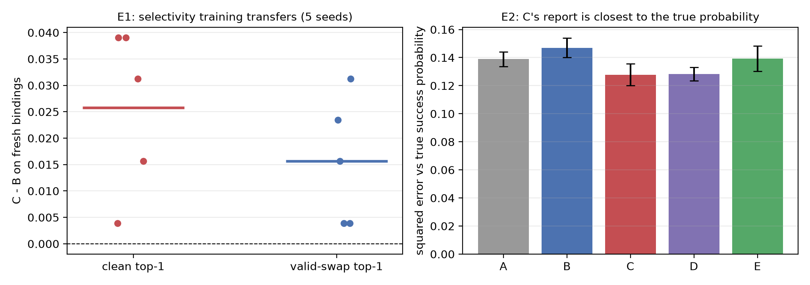
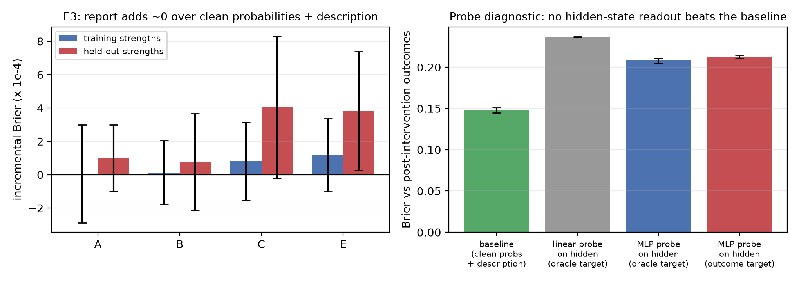

Selective MLP Retrieval for Metacognitive Confidence
Toy experiments E1-E3
15 October 2026
Complete for the toy stage. The added-information claim is not supported.

---

# 1. What we tested

The proposal asks whether training a functionally selective retrieval computation makes a model's own confidence report more useful. We built a controlled toy world with exact ground truth and ran three stages: **E1**, can selectivity be trained? **E2**, does the confidence report benefit? **E3**, can the report predict success *after a specified intervention* before the intervention is applied?

# 2. Toy world and model

Each subject is a sum of four relation components, `h_s = sum_r T_r v_a(s,r)`. The model sees the memory and the queried relation and must read only the queried component. Seven conditions (clean, irrelevant swap, target and irrelevant weakening, valid swap, coherent false memory, sham) have exact ground truth. To give E1 headroom, 30% of training bindings are spurious: all relations share the same answer, so unqueried components predict the queried one. A model trained only on clean data learns that shortcut; evaluation uses independent bindings where it fails.

The model is a one-layer gated-MLP decoder (width 32) with an answer head and a report head (2 x 256 MLP over a 21-point grid). Rank-8 adapters on the gate and up projections of the last block are the only trainable retrieval parameters; the base and down projections are frozen after a shared supervised warm start. A dense, overlapping, compressive encoding plus the width limit make selection non-trivial.

# 3. Training arms and objectives

All arms share the same reporting training. Arm A freezes retrieval; B trains it with the correctness reward; C adds the selectivity loss; D uses supervised retrieval plus selectivity; E adds the same extra data as C but no consistency term.

The answer policy is trained with correctness reward `J = E[Y] - beta KL(pi_theta || pi_ref)`, where `Y = 1[answer correct]` and `beta = 0.1`. The toy answer space is small, so `E[Y] = pi_theta(a_star | q, z)` is exact; the expected-reward gradient has the same expectation as a sampled policy gradient with no estimator variance. The selectivity loss pairs a binding `z` with one where all unqueried components are decorrelated (`T_irr z`):

`L_sel = E[-log pi(a_star | q, z)] + E[-log pi(a_star | q, T_irr z)] + eta KL(sg[pi(. | q, z)] || pi(. | q, T_irr z))`

Arm C minimizes `L_RL + lambda L_sel` (`lambda = 5`, `eta = 1`); the stop-gradient keeps the clean branch fixed. The report `c` predicts the probability that the next sampled answer is correct and is trained with the proper score `R(c, Y) = -(c - Y)^2` in risk form: squared error against the empirical mean of 8 draws from the frozen policy, on a stored rollout batch. Retrieval updates touch only the adapters; reporting updates only the report head.

# 4. E1: selectivity training transfers

On fresh bindings, C beats B on clean top-1 by +0.026 and on valid-swap following by +0.016, positive in all five seeds (Figure 1, left). Irrelevant-swap stability is unchanged. The S metric declines, but it is confounded here: weakening an unqueried component removes the shortcut that B relies on. Caveat: in E2, the matched-supervision arm E matches C on greedy accuracy, so the E1 gain is not yet attributable to the consistency term alone.

# 5. E2: no added reporting value

The ordinary baseline receives relation, top probability, entropy, and top-2 margin, but not the intervention identity; a privileged version is reported separately. Constant (0.5, train-rate) and recalibrated baselines are included, greedy and sampled success are separate, and false memories are evaluated separately.

| Arm | greedy | sampled | report | baseline | incremental | sq. prob. error |
| --- | --- | --- | --- | --- | --- | --- |
| A | 0.588 | 0.408 | 0.267 | 0.181 | +0.00049 | 0.139 |
| B | 0.617 | 0.439 | 0.276 | 0.183 | +0.00033 | 0.147 |
| C | 0.641 | 0.421 | 0.268 | 0.182 | +0.00038 | 0.128 |
| D | 0.638 | 0.419 | 0.269 | 0.181 | +0.00034 | 0.128 |
| E | 0.640 | 0.438 | 0.275 | 0.182 | +0.00049 | 0.139 |

The incremental Brier is negligible for every arm. C and D have the lowest squared probability error, in all five seeds (C - B -0.019, C - E -0.011), so selectivity training does move the report closer to the true success probability. But the reporter is weak in absolute terms: its raw Brier is worse than an always-0.5 predictor (0.250), and recalibration only brings it near the train-rate constant. C's greedy gain does not carry to sampled success, and E matches C. Coherent false memories stay confident (report about 0.19 vs actual 0.007).

# 6. E3: prospective reporting, fair comparison

The reporter sees the **clean** state and a description of an intervention that will be applied after the report (type and strength), and predicts success under the post-intervention policy. Both predictors receive the same description; neither sees the post-intervention state. Training covers weakening strengths 0.2, 0.5, 0.8 and swap scales 1, 2; evaluation adds held-out strengths 0.35, 0.65 and scale 3.

| Arm | report | baseline | incremental (test) | incremental (held-out) | sq. prob. error |
| --- | --- | --- | --- | --- | --- |
| A | 0.243 | 0.173 | +0.00000 | +0.00010 | 0.125 |
| B | 0.252 | 0.175 | +0.00001 | +0.00008 | 0.134 |
| C | 0.245 | 0.175 | +0.00008 | +0.00040 | 0.119 |
| E | 0.251 | 0.175 | +0.00012 | +0.00038 | 0.128 |

Incremental value is negligible everywhere, including held-out strengths and fresh bindings. C - B on held-out strengths is +0.00033 (5/5 seeds), but C - E is +0.00002 (2/5): that small gain comes from the extra supervision E also receives, not from the consistency objective. C's report again has the lowest squared probability error (0.119).

# 7. Why it failed, and conclusion

Can any readout of the clean hidden state plus the intervention description predict post-intervention success better than the baseline? Held-out-subject probes (1 seed, arms B/C/E):

| Predictor | Brier vs outcomes | Squared error vs true p |
| --- | --- | --- |
| baseline (clean probabilities + description) | 0.144-0.151 | 0.043-0.047 |
| linear probe on hidden + context | 0.236-0.237 | 0.130-0.139 |
| MLP probe, true-probability target | 0.204-0.211 | 0.102-0.107 |
| MLP probe, outcome-mean target (as the reporter sees) | 0.210-0.215 | 0.107-0.113 |

Even an MLP trained directly on the true post-intervention probability is far worse than the baseline: the clean state does not carry item-specific fragility in a readable way, so the E3 failure is representational for the tested readouts.

The added-information claim is not supported in the toy. Selectivity training improves retrieval on fresh bindings and moves the report closer to the true success probability, but adds no reporting information beyond clean probabilities plus the intervention description, and a real-model claim would need a state that carries item-specific fragility and a verbal report.
