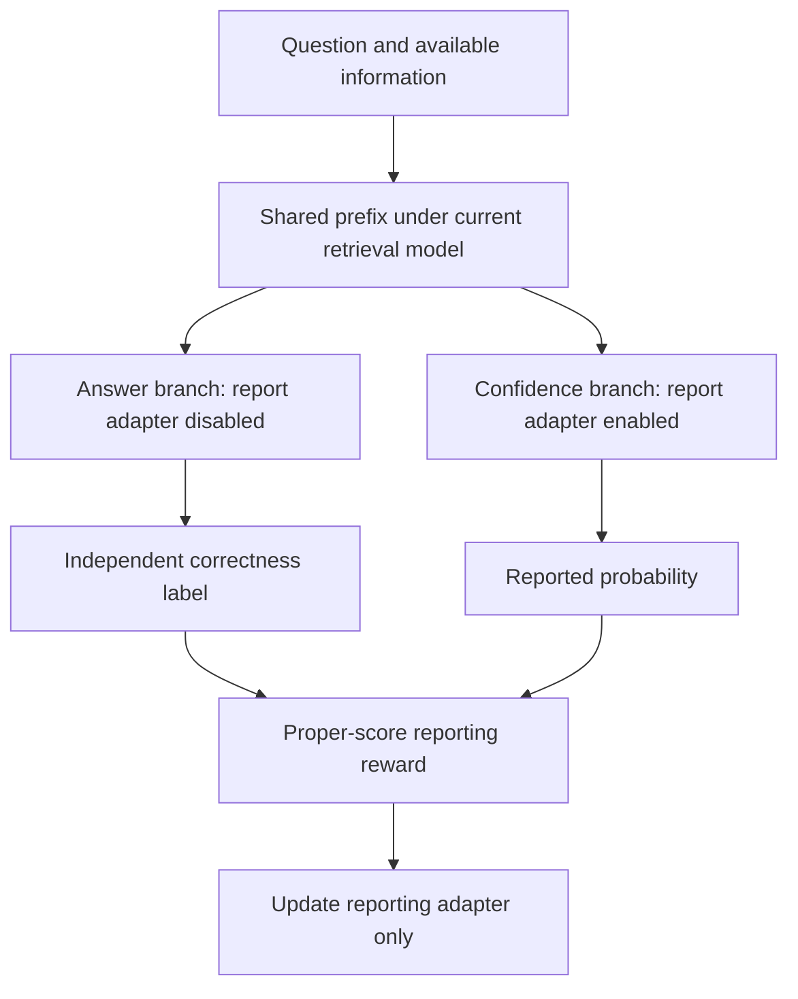

# Training Selective MLP Retrieval for Metacognitive Confidence

**Research proposal and experimental specification**  
**Date:** 12 October 2026  
**Status:** Proposed. No experiments in this document have been implemented or run.  
**Scope:** A comprehensive specification of the training direction summarized in [the consolidated research report](RETRIEVAL_MONITORING_PLAN.md).

> **Core question:** Can training an MLP to select task-relevant information make the model better at predicting when its own factual retrieval will succeed?

## Executive summary

We propose to train both a factual retrieval mechanism and a confidence-reporting channel. The retrieval component should select information relevant to the requested relation while resisting interference from other attributes. The reporting component should predict the probability that the current model will answer correctly.

The central hypothesis is that **a better-organized retrieval computation may make its reliability easier for the model to report**. This is stronger than asking whether existing MLP features correlate with correctness, but it is not established by the current evidence.

The recommended first method combines answer-correctness RL with a differentiable selectivity loss. Confidence training alternates with retrieval training, using independent answer outcomes from a temporarily frozen answer policy. Initially, confidence gradients do not change the answer policy.

Begin with a small synthetic model where relevant and irrelevant information are known by construction. Compare ordinary answer/confidence training with otherwise identical training that adds the selectivity objective. Include supervised training controls to establish whether RL itself contributes. Move to a pretrained model only after both functional selectivity and reporting benefits appear.

The strongest possible contribution would be evidence that training a particular retrieval computation improves transferable confidence beyond shared question difficulty, with causal tests linking the reporting benefit to that computation. Merely improving answer accuracy, increasing activation concentration, or obtaining better aggregate calibration is insufficient.

### Reading map

- Sections 1–3: motivation, existing evidence, and research claims.
- Sections 4–7: MLP quantities, architecture, objectives, and gradient paths.
- Sections 8–10: controlled task, training comparisons, and staged experiments.
- Sections 11–14: evaluation, causal controls, failure modes, and decision gates.
- Sections 15–18: implementation plan, novelty, references, and self-review.

## 1. Motivation and connection to the main research theme

The theme in [meet.md](../meet.md) is the distinction between shared question difficulty and a model's own ability to answer. Two models may find the same question familiar while differing in whether they can retrieve the right fact. A useful confidence report should reflect that difference.

The meeting proposed that interactions inside MLPs might provide a view of retrieval that ordinary confidence prompting fails to use. Existing experiments tested whether summaries of those interactions improve error prediction. This proposal changes the object of study: rather than only observe existing computations, train them and ask whether the resulting reliability becomes easier to report.

The meeting's stronger statements about architectural blindness and the complete removal of difficulty through bins should remain hypotheses. A residual stream can carry information about earlier computations, and popularity bins leave unmeasured difficulty variation.

### An intuitive example

Suppose a representation contains a person's birthplace, occupation, and parent. When asked for birthplace, a selective mechanism should retrieve birthplace without being distracted by the other attributes.

Now distinguish three events:

1. Occupation information changes, but birthplace information remains usable. The answer and its reliability should remain approximately stable.
2. Birthplace information becomes ambiguous or unavailable. Confidence should track the actual change in answer success.
3. Birthplace information is replaced by a coherent but false association. The model may have no internal evidence of the error. High confidence here is a limitation to measure, not a violation we can assume training will eliminate.

The target is accurate monitoring of available evidence and resulting competence. It is not an expectation that the model can identify every false memory without additional information.

## 2. What existing evidence supports—and what it does not

### 2.1 Frozen MLP summaries did not add a useful predictive gain

The [Section 3.3 confirmatory report](SECTION_3_3_CONFIRMATORY_REPORT.md) compared a baseline containing metadata, output-probability features, and hidden states with the same baseline plus MLP interaction summaries.

| Task | AUROC gain from adding MLP summaries | 95% interval | Brier improvement | 95% interval |
|---|---:|---:|---:|---:|
| Before answering | +0.0038 | [−0.0026, +0.0103] | +0.0008 | [−0.0006, +0.0022] |
| After answering | Approximately 0 | [−0.0024, +0.0024] | +0.0018 | [+0.0004, +0.0032] |

The registered useful-effect thresholds were not met. These results argue against another broad search over similar summaries in the unchanged model.

They do not establish that MLP parameters cannot be trained to improve retrieval, that every possible MLP observer is redundant, or that training cannot make useful information more accessible to a reporting channel.

This proposal must earn its support through new experiments. The old null result is not evidence in favor of the new training hypothesis.

### 2.2 The S3 intervention failed its original selectivity gate

The [saved S3 report](../runs/section33_v1/retrieval_monitoring/selectivity_report.json) used Qwen2.5-7B-Instruct, layer 8, and attenuation coefficient 25.

| Quantity | Estimate | 95% interval | Original required mean |
|---|---:|---:|---:|
| Relevant-map damage | +0.0172 | [0.0031, 0.0328] | At least 0.05 |
| Other-map damage | +0.0266 | [0.0094, 0.0469] | — |
| Random damage | +0.0094 | [−0.0125, 0.0313] | — |
| Relevant minus random damage | +0.0078 | [−0.0078, 0.0250] | At least 0.03 |

Both gates failed. Clean success was 0.2375, and 0.5375 of subject/relation cells had zero clean success. The exploratory 33-cell headroom subset did not rescue selectivity.

This failed manipulation must not be used as a validated training signal. The original M1–M3 program remains on hold. The proposed experiments below introduce a different training hypothesis and require their own validation.

Additional projection-variance and donor-patching diagnostics were supplied in the discussion; their full artifacts were not located in the saved pilot directory. They motivate caution but should retain that provenance.

### 2.3 What the geometric recall paper contributes

[Geometric Factual Recall in Transformers](https://arxiv.org/html/2605.12426v1) develops a controlled setting in which structured representations encode multiple attributes and an MLP selects the requested one. It studies learned solutions, interventions, and transfer to new factual assignments.

The paper uses language-model training, not RL. Its pretrained-model probing does not establish that the same causal mechanism operates in Qwen.

Our extension is therefore a proposed training-and-monitoring study: test whether encouraging functional selection improves the model's ability to report its own reliability. We must validate that extension separately.

## 3. Hypotheses and possible contributions

| Hypothesis | Required evidence | Evidence that would not suffice |
|---|---|---|
| H1: Selection can be trained | Better correct retrieval and invariance to irrelevant changes on held-out cases | Lower channel entropy |
| H2: Selection training improves reporting | Better prospective confidence than ordinary answer/confidence training | Better factual accuracy alone |
| H3: The benefit is model-specific | Reports track different competence states for identical questions, beyond tested controls | Higher population AUROC |
| H4: The trained computation contributes causally | Controlled removal/restoration changes the benefit in a specific, reproducible way | Correlation with an MLP statistic |
| H5: RL offers an advantage | Better results or efficiency than an appropriately matched supervised alternative | Success of one RL run |

H1 and H2 are the minimum scientific target. H3 connects the result to meet.md. H4 supports a mechanistic interpretation. H5 is a separate claim and may fail while the broader training idea remains useful.

A restrained candidate paper claim is:

> Training functionally selective retrieval improves prospective confidence about the model's own factual success, including under held-out changes in available knowledge.

Do not claim that MLPs encode truth intrinsically, that confidence becomes independent of all difficulty, or that these experiments establish privileged introspective access.

## 4. What “MLP selectivity” means

### 4.1 Actual channel contributions in a gated MLP

For normalized input \(x\), the Qwen-style gated MLP computes

\[
a=W_{\mathrm{gate}}x,\qquad b=W_{\mathrm{up}}x,
\]

\[
s=\operatorname{SiLU}(a)\odot b,\qquad
o=W_{\mathrm{down}}s.
\]

For channel \(j\), define

\[
v_j=W_{\mathrm{down}}[:,j],\qquad
u_j=s_jv_j,\qquad
e_j=\|u_j\|_2=|s_j|\|v_j\|_2.
\]

These definitions match [the existing feature implementation](../section33/features/mlp_math.py).

| Quantity | Interpretation | Limitation |
|---|---|---|
| \(s_j\) | Signed channel coefficient | Large magnitude does not establish correctness |
| \(u_j\) | Channel's vector contribution | Contributions can reinforce or cancel |
| \(e_j\) | Contribution magnitude | Loses sign and direction |
| \(x^\top v_j\) | Input/write-vector similarity | Not the channel-selection coefficient |
| \(x^\top u_j\) | Signed input/contribution alignment | Not inherently alignment with the correct answer |

The raw \(x^\top v_j\) statistic is sensitive to parameterization. For example, scaling a row of \(W_{\mathrm{up}}\) by a positive constant and inversely scaling the corresponding column of \(W_{\mathrm{down}}\) preserves \(u_j\) while changing \(x^\top v_j\).

Contribution mass avoids that particular scaling problem, but it still does not measure truth.

### 4.2 Three distinct notions

**Concentration:** A few channels carry most measured contribution mass.

**Functional selectivity:** The computation uses information relevant to the requested relation while resisting irrelevant information.

**Metacognitive reliability:** The reported probability predicts the current model's chance of answering correctly.

Concentration is a diagnostic. Functional selectivity is a training/evaluation target. Metacognitive reliability is the main research outcome.

No objective should simply make all correct items concentrated and all incorrect items diffuse. Such a loss could create a training-label marker rather than a general retrieval mechanism.

### 4.3 Measure at a causally appropriate position

A subject token that occurs before the requested relation cannot condition on that later relation in a causal decoder.

Start at the final question position, where both subject and relation are available. Earlier subject states can be studied as storage representations, but their activity should not be interpreted as selection conditioned on unseen text.

Layer choice must be made on development data. A layer selected for strong frozen probing is not automatically the best intervention or training site.

## 5. Prediction target and architecture

### 5.1 Define exactly what confidence predicts

Let:

- \(q\): question;
- \(z\): available internal information or experimental condition;
- \(\theta\): current answer-policy parameters;
- \(\tau\): fixed decoding configuration;
- \(A\sim\pi_{\theta,\tau}(\cdot\mid q,z)\): generated answer;
- \(Y=\mathbf{1}\{A\text{ satisfies the audited answer policy}\}\).

The prospective target is

\[
p_{\theta,\tau}(q,z)
=\Pr(Y=1\mid q,z,\theta,\tau).
\]

The report \(c\in[0,1]\) predicts this probability before observing the answer draw. It does not predict generic answerability, answer agreement, or a different checkpoint's success.

Specify temperature, top-p, maximum answer length, aliases, and abstention handling. Changing these can change the target probability.

### 5.2 Initial trainable components

| Component | Initial treatment | Purpose |
|---|---|---|
| Selected MLP gate/up matrices | Small adapters | Change selection coefficients |
| MLP down matrices | Frozen | Limit simultaneous changes to write vectors |
| Other answer-model weights | Frozen | Restrict the initial intervention |
| Reporting adapter | Trainable only during reporting updates | Produce a verbal probability |
| Optional observer head | Diagnostic, separately labeled | Test whether reliability information is available |

For a pretrained pilot, start with rank-8 adapters at one or two development-selected layers. Restricting updates to gate/up matrices encourages a selection-focused experiment, but does not prove the resulting change is exclusively routing.

All non-frozen retrieval arms must use the same trainable parameter set in the primary comparison. A later capacity-matched adapter at other sites can test whether the location matters.

### 5.3 Separate answer and report branches



The report must not enter the answer branch. Gold answers, correctness labels, condition names, and sampled answer text must not enter the prospective reporting branch.

A practical branch implementation can reuse a frozen prefix cache and train a reporting adapter on suffix computation. Verify that the adapter can access the necessary prefix information; success is not guaranteed. Gradient checks and full-run/cache equivalence checks are required.

An external scalar head is an acceptable feasibility diagnostic, but it is not a native verbal-confidence result. If the final method injects MLP features into a special observer, disclose the architecture change and compare an otherwise identical observer receiving hidden states.

## 6. Training objectives and credit assignment

### 6.1 Retrieval update

Optimize the answer policy using verified correctness:

\[
J_{\mathrm{answer}}(\theta)
=
\mathbb{E}_{A\sim\pi_\theta}[Y]
-\beta\,\mathcal{K}(\pi_\theta,\pi_{\mathrm{ref}}).
\]

Here \(\mathcal{K}\) is a specified policy-divergence penalty. It is an optimization constraint, not evidence that general capabilities are preserved.

Use an ordinary policy-gradient method, such as a GRPO-style implementation, with its estimator and normalization documented. The optimizer is not itself the proposed novelty.

Add a direct selectivity loss:

\[
\mathcal{L}_{\mathrm{retrieval}}
=
\mathcal{L}_{\mathrm{RL}}
+\lambda_{\mathrm{sel}}\mathcal{L}_{\mathrm{sel}}.
\]

### 6.2 A concrete selectivity loss

In the controlled task, let \(z\) be a clean memory and \(T_{\mathrm{irr}}z\) change an irrelevant attribute without changing the correct answer \(a^\star\).

One starting objective is

\[
\mathcal{L}_{\mathrm{sel}}
=
\mathbb{E}\left[-\log \pi_\theta(a^\star\mid q,z)\right]
+
\mathbb{E}\left[-\log \pi_\theta(a^\star\mid q,T_{\mathrm{irr}}z)\right]
+
\eta\,D_{\mathrm{KL}}\left(
\operatorname{sg}[\pi_\theta(\cdot\mid q,z)]
\;\|\;
\pi_\theta(\cdot\mid q,T_{\mathrm{irr}}z)
\right).
\]

The stop-gradient operator \(\operatorname{sg}\) prevents the reference branch from moving merely to satisfy the consistency term during that update. Correctness anchors remain necessary: agreement between two wrong constant outputs is not useful selectivity.

For valid alternate worlds, an additional supervised term can reward the new, explicitly defined correct answer. Never silently treat an internal corruption as a change in external truth.

This expression is directly tractable for the toy task's one-token answer space. For natural multi-token answers, specify whether consistency is measured at the first token, over teacher-forced token distributions, or over sampled semantic answers. These are different objectives; a first-token proxy is not whole-answer invariance.

Gold targets are allowed for training losses and evaluation. They are forbidden as prospective inference-time features. This distinction avoids repeating the previous oracle-feature problem.

**Fairness control:** The augmented arm receives extra supervised information through this objective. Add a control with the same cross-entropy terms and examples but no structured invariance term. Otherwise a gain could result from extra labels or updates rather than selective training.

### 6.3 Reporting update

Freeze the current answer policy and obtain independent Bernoulli outcomes. Reward a verbal report using

\[
R_{\mathrm{conf}}(c,Y)=-(c-Y)^2.
\]

For a fixed prediction event with success probability \(p\),

\[
\mathbb{E}[(c-Y)^2]=(c-p)^2+p(1-p).
\]

Thus the unconstrained expected optimum is \(c=p\). This is a conditional property of the score, not a guarantee that a finite model learns it or generalizes.

Using \(K\) independent outcomes, the reporting reward can be averaged:

\[
\widehat{R}_{\mathrm{conf}}
=-\frac{1}{K}\sum_{k=1}^{K}(c-Y_k)^2.
\]

For a fixed set of outcomes, this differs from \(-(c-\bar Y)^2\) only by a term independent of \(c\). Use fresh outcomes for final evaluation.

For verbal reports, start with a predefined numerical grid and document its resolution. Properness is then constrained by that grid. Validate parsing and do not silently discard malformed reports.

To preserve the stated reporting objective, begin with an unnormalized reward and an action-independent baseline, such as a suitable leave-one-out baseline. Reward-dependent group standardization can change the effective objective. Clipping, KL regularization, finite optimization, and restricted report vocabularies also mean that the proper-score optimum is a target, not an exact property of the trained policy.

### 6.4 Why a detached pre-answer mass reward can fail

Suppose \(g_\theta(q)\) is computed before any answer tokens are sampled, with deterministic inference. Every completion in a GRPO group receives the same geometric bonus:

\[
r_i=r_i^{\mathrm{task}}+\alpha g_\theta(q).
\]

Group centering gives

\[
r_i-\bar r=r_i^{\mathrm{task}}-\bar r^{\mathrm{task}}.
\]

The bonus cancels. Under a score-function estimator, an action-independent detached reward also has zero expected policy-gradient contribution.

The fact that \(g_\theta\) depends on parameters does not fix this if the reward is detached. Direct differentiation would add a separate gradient path; that is an auxiliary optimization term.

Generated-token features can vary across trajectories and avoid this exact cancellation. They introduce different issues: answer-dependent reward gaming and a change from prospective to trajectory-conditioned measurement.

### 6.5 Keep the gradient paths explicit

| Signal | Updates retrieval adapters? | Updates reporting adapter? |
|---|---:|---:|
| Answer correctness RL | Yes | No |
| Differentiable selectivity loss | Yes | No |
| Proper-score report reward | No, in the initial method | Yes |
| Logged mass/dot-product summaries | No | No |
| Diagnostic probe loss | No | Diagnostic probe only |

Alternating updates are a deliberate identification choice. They let us ask whether changing retrieval makes reporting easier without allowing the report objective to reshape its own target.

A later joint-gradient variant may be informative, but it is a separate ablation with a moving prediction target and stronger opportunities for artificial coding.

### 6.6 Alternating training procedure

```text
Initialize all retrieval arms from the same warm-start model.
Initialize reporting adapters using the same procedure.

For each planned training round:
    1. Update the permitted retrieval parameters using that arm's objective.
    2. Freeze the resulting answer-policy snapshot.
    3. Generate fresh answer outcomes under the declared decoding policy.
    4. Train the reporting adapter against those outcomes.
    5. Evaluate on development subjects and conditions.

At the final checkpoint:
    Freeze all parameters.
    Collect fresh test answers and confidence reports.
    Evaluate using the prespecified analysis.
```

Log snapshot IDs with all reporting labels. Mixing outcomes from old checkpoints with new reports changes the target and can create spurious calibration errors.

## 7. A more direct RL extension: stochastic routing

An optional extension makes routing decisions actual policy actions.

Let a controller sample a mask \(m\) over channel groups:

\[
m\sim\rho_\psi(\cdot\mid x),\qquad
o=W_{\mathrm{down}}(m\odot s).
\]

Because masks vary, answer outcomes can assign credit to routing choices:

\[
\nabla_\psi J
=
\mathbb{E}\left[
(R-b(x))\nabla_\psi\log\rho_\psi(m\mid x)
\right].
\]

Begin with grouped channels and an explicit activity budget, rather than independently sampling thousands of neuron decisions. Correctness and irrelevant-change robustness should anchor the routing reward. A budget prevents the controller from winning simply by activating everything.

Two confidence targets are possible: success conditional on a sampled mask, or success marginalized over the routing policy. Choose one and keep the report's information access consistent with it.

If calibration reward is also used to update routing, report separate results because the router may select easier-to-predict behaviors. Initially update routing from task reward and train confidence against frozen-router outcomes.

This is a larger architectural change with potentially high variance and inference cost. It should follow, not precede, a successful simpler experiment. Neither learned masking nor policy gradients alone should be claimed as novel.

## 8. Controlled task and intervention semantics

### 8.1 Suggested toy world

Use approximately 512 subjects, four relations, and a shared pool of answer symbols. A concrete initial choice is 128 possible answers and a 256-dimensional memory representation. These are development defaults, not optimized settings.

Construct memory from relation-specific components:

\[
h_s=\sum_{r=1}^{R}T_r v_{a(s,r)},
\]

where \(v_a\) is an answer code and \(T_r\) embeds it into a known relation-specific subspace. Supply the memory through a fixed memory-token representation in a small decoder.

The model sees the memory and requested relation, but not labels identifying interventions. The selector must extract the relevant attribute; the evaluator knows the construction.

This deliberately provides structure to test learnability. It does not show that ordinary pretraining produces that structure. A later overlapping-subspace or learned-encoding version can test robustness to weaker assumptions.

Use multiple worlds or periodically resampled bindings during training. Otherwise the model could memorize subject/relation answers and bypass the manipulated memory. Hold out subjects and entirely fresh assignments for evaluation.

Give all arms the same short supervised warm start if random initialization makes correctness rewards too sparse. Keep the memory encoding fixed during this warm start, then freeze the shared down projection and other non-target parameters before the comparison. Select a development regime with both successes and failures; a perfect selector on every condition provides little information about confidence discrimination.

### 8.2 Conditions

| Condition | Change | Ground truth | Expected interpretation |
|---|---|---|---|
| Clean | None | Original world | Baseline retrieval |
| Irrelevant swap | Replace an unqueried component | Unchanged | Should preserve the requested answer |
| Target weakening | Attenuate or obscure queried information | Unchanged | Measure success loss; do not prescribe it |
| Irrelevant weakening | Equally weaken an unqueried component | Unchanged | Control for generic damage |
| Valid target swap | Replace target component and update the declared world | New world | Correct answer changes; confidence need not fall |
| Coherent false memory | Replace target component, keep original world | Original world | May be internally undetectable |
| Sham/random control | Matched nuisance change | Unchanged | Test generic anomaly sensitivity |

Use matched component energies, randomized locations, and norm controls. Avoid a visible missingness flag present only in hard examples. Include harmless perturbations as well as harmful ones, so “some intervention happened” is not sufficient.

Normalization can alter effective component strengths. Record the actual representation fed to the model and validate each transformation numerically.

### 8.3 Avoid a trivial confidence task

Do not let corruption strength alone determine correctness. Mix examples where the same nominal strength has different behavioral effects. Include clean failures and perturbed successes.

Fresh assignments prevent the reporter from learning a table of subject-level success rates. Matched irrelevant perturbations test whether it recognizes the relevance of missing information.

The coherent-false-memory condition is a boundary test. If its observable internal state is indistinguishable from a valid world, demanding different confidence is not an identifiable task.

## 9. Training arms and essential controls

Use the same confidence-training algorithm, report format, and reporting budget across the primary retrieval comparison.

| Arm | Retrieval update | Confidence update | Purpose |
|---|---|---|---|
| A: Frozen retrieval | None | Proper-score reporting training | Baseline learnability |
| B: Ordinary RL | Correctness RL | Same reporting training | Generic task-training benefit |
| C: Selectivity hybrid | B plus direct selectivity loss | Same reporting training | Proposed method |
| D: Supervised selector | Supervised retrieval plus selectivity loss | Same reporting training | Whether retrieval RL is necessary |
| E: Matched supervision | B plus matched supervised examples/updates, without structured invariance | Same reporting training | Extra-label/compute control |

Keep the untouched model as an additional reference.

Run A–D for the first feasibility comparison. If C improves over B, E is required before attributing that difference to functional selectivity rather than extra supervision. A shuffled relation/counterfactual pairing control can further test whether the structure matters.

A fully supervised confidence reporter is a separate follow-up. Changing both retrieval and reporting optimization in D would confound the specific question of whether retrieval RL helps.

Report two comparisons where feasible: equal data/supervision and equal measured compute. Do not assert that examples, parameter count, optimizer steps, and FLOPs are simultaneously matched when they are not.

## 10. Staged small experiments

### E0 — Data and branch contract

**Question:** Do answer and confidence refer to the same task and internal condition?

Audit answer references and aliases. Use a valid common prompt and inspect complete generations. Check masks, positions, cache equivalence, and absence of gold/answer leakage.

The existing collector passes a bare relation question to the answer suffix but a named question to the confidence suffix. Under subject-prefix intervention, that can reintroduce clean subject information to one branch. Fix this before reusing that apparatus.

For the new architecture, verify by parameter snapshots or gradient checks that reporting updates cannot change the answer policy.

**Proceed when:** The prediction event and branch contract are correct. Parser success alone is insufficient.

### E1 — Can selective retrieval be learned?

Train the toy selector under B and C first, using three seeds. Use the same clean starting model and the same exposure to factual bindings.

Evaluate on fresh assignments and held-out interventions. Measure correct-answer probability, irrelevant-change stability, and response to valid target swaps.

**Proceed when:** C improves functional selectivity without winning through constant outputs, answer memorization, or a large clean-accuracy loss.

### E2 — Does confidence benefit?

Add A and D; train equivalent reporters for all arms. Collect fresh independent answers for evaluation.

The primary comparison is C versus B. The practical question is whether confidence gains remain after accounting for differences in the answer tasks' difficulty and base success rates.

**Proceed when:** Reporting improves on held-out cases and same-question conditions, with evidence beyond merely increasing accuracy. If C wins, run E before interpreting the mechanism.

### E3 — Does the reporter use the trained computation?

Perform held-out attenuation/restoration tests at the proposed selection site. Compare with sham and matched random interventions. Refit hidden-state and MLP-feature probes separately for each checkpoint.

Where report-only feature access exists, shuffle features between difficulty-matched examples. This tests feature use by that observer, not automatically use by the native model.

**Proceed when:** Evidence supports a specific dependence rather than generic damage detection. Treat mediation claims as stronger than simple ablation evidence.

### E4 — Pretrained-model pilot

Use one 0.5B–3B model, approximately 400 audited subjects, and two unambiguous relations per subject. Split subjects into 240 train, 80 development, and 80 test.

Start with B and C, using gate/up adapters in no more than two layers. Run a parameter/label-matched control if a gain appears.

First validate the real-model perturbation or supervision source. The exact toy components do not automatically exist in Qwen. If no defensible relation-selective manipulation can be established, the natural-model mechanistic test is blocked; an output-level robustness experiment supports a weaker claim.

For eight independent answer draws per question:

| Split | Questions | Answer draws per model |
|---|---:|---:|
| Train, if evaluated | 480 | 3,840 |
| Development | 160 | 1,280 |
| Test | 160 | 1,280 |
| All splits | 800 | 6,400 |

These counts exclude training rollouts, confidence generations, interventions, and repeated seeds. Test-only evaluation needs 1,280 answer draws per model. Across two arms and three seeds, that is 7,680 test answer draws, before additional conditions.

This pilot has only 80 test subjects and may be inconclusive. Do not present generation count as independent sample size.

### E5 — Competence-transfer evaluation

Train complementary knowledge updates on two copies, balancing subject exposure, relation frequency, answer vocabulary, and optimization budget. Test a frozen reporter on new assignments.

Both copies answer identical questions. Verify competence reversal from actual answers; do not infer it from exposure. Supply no checkpoint ID to the reporter.

This evaluation is not novel by itself. Its role is to test whether the proposed training improves reporting transfer when model-specific competence changes.

### E6 — Optional routing-policy extension

Only after E1–E3 support the simpler hypothesis, test stochastic routing against deterministic gate/up training at matched task and inference budgets.

Stop if variance, compute, or routing instability overwhelms the benefit. A more complex RL method is not an improvement merely because it makes routing an explicit action.

## 11. Evaluation and statistical analysis

### 11.1 Primary reporting endpoint

For a frozen checkpoint, compute

\[
\mathrm{BS}
=
\frac{1}{N}\sum_i
\frac{1}{K_i}\sum_k(c_i-Y_{ik})^2.
\]

Average within question/condition and then within subject using prespecified weights. Report all invalid confidence outputs and a prespecified scoring/fallback policy; do not evaluate only successfully parsed rows.

For within-policy baselines, report incremental Brier improvement from adding native confidence to a development-fitted predictor using metadata and prospective output-probability features.

Use independent RNG streams for answer draws and reporting samples. For stochastic reporting, preregister whether evaluation uses one sampled report, a deterministic report, or the mean of several reports; these have different inference costs and prediction distributions.

When comparing retrieval policies with different success probabilities, raw Brier can change because \(p(1-p)\) changes. Therefore report accuracy, resolution/reliability diagnostics, same-question condition tracking, and baseline-adjusted gains alongside the raw score.

### 11.2 An estimate of squared probability error

With at least two independent evaluation draws per item, an unbiased estimator of \((c_i-p_i)^2\), conditional on the frozen policy and report, is

\[
\widehat{E}_i
=
c_i^2-2c_i\bar Y_i+
\frac{1}{K_i(K_i-1)}
\sum_{k\ne l}Y_{ik}Y_{il}.
\]

This removes the Bernoulli outcome-variance term in expectation. It can be negative for individual items and noisy at small \(K_i\); use aggregated estimates and intervals, not clipped item scores.

It is an additional diagnostic, not a cure for distribution differences between trained policies. All evaluation draws must be independent of report fitting and report selection.

### 11.3 Functional selectivity endpoints

Report the components separately:

- Clean correctness.
- Correctness under irrelevant changes.
- Correctness in valid swapped worlds.
- Output-distribution changes under irrelevant interventions.
- Success and confidence changes under target weakening.
- Same quantities under sham and random controls.

A useful diagnostic is

\[
S=
(p_{\mathrm{clean}}-p_{\mathrm{target\ weakened}})
-
(p_{\mathrm{clean}}-p_{\mathrm{irrelevant\ weakened}}).
\]

This measures relative sensitivity in the specified task. It must not become a training reward that can be increased by deliberately damaging target-weakened performance. It is also not comparable across arbitrary perturbation scales without controls.

### 11.4 Beyond shared difficulty

Use subject-disjoint training, popularity/relation bins, metadata predictors, and same-question comparisons across competence states.

If multi-model data are used to estimate shared difficulty, exclude the target model from its own difficulty estimate. Fit bins and predictors without test outcomes.

Measure whether confidence differences track differences in independent success rates for the same question. Include a question-only predictor, checkpoint-wide offsets, prospective logit features, and hidden-state reporters.

Within-bin AUROC is secondary and requires both outcome classes. Report how many bins/cells are estimable and their weighting. Difficulty matching controls observed covariates; it is not a proof that every difficulty cue has been removed.

### 11.5 Uncertainty and multiplicity

Resample subjects with their conditions and draws kept together. Account for shared synthetic worlds, donors, or assignment seeds when those create dependence.

Report per-seed results as well as aggregate uncertainty. Three seeds are a feasibility convention, not a precise estimate of training variance.

Prespecify the main comparison and practical-effect margin. Treat layer searches, feature screens, and additional metrics as development/exploratory work unless independently confirmed.

## 12. Causal and transfer controls

| Alternative explanation | Required control |
|---|---|
| More labels or optimizer steps | Arm E and measured compute |
| Higher answer accuracy alone | Probability-error analysis, same-question tests, baseline-adjusted reporting gains |
| A generic “perturbed” detector | Harmless interventions and matched random/sham changes |
| Popularity or relation shortcut | Subject holdouts, bins, identical-question competence comparisons |
| Reporter memorizes facts | New bindings/worlds and reporting-supervision holdouts |
| Artificial scalar code | Held-out intervention families and functional-selection evidence |
| MLP location is incidental | Capacity-matched update at another site |
| External feature access explains gain | Matched hidden-state observer and native-report result |
| Confidence is willingness to answer | Separate belief reports from decision stakes for a fixed answer policy |

For restoration experiments, verify that restoration recovers the intended computation rather than merely adding a large generic residual vector. A successful rescue strengthens evidence but does not by itself identify a unique causal pathway.

If changing the shared computation changes both answers and confidence, test whether confidence follows the new success probability. Do not interpret this alone as a confidence-specific pathway dissociation.

## 13. Failure modes and interpretation

| Observed result | Supported interpretation | Next action |
|---|---|---|
| Mass becomes concentrated; selectivity unchanged | A geometric statistic was optimized | Reject concentration as the mechanism |
| Selectivity improves; reporting does not | Better retrieval without learned monitoring benefit | Stop the metacognition claim |
| Confidence improves equally in B and C | Ordinary task/report training may explain the gain | Do not claim selectivity adds value |
| C beats B but not E | Extra supervision is sufficient | Revise the method claim |
| D matches or beats C | RL is not necessary for the observed effect | Prefer the simpler training route |
| External probe improves; native report does not | Information is accessible to that observer | Investigate the reporting interface |
| Confidence detects all interventions equally | Anomaly sensitivity remains sufficient | Strengthen harmless-change controls |
| Confidence transfers only to familiar assignments | Memorization or narrow adaptation | Restrict the scope |
| Coherent wrong memories remain confident | Stability and truth remain separable | Report this boundary explicitly |
| Real-model interventions fail validation | Toy mechanism has not transferred | Stop the real-model causal claim |

A null result should identify which link failed: training selection, exposing reliability, reporting it, or generalizing beyond the training conditions.

## 14. Decision gates and stopping rules

These are new proposed gates. They do not replace the failed S3 thresholds.

| Gate | Pass requirement |
|---|---|
| G0: Task validity | Audited scoring, shared prediction event, no information leakage |
| G1: Mechanism feasibility | Held-out functional-selectivity improvement with acceptable clean performance |
| G2: Reporting benefit | C improves over B beyond accuracy-only explanations |
| G3: Attribution | Extra-supervision and anomaly controls do not explain the gain |
| G4: Transfer | Benefit survives held-out subjects, assignments, and at least one meaningful condition shift |
| G5: Real-model claim | Natural-model manipulation and reporting interface independently validated |

Choose practical-effect margins and acceptable accuracy loss using development evidence before test evaluation. Report both the estimated effect and its uncertainty relative to those margins.

An interval spanning useful and negligible effects is inconclusive. It should trigger a prespecified follow-up sample-size decision, not a post hoc success label.

Do not expand to many models, layer sweeps, or architectural variants after a clear G1/G2 failure. Revisit the hypothesis explicitly before spending more compute.

## 15. Implementation plan and artifacts

### 15.1 Reuse with care

The existing [retrieval_monitoring package](../retrieval_monitoring/README.md) provides retained-state, evaluation, and toy-world components. Its old relation-map attenuation workflow is not the new method.

The [MLP feature utilities](../section33/features/mlp_math.py) can supply diagnostics. Full per-channel tensors are large; initially save scalar summaries and a prespecified small diagnostic subset.

### 15.2 Proposed additions—not existing files

A future implementation could contain:

- A controlled-world generator with explicit ground-truth semantics.
- A registry of relevant, irrelevant, sham, and random transformations.
- Gate/up adapter configuration and gradient-isolation checks.
- Retrieval RL and direct selectivity-loss implementations.
- A branch-isolated confidence trainer.
- A rollout store keyed by checkpoint, subject, condition, and decoding policy.
- An evaluation script that reproduces primary tables from saved rows.
- A manifest recording datasets, seeds, splits, hyperparameters, and compute.

Keep this work separate from the failed S3 runner until the new contracts are tested.

### 15.3 Required saved fields

At minimum record: experiment/arm ID; model and adapter hashes; training/world seed; subject and relation; split; factual-world version; condition and strength; layer/site; decoding settings; answer text; correctness and scoring provenance; confidence text and parsed value; parsing validity; rollout seed; reporting-label snapshot; and diagnostic-feature version.

Do not overwrite old pilot rows or relabel old failure as a new successful intervention.

### 15.4 Verification before substantive runs

Check mathematical interventions against their intended world semantics; disjoint splits; cache/mask equivalence; confidence-to-answer isolation; parameter gradient scopes; score parsing; and recomputation of metrics from saved rows.

Test the geometric reward cancellation on a toy batch so the implementation cannot silently treat a constant reward as a useful shaping signal. Check that the direct selectivity loss produces gradients in the intended matrices.

### 15.5 Intended deliverables

The first milestone should produce a reproducible toy comparison, not a large model claim: configuration, saved outcomes, training curves, functional-selectivity table, confidence table, and failure analysis.

Useful figures are a computation diagram, selectivity-versus-reporting gains by seed, paired confidence/success changes for identical questions, and a hard-case plot separating stable wrong answers from unstable retrieval.

## 16. Novelty boundaries and closest work

| Prior work | Relevant precedent | What this proposal would still need to establish |
|---|---|---|
| Geometric Factual Recall | Structured factual representations and relation-conditioned selection | Training selection improves self-reporting in the proposed setting |
| Language Models (Mostly) Know What They Know | Sampled-correctness training; self-knowledge versus difficulty comparisons | Added value of a trained retrieval mechanism |
| RLMF | RL for uncertainty expression and metacognitive feedback | Mechanism-specific benefit beyond ordinary confidence RL |
| CORE-PO | Confidence-guided preference training | Calibrated prospective confidence, not only accuracy |
| SelfAware | Recognition of answerability and uncertainty | Model-specific competence rather than answerability alone |
| Cheang et al. | Correct and false associations can have similar retrieval signatures | Hard-case behavior without equating strong retrieval with truth |
| Reported Confidence Tracks Commitment | Confidence can reflect commitment | A fixed prediction event and separate decision controls |
| Can LLMs Introspect? | Need to control first-order explanations of apparent introspection | A bounded functional claim, not privileged-access rhetoric |

ESMA, Looking Inward, Probe-SD, and Future Confidence Distillation are additional close comparisons for learning self-prediction and transferring internal confidence into reports.

The main novelty candidate is the combination of **training a functionally selective computation, improving native confidence, and causally testing its transfer beyond shared difficulty**. Novelty is not established by this proposal or by failure to find an exact keyword match.

Before a paper-scale run, compare the actual objectives, parameter updates, supervision, and evaluations of the closest methods. Do not claim “first RL method for metacognition,” “first model-specific confidence training,” or “first use of MLP confidence features.”

## 17. References and local evidence

### Papers

1. Ravfogel et al. [Geometric Factual Recall in Transformers](https://arxiv.org/html/2605.12426v1).
2. Singh, Linzen, and Ravfogel. [Can LLMs Introspect? A Reality Check](https://arxiv.org/html/2605.26242v2).
3. Kadavath et al. [Language Models (Mostly) Know What They Know](https://arxiv.org/html/2207.05221v4).
4. Yin et al. [Do Large Language Models Know What They Don't Know?](https://arxiv.org/html/2305.18153v2).
5. Jang et al. [Self-Training Large Language Models with Confident Reasoning](https://aclanthology.org/2025.findings-emnlp.806.pdf).
6. Cheang et al. [Large Language Models Do NOT Really Know What They Don't Know](https://arxiv.org/html/2510.09033v1).
7. [Reported Confidence in LLMs Tracks Commitment More Than Correctness](https://arxiv.org/html/2606.29490v1).
8. Liu et al. [Reinforcement Learning with Metacognitive Feedback Elicits Faithful Uncertainty Expression in LLMs](https://arxiv.org/html/2606.32032v1).
9. Park et al. [Fine-Tuning Language Models to Know What They Know](https://arxiv.org/html/2602.02605v1).
10. [Looking Inward: Language Models Can Learn About Themselves by Introspection](https://arxiv.org/abs/2410.13787).
11. Xi et al. [Calibration, Not Answer Selection: Distilling Internal Confidence in Reasoning Models](https://arxiv.org/abs/2609.33290).
12. Kale. [Future Confidence Distillation in Large Language Models](https://arxiv.org/abs/2607.07626).

These links carry forward the focused literature reading documented in the consolidated report. This document is a research proposal, not an exhaustive systematic literature review.

### Repository evidence

- [Meeting theme](../meet.md).
- [MLP confirmatory results](SECTION_3_3_CONFIRMATORY_REPORT.md).
- [Failed S3 gate](../runs/section33_v1/retrieval_monitoring/selectivity_report.json).
- [Repaired text-baseline results](RETRIEVAL_MONITORING_S0_RESULT.json).
- [MLP definitions](../section33/features/mlp_math.py).
- [Current collector and branch implementation](../retrieval_monitoring/collector.py).
- [Consolidated research report](RETRIEVAL_MONITORING_PLAN.md).
- [Archived earlier plan](archive/retrieval_monitoring_20261012_before_revision/RETRIEVAL_MONITORING_PLAN.md).

## 18. Claim audit and self-review

### Claim–evidence map

| Claim | Evidence | Status |
|---|---|---|
| Tested frozen MLP summaries add no registered useful gain | Confirmatory report and intervals | Supported for that setting |
| Original relation-map attenuation failed selectivity | Saved S3 report | Supported for that procedure |
| A detached deterministic prefix reward cancels under group centering | Algebra in Section 6.4 | Supported under stated assumptions |
| Brier reward targets success probability for a fixed policy | Decomposition in Section 6.3 | Supported under stated assumptions |
| Gate/up training improves functional selection | E1 | Needs experiment |
| Better selection improves native confidence | E2 and matched controls | Needs experiment |
| The reporting benefit depends on the trained computation | E3 | Needs experiment |
| Benefit transfers to pretrained models and new competence states | E4–E5 | Needs experiment |
| RL is preferable to supervised training | C versus D under explicit budgets | Needs experiment |
| The combined contribution is novel | Detailed nearest-work comparison | Not established |

### Five-dimension self-review

**Contribution.** What new knowledge would the study provide? Whether changing retrieval organization improves transferable self-reporting. This remains an untested contribution; optimizer or feature substitution alone is insufficient.

**Writing clarity.** Can a reader distinguish observations, hypotheses, and proposed experiments? The document separates prior results, objectives, implementation defaults, and claims needing evidence. Natural-model intervention design is intentionally unresolved.

**Experimental strength.** What would make a result convincing? Meaningful effects across seeds and held-out conditions, with C outperforming both ordinary RL and matched supervision. The proposed small pilot is a feasibility screen, not that full evidence.

**Evaluation completeness.** What could explain a false positive? Extra supervision, better accuracy, generic anomaly detection, memorization, or architectural access. The comparison arms and causal controls address these, but their adequacy must be checked empirically.

**Method soundness.** What is the largest unresolved risk? Exact relation components are available in the toy world but not validated in a pretrained model. A toy success does not remove this obstacle. A second risk is that selection can become better without making its errors more recognizable.

### Immediate next action

Implement E0 and the toy E1 comparison first. Treat E2 as the decisive test of the metacognition hypothesis. Proceed to larger training only when functional selection and reporting benefits both survive the stated controls.
