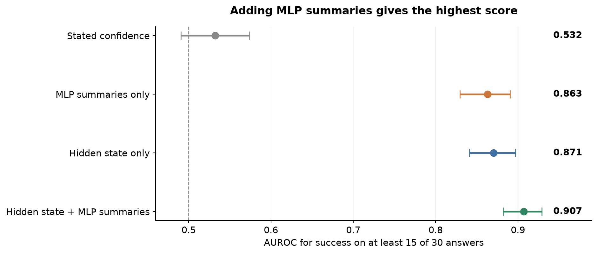
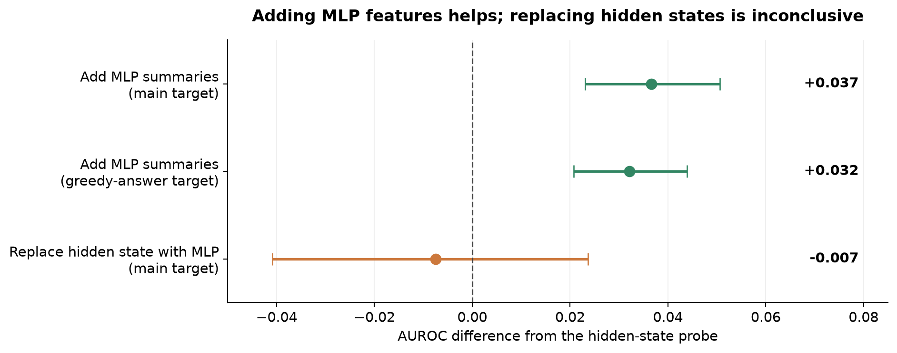
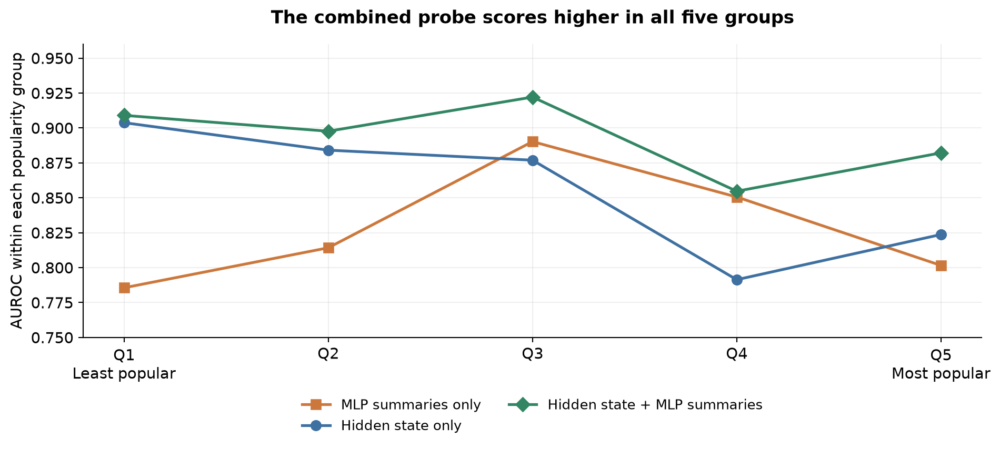

# Do MLP features improve confidence?

Two-page summary · The claim in meet.md, section 3.3
{: .subtitle }

Keshav Krishna · 7 October 2026 · Qwen2.5-7B-Instruct / PopQA
{: .meta }

> **Answer: partly.** Adding MLP summaries to a hidden-state probe improves its prediction of answer success in this offline test. MLP summaries alone do not clearly improve on hidden states. The test does not establish accurate confidence probabilities or independence from question difficulty.

## 1. The claim under test

Section 3.3 proposes a small auxiliary model that reads MLP interactions and estimates confidence. An **MLP** (multilayer perceptron) is a neural-network module inside each model layer. A **probe** is a small classifier that reads recorded model values and predicts success. A **hidden state** is a vector of internal model values.

The proposed mechanism is simple: one dominant MLP interaction could indicate certain recall. Several interactions of similar strength could indicate uncertainty. The proposal suggests that these patterns could give confidence information independent of question difficulty. These statements are hypotheses.

We test two comparisons: MLP features instead of hidden states, and MLP features added to hidden states. The second comparison directly tests whether MLP features add useful information to the selected hidden-state probe.

## 2. How we tested the claim

The pilot used Qwen2.5-7B-Instruct and 1,087 PopQA questions about people. The model produced 30 sampled answers per question. A text matcher checked these answers against accepted reference answers. The main target was success on at least 15 of 30 answers. There were 179 positive questions.

We trained linear probes while the language model stayed fixed. Five evaluation groups kept questions about the same person together. Each question received a score from a probe trained on other groups.

The hidden-state probe used layer 18. The MLP-only probe used 17 summary values from layer 2 at the last prompt position. These summaries describe the distribution, size, and direction of MLP activity. The combined probe added 952 MLP summary values to the same hidden-state vector. Those summaries cover all 28 layers and two token positions. A **token** is a piece of text processed by the model.

**AUROC** measures how well a score separates positive and negative questions. An AUROC of 0.5 means random order; 1.0 means perfect separation. This measure tests the order of confidence scores. It does not test whether a confidence value of 80% means 80% success.

## 3. What the comparison shows

| Probe input | AUROC |
|---|---:|
| Stated confidence only | 0.532 |
| MLP summaries only | 0.863 |
| Hidden state only | 0.871 |
| Hidden state + MLP summaries | **0.907** |

**Adding MLP features helps in this test.** The increase over hidden states is 0.037. The paired 95% resampling interval is +0.023 to +0.051. This interval stays above zero (Figures 1 and 2).

**Replacing hidden states with MLP summaries has no clear advantage.** The difference is −0.007, with an interval from −0.041 to +0.024. That interval includes both a decrease and an increase. The result does not establish that the two probes are equivalent.

## 4. How much of the claim does the evidence establish?

**Useful extra information: yes, for the selected probe.** The combined probe scores higher than hidden states on both tested targets. For the second target, the model produced one greedy answer. At each step, it selected the most probable token. The combined probe reached 0.885; hidden states reached 0.853. The increase was 0.032, with a 95% interval of +0.021 to +0.044 (Figure 2).

**Independence from difficulty: not established.** We divided questions into five groups by subject popularity, measured with Wikipedia page views. The combined probe scored higher than hidden states in all five groups (Figure 3). Its AUROC ranged from 0.855 to 0.922. This is useful evidence within broad popularity groups. Other difficulty factors still vary inside each group.

The probes trained across groups. The pilot did not remove difficulty information during training. Thus, these results do not establish the difficulty independence proposed in section 3.3.

**The proposed MLP mechanism: not established.** We tested activation values and summary features. We did not test the proposed query-to-W2 dot-product distribution as a separate feature family. Here, W2 means the MLP output weight matrix. The scores do not show that one dominant interaction causes reliable recall. A direct test must relate interaction concentration to success under difficulty control.

## 5. Why the answer remains qualified

**The strongest features use the reference answer.** The hidden-state probe reads the first reference token. Five of the 17 MLP summaries also use reference-token information, including summaries at the last prompt position. The combined probe therefore needs information unavailable when the correct answer is unknown.

**Better prediction does not establish better probability calibration.** Calibration means that predicted confidence probabilities agree with observed success rates. This comparison does not test calibration. It also does not show that the language model's own stated confidence improves. The auxiliary probe produces a separate score.

**The comparison has evaluation limits.** The same data selected the best layers and variants; there is no separate final test set. Preprocessing used inner validation data. The intervals resample questions instead of subjects and exclude uncertainty from probe selection and retraining. A stricter answer matcher changes three main labels. The audit reproduced the saved scores, but these limits remain.

The combined probe also has more input features than the hidden-state probe. A matched control is needed to isolate the contribution of MLP information. Its advantage over the tested probability-feature probe remains uncertain: +0.023, with an interval from −0.007 to +0.050.

## 6. The next test of this claim

1. Compare hidden states with hidden states plus MLP features that need no reference answer.
2. Use the same token position and a matched feature budget for both probes.
3. Test interaction concentration directly, and control question difficulty during training and evaluation.
4. Review answer labels, select all preprocessing within training data, and use a separate final test set.
5. Measure both AUROC and calibration to determine whether the added MLP features improve confidence estimates.

**Supported conclusion:** MLP summaries add predictive value to the selected hidden-state probe in this offline pilot. The stronger claim in section 3.3 remains open: MLP interactions provide reliable confidence independent of difficulty.

## Results plots · The effect of MLP features

*Figure 1. The combined probe gives the highest score among these four inputs. Points show AUROC; lines show 95% resampling intervals. The target is success on at least 15 of 30 sampled answers. The internal probes use reference-answer information.*
{: .caption }

*Figure 2. Adding MLP features gives a positive difference for both targets. Replacing hidden states with MLP summaries gives an interval that crosses zero. Each paired sample uses the same questions for both probes. Points show observed differences; lines show 95% intervals. These intervals exclude uncertainty from probe selection and retraining.*
{: .caption }

## Results plot · Does the gain survive popularity groups?

*Figure 3. The combined probe scores higher than hidden states in all five popularity groups. Q1 contains the least popular subjects; Q5 contains the most popular. Each point uses saved scores from probes trained across groups. These descriptive comparisons do not establish independence from difficulty.*
{: .caption }

**How to read this result.** The combined-minus-hidden difference ranges from +0.005 to +0.063 across the five groups. These are observed differences, without separate uncertainty intervals. Popularity groups contain questions with different difficulty levels. The result therefore gives limited evidence for the difficulty-independence part of section 3.3.

**Feature definitions.** The hidden-state probe reads layer 18 at the reference-token position. The compact MLP probe reads 17 summaries at the last prompt position, layer 2. The combined probe uses the hidden-state vector plus all MLP summaries from both positions across 28 layers. Layer numbers start at zero. A reference token comes from the known correct answer.

**Evidence sources.** Claim: `meet.md`, section 3.3, and `meet.original.txt`. Scores: `results/pilot7b_frac_extra.csv` and `results/pilot7b_greedy_extra.csv`. Paired intervals: `results/audit_checks.json`. Popularity groups: `results/pilot7b_frac_extra_withinbin.csv`. Methods and limits: `report/REPORT.md` and `report/AUDIT.md`. Plot source: `scripts/make_summary_claim_figures.py`.

**Writing basis.** [ASD-STE100, Issue 9](https://www.asd-ste100.org/assets/files/ASD-STE100_ISSUE9.pdf): short sentences, active voice, consistent terms, and defined technical nouns. The summary uses the research terms MLP, probe, hidden state, token, AUROC, and calibration.
