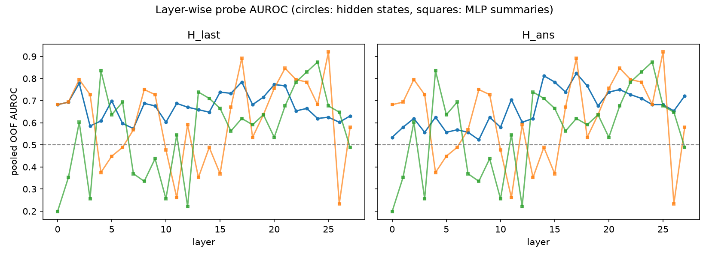
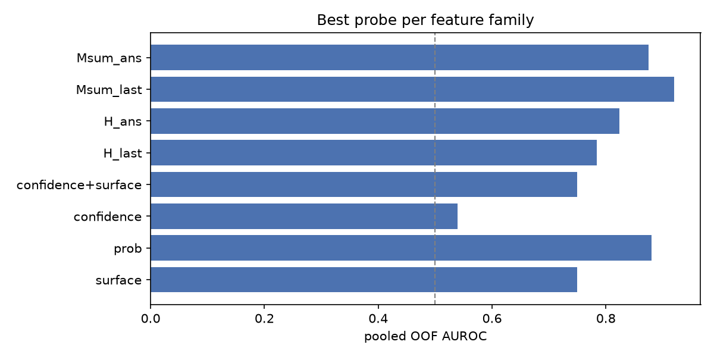
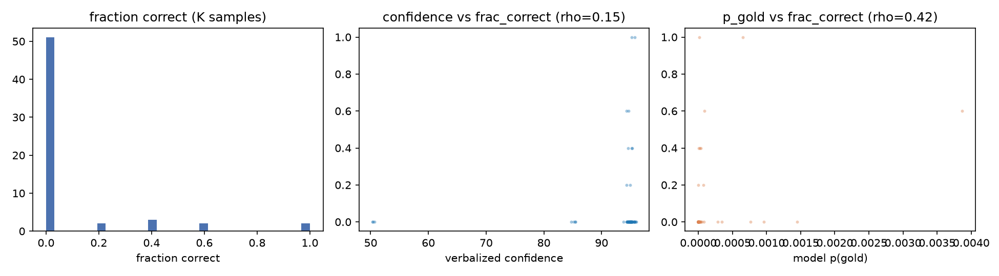

# Pilot probe report (`fs15`)

Historical small-model pipeline check. Only four main-label positives occur.
These numbers do not establish the main research claims. Gold dependencies and
evaluation limits are described in `../report/AUDIT.md`.

- questions: 60
- positive rate (label): 0.067
- greedy accuracy: 0.117
- mean verbalized confidence: 92.1

## Headline AUROCs (pooled out-of-fold)

| feature family | best AUROC | 95% CI | best variant |
| --- | --- | --- | --- |
| surface (difficulty) | 0.750 | [0.426, 0.978] | `surface` |
| model probs | 0.881 | [0.739, 1.000] | `prob` |
| verbalized confidence | 0.540 | [0.250, 0.859] | `confidence` |
| hidden states | 0.824 | [0.609, 1.000] | `H_ans_l17` |
| MLP summaries | 0.875 | [0.679, 1.000] | `Msum_ans_l24` |

## Verbalized confidence vs difficulty

- Spearman(confidence, log10 s_pop) = -0.072
- Spearman(confidence, frac_correct) = 0.152
- Spearman(confidence, p_gold) = 0.136
- AUROC(confidence -> correct) = 0.540 (compared with probes above)

## Layer curves





## Verdict against hypotheses (auto-computed, to be interpreted)

- H1 (MLP signal > surface): MLP 0.875 vs surface 0.750 -> supported
- H2 (comparable to hidden): delta = +0.051 -> not supported


## Stage 2: difficulty control (s_pop quintiles)

| score                 | feature_set   |   overall_auroc |   bin0_auroc |   bin1_auroc |   bin2_auroc |   bin3_auroc |   bin4_auroc |
|:----------------------|:--------------|----------------:|-------------:|-------------:|-------------:|-------------:|-------------:|
| surface (difficulty)  | surface       |           0.750 |          nan |        1.000 |        0.875 |        0.727 |        0.222 |
| verbalized confidence | confidence    |           0.540 |          nan |        0.643 |        0.438 |        0.318 |        0.833 |
| model probs           | prob          |           0.881 |          nan |        0.714 |        1.000 |        0.909 |        0.778 |
| hidden states         | H_ans_l17     |           0.824 |          nan |        0.714 |        0.875 |        1.000 |        0.222 |
| MLP summaries         | Msum_ans_l24  |           0.875 |          nan |        1.000 |        0.750 |        1.000 |        0.667 |

### Per-relation AUROC

```
                score  father  mother  occupation  place of birth
 surface (difficulty)     NaN   0.308       0.762             NaN
verbalized confidence     NaN   0.846       0.429             NaN
          model probs     NaN   0.769       0.929             NaN
        hidden states     NaN   0.385       0.786             NaN
        MLP summaries     NaN   0.769       0.929             NaN
```

Residual diagnostic (Spearman with `frac_correct - surface_OOF`):

| score                 |   spearman_with_residual |
|:----------------------|-------------------------:|
| surface (difficulty)  |                   -0.426 |
| verbalized confidence |                   -0.042 |
| model probs           |                    0.132 |
| hidden states         |                   -0.117 |
| MLP summaries         |                    0.261 |

- Paired bootstrap delta (MLP summaries - hidden states): +0.052 [-0.073, +0.232]
- Permutation check (`H_ans_l14`, shuffled labels): AUROC 0.273 (expected ~0.5)

*Caveats: best layer/variant selected on pooled OOF scores (optimistic bias); single model, single dataset; K-sample labels are noisy; answer-alignment features use the gold token (oracle) and are not deployable as-is.*
