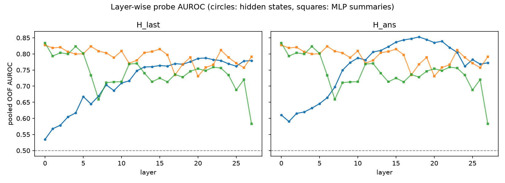
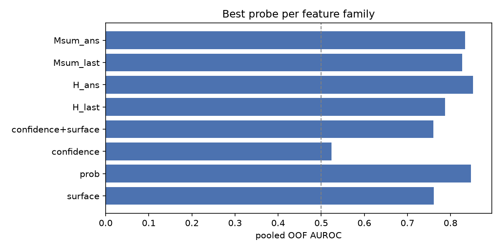
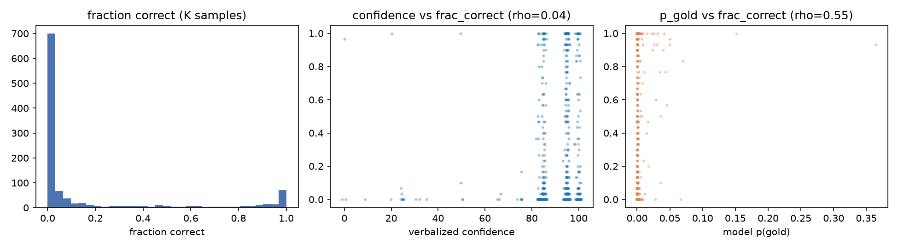

# Pilot probe report (`pilot7b_greedy`)

Historical automatic summary. The audited definitions and interpretation are in
`../report/REPORT.md` and `../report/AUDIT.md`. Gold dependencies and
preprocessing limits apply. The diagnostic gap is not a regression residual.
The hypothesis verdicts below are exploratory rules.

- questions: 1087
- positive rate (label): 0.193
- greedy accuracy: 0.193
- mean verbalized confidence: 90.9

## Headline AUROCs (pooled out-of-fold)

| feature family | best AUROC | 95% CI | best variant |
| --- | --- | --- | --- |
| surface (difficulty) | 0.762 | [0.722, 0.794] | `surface` |
| model probs | 0.847 | [0.817, 0.873] | `prob` |
| verbalized confidence | 0.524 | [0.483, 0.564] | `confidence` |
| hidden states | 0.853 | [0.824, 0.879] | `H_ans_l18` |
| MLP summaries | 0.834 | [0.800, 0.864] | `Msum_ans_l0` |

## Verbalized confidence vs difficulty

- Spearman(confidence, log10 s_pop) = 0.079
- Spearman(confidence, frac_correct) = 0.041
- Spearman(confidence, p_gold) = -0.001
- AUROC(confidence -> correct) = 0.524 (compared with probes above)

## Layer curves





## Verdict against hypotheses (auto-computed, to be interpreted)

- H1 (MLP signal > surface): MLP 0.834 vs surface 0.762 -> supported
- H2 (comparable to hidden): delta = -0.019 -> supported


## Stage 2: difficulty control (s_pop quintiles)

| score                 | feature_set   |   overall_auroc |   bin0_auroc |   bin1_auroc |   bin2_auroc |   bin3_auroc |   bin4_auroc |
|:----------------------|:--------------|----------------:|-------------:|-------------:|-------------:|-------------:|-------------:|
| surface (difficulty)  | surface       |           0.762 |        0.645 |        0.619 |        0.656 |        0.738 |        0.683 |
| verbalized confidence | confidence    |           0.524 |        0.463 |        0.513 |        0.541 |        0.499 |        0.524 |
| model probs           | prob          |           0.847 |        0.826 |        0.845 |        0.821 |        0.811 |        0.819 |
| hidden states         | H_ans_l18     |           0.853 |        0.867 |        0.889 |        0.892 |        0.766 |        0.788 |
| MLP summaries         | Msum_ans_l0   |           0.834 |        0.741 |        0.799 |        0.900 |        0.838 |        0.790 |

### Per-relation AUROC

```
                score  father  mother  occupation  place of birth
 surface (difficulty)   0.763   0.858       0.755           0.675
verbalized confidence   0.558   0.604       0.480           0.499
          model probs   0.840   0.875       0.840           0.842
        hidden states   0.767   0.874       0.875           0.893
        MLP summaries   0.773   0.908       0.812           0.848
```

Residual diagnostic (Spearman with `frac_correct - surface_OOF`):

| score                 |   spearman_with_residual |
|:----------------------|-------------------------:|
| surface (difficulty)  |                   -0.320 |
| verbalized confidence |                   -0.009 |
| model probs           |                    0.211 |
| hidden states         |                    0.152 |
| MLP summaries         |                    0.224 |

- Paired bootstrap delta (MLP summaries - hidden states): -0.019 [-0.052, +0.013]
- Permutation check (`H_ans_l14`, shuffled labels): AUROC 0.502 (expected ~0.5)

*Caveats: best layer/variant selected on pooled OOF scores (optimistic bias); single model, single dataset; K-sample labels are noisy; answer-alignment features use the gold token (oracle) and are not deployable as-is.*
