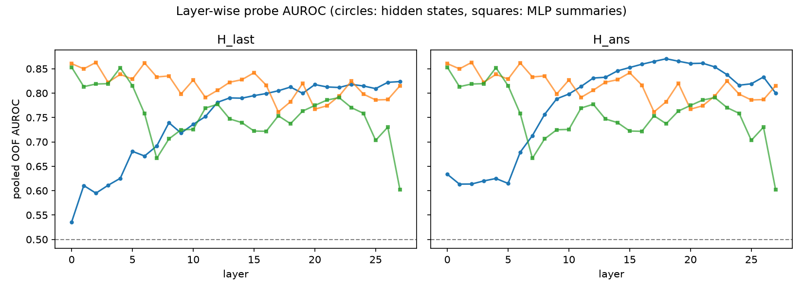
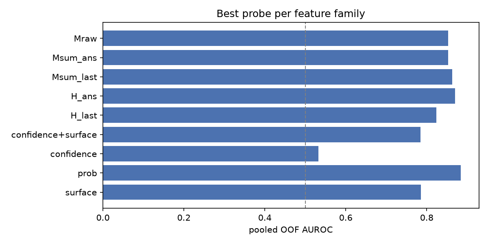

# Pilot probe report (`pilot7b`)

Historical automatic summary. The audited definitions and interpretation are in
`../report/REPORT.md` and `../report/AUDIT.md`. This summary prioritizes the
answer-position MLP family, not the best variant across both positions.
Gold dependencies and preprocessing limits apply. The diagnostic gap is not a
regression residual. The hypothesis verdicts below are exploratory rules.

- questions: 1087
- positive rate (label): 0.165
- greedy accuracy: 0.193
- mean verbalized confidence: 90.9

## Headline AUROCs (pooled out-of-fold)

| feature family | best AUROC | 95% CI | best variant |
| --- | --- | --- | --- |
| surface (difficulty) | 0.786 | [0.749, 0.820] | `surface` |
| model probs | 0.885 | [0.859, 0.907] | `prob` |
| verbalized confidence | 0.532 | [0.491, 0.573] | `confidence` |
| hidden states | 0.871 | [0.841, 0.897] | `H_ans_l18` |
| MLP summaries | 0.853 | [0.819, 0.883] | `Msum_ans_l0` |
| MLP raw | 0.853 | [0.822, 0.882] | `Mraw_down_ans_l16` |

## Verbalized confidence vs difficulty

- Spearman(confidence, log10 s_pop) = 0.079
- Spearman(confidence, frac_correct) = 0.041
- Spearman(confidence, p_gold) = -0.001
- AUROC(confidence -> correct) = 0.532 (compared with probes above)

## Layer curves





## Verdict against hypotheses (auto-computed, to be interpreted)

- H1 (MLP signal > surface): MLP 0.853 vs surface 0.786 -> supported
- H2 (comparable to hidden): delta = -0.017 -> supported
- Raw MLP vector probe (exploratory): 0.853 (`Mraw_down_ans_l16`)


## Stage 2: difficulty control (s_pop quintiles)

| score                 | feature_set   |   overall_auroc |   bin0_auroc |   bin1_auroc |   bin2_auroc |   bin3_auroc |   bin4_auroc |
|:----------------------|:--------------|----------------:|-------------:|-------------:|-------------:|-------------:|-------------:|
| surface (difficulty)  | surface       |           0.786 |        0.700 |        0.659 |        0.693 |        0.746 |        0.687 |
| verbalized confidence | confidence    |           0.532 |        0.499 |        0.545 |        0.590 |        0.530 |        0.474 |
| model probs           | prob          |           0.885 |        0.893 |        0.890 |        0.834 |        0.854 |        0.857 |
| hidden states         | H_ans_l18     |           0.871 |        0.904 |        0.884 |        0.877 |        0.791 |        0.824 |
| MLP summaries         | Msum_ans_l0   |           0.853 |        0.790 |        0.879 |        0.897 |        0.850 |        0.796 |

### Per-relation AUROC

```
                score  father  mother  occupation  place of birth
 surface (difficulty)   0.785   0.863       0.764           0.691
verbalized confidence   0.557   0.515       0.522           0.538
          model probs   0.874   0.907       0.864           0.903
        hidden states   0.792   0.907       0.896           0.883
        MLP summaries   0.793   0.894       0.817           0.917
```

Residual diagnostic (Spearman with `frac_correct - surface_OOF`):

| score                 |   spearman_with_residual |
|:----------------------|-------------------------:|
| surface (difficulty)  |                   -0.303 |
| verbalized confidence |                   -0.004 |
| model probs           |                    0.210 |
| hidden states         |                    0.145 |
| MLP summaries         |                    0.236 |

- Paired bootstrap delta (MLP summaries - hidden states): -0.018 [-0.054, +0.018]
- Permutation check (`H_ans_l14`, shuffled labels): AUROC 0.530 (expected ~0.5)

*Caveats: best layer/variant selected on pooled OOF scores (optimistic bias); single model, single dataset; K-sample labels are noisy; answer-alignment features use the gold token (oracle) and are not deployable as-is.*
